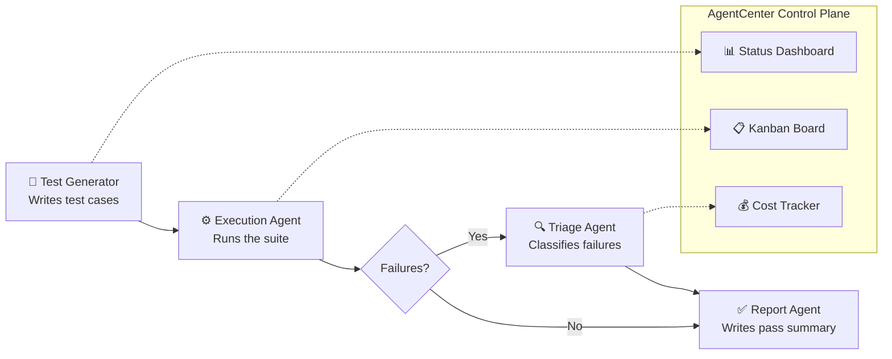

QA engineers know the feeling: the CI pipeline is red, and you're not sure if the problem is the code being tested, the agent that generated the test cases, or the runner agent that hit a timeout. When you've got 4 agents chained together and no visibility into which one stalled, "something broke" is the most information you have.

That's the core problem ai agents for qa teams create when there's no control plane.

## Where AI Agents for QA Teams Fall Apart

A typical QA team with AI agents runs at least 3 to 5 agents in a pipeline: one to generate test cases, one to execute the suite, one to triage failures, one to watch regressions overnight, sometimes another to write bug reports. Each agent is a separate process. Without central visibility, you're managing them like separate scripts — by checking each one individually when something goes wrong.

Three things break predictably.

**Test flakiness you can't attribute.** A test fails. Was it a real regression? A bad test case the generator wrote? The runner agent timing out mid-suite? Without seeing exactly what each agent did and in what order, you end up re-running the suite hoping for clarity.

**Cost spikes from high-volume runs.** QA agents run on every commit, every PR, every nightly build. They can burn through API budget fast. Without per-agent cost tracking, you don't know if the test generation agent costs $0.30 per run or $3.00. You only find out when the bill arrives.

**Stalled handoffs between stages.** The test generator finishes. The runner doesn't pick up cleanly. Or the bug reporter waits on a result that never arrives. You have no way to tell whether a stage is "in progress" or "stuck waiting" without digging into logs.

## How AgentCenter Solves This

Here's how the features map to what QA teams actually need.

### Real-Time Agent Status

The [agent monitoring dashboard](/features/agent-monitoring) shows every agent's current state: online, working, idle, or blocked. For QA pipelines, this matters most when an agent hits a rate limit or waits on a dependency.

Example: your nightly regression agent starts a 200-test suite at 2am. It gets 80 tests in, hits a rate limit, and stalls. Without status monitoring, you don't notice until the morning standup when the report is missing. With AgentCenter, the agent shows as "blocked" within minutes of stalling. You get to it before the team is up.

### Kanban Board for Pipeline Stages

The [task orchestration board](/features/task-orchestration) lets you map each stage of your QA pipeline as a task. Test case generation, execution, triage, and reporting each get their own card. You see in real time which stage is active, waiting, or complete.

This matters most for pipelines with conditional stages. If your triage agent only runs when the execution agent reports failures, you want to know whether triage was skipped because there were no failures — or skipped because the execution agent never finished.

### Per-Agent Cost Tracking

AgentCenter breaks down LLM costs by agent. For QA teams, this usually reveals that the test generation agent is responsible for most of the spend — not because it's inefficient, but because it runs at the highest volume.

Once you can see cost per agent per run, you can make real decisions: which agent needs a cheaper model, which one actually warrants GPT-4, whether the nightly regression suite should run on a lighter schedule during low-traffic periods.

### Deliverable Review Gates

Before AI-generated test cases go to the runner, it's worth reviewing a sample. The review gate feature lets you hold generated test cases for spot-check before execution starts.

Here's a real pattern: a team runs 50 AI-generated tests on their first QA agent deployment. 9 of them have logic errors — wrong assertions, missing setup steps. Without a review gate, those run anyway, produce confusing failures, and waste an hour of debugging. With a gate, the review takes 5 minutes and only valid test cases move forward.

## The Numbers for QA Teams

Most QA engineering teams running AI agents end up with 4 to 8 agents across their pipelines: a test generator, an execution coordinator, a triage agent, a regression watcher, sometimes a bug reporter.

The Pro plan ($29/mo) fits this range well. It covers 15 agents across 15 projects. If you're running QA agents for multiple services or environments, each gets its own project without hitting limits. Check the [full plan comparison on pricing](/pricing).

What AgentCenter replaces: a mix of Slack alerts, custom logging scripts, and someone manually checking the CI dashboard every morning to figure out why the overnight run didn't complete.

## Before vs After

| | Without AgentCenter | With AgentCenter |
|---|---|---|
| Visibility | Open each agent log separately | Single dashboard, all agent states at a glance |
| Task handoffs | No way to tell if a stage stalled or was skipped | Kanban view shows every stage and current status |
| Error detection | Pipeline fails, root cause unclear for 20+ minutes | Blocked agent flagged within minutes of stalling |
| Cost tracking | Monthly bill surprise, no breakdown by agent | Per-agent spend per run, visible in real time |
| Debugging time | 45 to 60 minutes tracing failures through 4 logs | Timeline shows exactly where the chain broke |

## Where to Start

Set up agent status monitoring first. Before anything else, seeing whether each agent in your pipeline is running, idle, or blocked removes the most frustrating class of failure: the one where something's wrong but you can't tell what or where.

From there, add the Kanban board for your pipeline stages. Once you can see status and stage in one view, you'll catch handoff failures in minutes rather than an hour into the morning standup.

---

*QA and test engineering teams that add a control plane early spend less time firefighting later. [Start your 7-day free trial](/pricing).*
