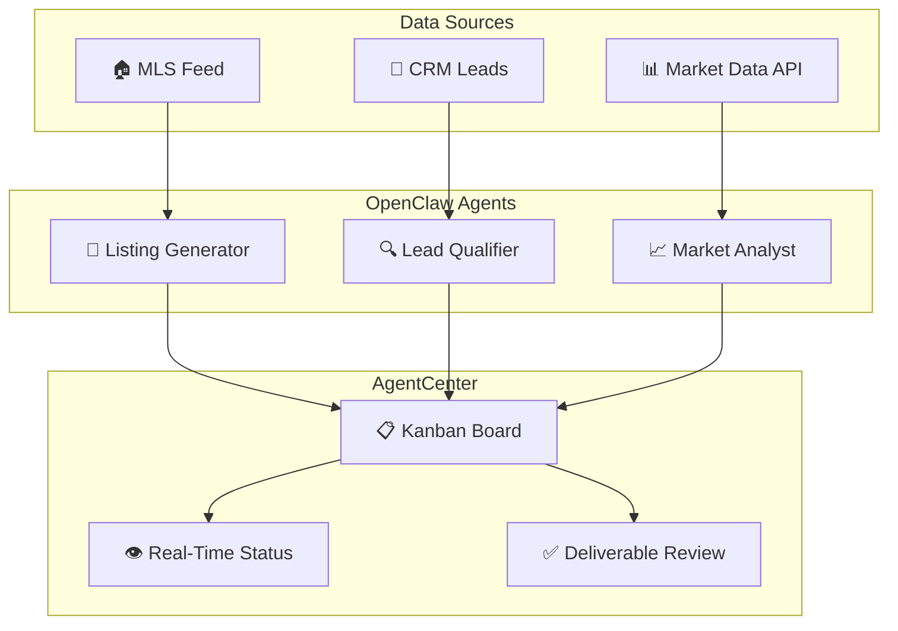

Real estate tech teams hit a visibility wall fast. You've got agents generating listing descriptions, scoring inbound leads, pulling market comparisons, and flagging price change opportunities. Each runs on its own schedule, tied to a different data source. And when one fails, the first sign is usually a sales rep asking why their lead queue went quiet.

That's the pattern. No crash. No alert. Just someone noticing something feels off, hours after it started.

## Why Real Estate Agent Pipelines Break Quietly

The failures in real estate tech workflows tend to be silent. An agent stalls mid-queue, or produces slightly wrong output, and nothing in your stack catches it.

Three things break first:

**Listing generation agents go silent mid-queue.** You have 40 new properties to process overnight. The agent handles the first 27, hits an edge case on a commercial unit with missing lot size data, and stops. You don't know which 13 didn't get descriptions until a listing coordinator notices the gaps the next morning.

**Lead qualification creates invisible backlogs.** Your lead scoring agent runs every 30 minutes. If it stalls on one batch, the next batch queues behind it. Three hours later you've got 80 unscored leads, no one noticed, and the sales team is calling those leads "cold" in the CRM.

**Shared APIs produce cascading wrong output.** Your market data API has a per-minute rate limit. Your listing generator, pricing agent, and market analyst all call it independently. One burst request pattern and all three start returning stale data. No error is thrown. Just wrong numbers, quietly embedded in outputs your team trusts.

## How AgentCenter Fits Into a Real Estate Tech Workflow

Here's what each feature does for a team running these agents day to day.

### Kanban Board for Task Visibility

Every listing, lead batch, and market report becomes a trackable task. The board shows "Listing Generator: 27 done, 13 queued, 0 failed" at a glance. When those 13 go quiet overnight, they stay in "in progress" instead of completing. That's your signal, without waiting for a morning call.

The [task orchestration view](/features/task-orchestration) makes this concrete: you see exactly where each piece of work is, not just whether the agent is running.

### Real-Time Agent Status

AgentCenter shows each agent's current state: online, working, idle, or blocked. When your lead qualifier stalls, it shows "blocked" rather than "working." The difference between those two states is the difference between waiting for someone to notice and actually fixing the problem.

You see this directly on the [agent monitoring dashboard](/features/agent-monitoring), without touching a single log file.

### Deliverable Review for High-Stakes Outputs

When the listing generator produces a description for a multi-million dollar property, you want a human to review it before it goes live. AgentCenter surfaces the deliverable with an @mention to whoever handles high-value listings. The reviewer sees it in the task thread, approves or requests edits, and the agent moves on.

No email chain. No Slack message that gets buried.

### Error Detection Without Log Tracing

When the market data API starts rate-limiting, AgentCenter catches the pattern in the agent activity feed. You see three agents hit the same error class within two minutes. That's a shared dependency failing, not three independent bugs. You fix the root cause once.

## The Numbers for Real Estate Tech Teams

A typical real estate tech team runs 8 to 20 agents covering listings, leads, pricing intelligence, market reports, and compliance document checks. Some larger platforms run more if they split agents by market or property type.

The Pro plan at $29 per month covers 15 agents across 15 projects. That's the right size for most teams in this range. Teams running agents across multiple regional markets or product lines tend to move to the Scale plan at $79 per month, which handles 50 agents. A 7-day free trial is available on any monthly plan, with no lock-in.

What it replaces: spreadsheets for tracking which listings got processed, Slack pings to check whether the lead qualifier ran, and manual log review to figure out what went wrong overnight.

## Before vs. After AgentCenter

| | Without AgentCenter | With AgentCenter |
|---|---|---|
| **Visibility** | No idea which listings the agent processed until someone checks manually | Kanban board shows every task state in real time |
| **Task handoffs** | Agent completes with no notification to the reviewer | Deliverable triggers an @mention to the assigned reviewer |
| **Error detection** | Sales rep reports missed leads hours after the agent stalled | Blocked status appears in the dashboard within minutes |
| **Cost tracking** | API costs spread across team accounts with no per-task breakdown | Per-agent, per-task cost visible in the activity feed |
| **Debugging time** | 30 to 60 minutes tracing logs to find which batch failed | Error surfaces directly in the task timeline |

## Where to Start

Set up the [agent monitoring dashboard](/features/agent-monitoring) first. Connect whichever agent runs most often, whether that's your listing generator or your lead qualifier. Watch its task states for a week.

You'll find at least one failure pattern you didn't know existed. Maybe the agent stalls every time it hits a property with missing lot size data. Maybe it runs slower on Sunday nights because the MLS feed slows down. One week of visibility is worth more than a month of log parsing.

From there, add the kanban board for your team and wire up one review workflow for high-value deliverables.

---

*Real estate tech teams that add a control plane early spend less time firefighting later. [Start your 7-day free trial](/pricing).*
