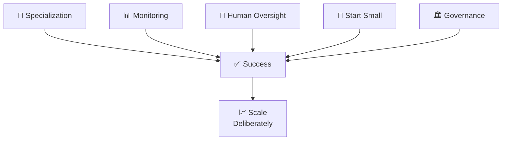
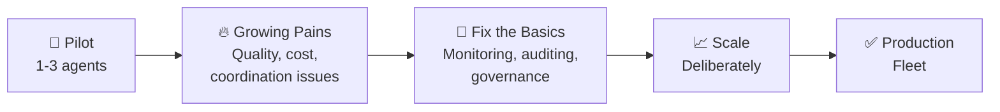

Everyone talks about what AI agents _could_ do. Fewer people talk about what happens when you actually run them in production — the coordination nightmares, the cost surprises, the moment you realize your "intelligent" agents are silently failing.

These five teams figured it out. Not by finding a perfect framework, but by building management practices around their agent fleets. Here's what they did, what went wrong, and what actually worked.

---

## 1. The E-Commerce Team That Cut Support Costs by 73%

**Industry:** Online retail  
**Agent count:** 12 specialized agents  
**Timeline:** 6 months from pilot to full production

### The Problem

A mid-size e-commerce company was drowning in support tickets. Their team of eight human agents handled 2,400 tickets per day — returns, shipping questions, product inquiries, order modifications. Response times averaged 14 hours. Customer satisfaction was sinking.

They'd tried a basic chatbot. It handled maybe 15% of queries before customers demanded a human.

### What They Built

Instead of one monolithic chatbot, they deployed a fleet of specialized AI agents:

- **Triage agent** — classifies incoming tickets by intent, urgency, and complexity
- **Returns agent** — handles return requests end-to-end, including generating shipping labels
- **Order status agent** — pulls real-time tracking data and proactively notifies customers
- **Product expert agent** — answers detailed product questions using catalog data
- **Escalation agent** — identifies when a human is needed and routes with full context

### What Went Wrong First

The first month was chaos. Agents contradicted each other. The returns agent approved refunds the policy didn't allow. The triage agent misrouted 30% of tickets. Costs were _higher_ than the human team because agents were making expensive LLM calls on simple queries.

The core issue: no one was watching the agents. They had monitoring for uptime, but nothing for _output quality_.

### What Fixed It

Three changes made the difference:

1. **Output auditing** — They implemented spot-check reviews of agent responses, catching policy violations before they reached customers. Tools like [AgentCenter](https://agentcenter.cloud) made it possible to monitor agent outputs across all 12 agents from a single dashboard.

2. **Tiered model routing** — Simple queries (order status, tracking) went to smaller, cheaper models. Complex queries (returns with exceptions, product comparisons) used more capable models. This cut LLM costs by 58%.

3. **Feedback loops** — Customer satisfaction scores per agent, per query type. They could see that the product expert agent scored 4.2/5 on electronics but 2.8/5 on clothing — and fix it.

### Results

| Metric                | Before     | After        |
| --------------------- | ---------- | ------------ |
| Avg response time     | 14 hours   | 47 seconds   |
| Tickets handled by AI | 0%         | 78%          |
| Support costs         | $38K/month | $10.2K/month |
| Customer satisfaction | 3.1/5      | 4.4/5        |

The human team didn't shrink — they shifted to handling complex cases and improving agent prompts. Their job satisfaction actually went up.

---

## 2. The Legal Tech Startup That Automated Contract Review

**Industry:** Legal technology  
**Agent count:** 8 agents  
**Timeline:** 4 months to production

### The Problem

A legal tech startup wanted to automate the first pass of contract review for mid-market companies. Their clients were spending $500–$2,000 per contract on outside counsel for routine reviews that followed predictable patterns.

### What They Built

An agent pipeline for contract analysis:

- **Extraction agent** — pulls key terms, dates, obligations, and parties from contracts
- **Risk flagging agent** — identifies unusual clauses, missing protections, and deviation from standard terms
- **Comparison agent** — compares contract terms against the client's preferred positions
- **Summary agent** — generates executive summaries with risk scores
- **Amendment drafting agent** — suggests redline changes for flagged issues

### What Went Wrong First

Accuracy was the existential problem. In legal work, a 95% accuracy rate means 1 in 20 contracts has a potentially costly error. Their initial accuracy on key term extraction was 91% — unacceptable.

Worse, they couldn't tell _which_ contracts had errors. The agents were confidently wrong, and without systematic review, bad outputs looked identical to good ones.

### What Fixed It

1. **Confidence scoring** — Each agent assigned confidence scores to its outputs. Low-confidence extractions got routed to human review automatically. This caught 89% of errors before they reached clients.

2. **Agent-to-agent verification** — The risk flagging agent cross-checked the extraction agent's outputs. Disagreements triggered automatic escalation. This added latency but caught contradictions that single-agent review missed.

3. **Centralized monitoring** — They tracked accuracy metrics per agent, per contract type, per clause category. When the extraction agent's performance dropped on non-compete clauses after a prompt update, they caught it within hours — not weeks. A management platform with per-agent performance dashboards was essential for this visibility.

### Results

- Contract review time: from 4–6 hours (human) to 22 minutes (agent pipeline + human spot-check)
- Cost per review: from $800 average to $120
- Accuracy on key terms: 97.3% (with confidence-based routing catching most of the remaining 2.7%)
- Client retention: 94% after first year

---

## 3. The DevOps Team Running 30+ Infrastructure Agents

**Industry:** Cloud infrastructure / SaaS  
**Agent count:** 34 agents  
**Timeline:** 8 months iterative rollout

### The Problem

A SaaS company with 200+ microservices was spending too much engineering time on operational tasks — incident response, scaling decisions, deployment validation, cost reduction. Their SRE team of six couldn't keep up.

### What They Built

A fleet of infrastructure agents, each owning a specific operational domain:

- **Incident triage agents** (4) — monitor alerts, correlate signals, draft incident reports
- **Scaling agents** (6) — manage auto-scaling decisions based on traffic patterns and cost constraints
- **Deployment validators** (8) — run post-deploy health checks, canary analysis, and automatic rollbacks
- **Cost reduction agents** (4) — identify idle resources, recommend rightsizing, schedule non-critical workloads
- **Documentation agents** (6) — keep runbooks updated based on actual incident resolutions
- **Security scanning agents** (6) — continuous compliance checks across infrastructure

### What Went Wrong First

At 34 agents, coordination became the bottleneck. Three specific problems:

1. **Conflicting actions** — The scaling agent would scale up a service while the cost reduction agent was trying to scale it down. These conflicts happened at 3 AM when no one was watching.

2. **Alert storms** — When one agent triggered an action, it created alerts that other agents responded to, creating cascading reactions. A single deployment once triggered 847 agent actions in 12 minutes.

3. **Configuration drift** — With six engineers updating agent configs independently, agents started behaving inconsistently. The same type of incident got different responses depending on which agent happened to pick it up.

### What Fixed It

1. **Action governance** — Before any agent executes an infrastructure change, it registers the planned action in a central queue. Conflicting actions get flagged and held for human approval. This eliminated the scaling-vs-cost conflicts entirely.

2. **Circuit breakers** — If any agent triggers more than 5 actions in 10 minutes, it pauses and alerts the team. This killed the cascade problem.

3. **Centralized configuration management** — All agent configs managed through a single platform with version control, change tracking, and approval workflows. [AgentCenter's](https://agentcenter.cloud) task management and agent monitoring features were key here — they could see all 34 agents' status, current tasks, and recent actions in one place.

### Results

| Metric                      | Before     | After      |
| --------------------------- | ---------- | ---------- |
| Mean time to detect (MTTD)  | 8 minutes  | 45 seconds |
| Mean time to resolve (MTTR) | 47 minutes | 11 minutes |
| Monthly infra cost savings  | —          | $23K       |
| SRE on-call escalations     | 340/month  | 52/month   |
| Runbook accuracy            | ~60%       | 94%        |

The SRE team went from firefighting to strategy. They now spend 70% of their time improving agent capabilities instead of responding to incidents.

---

## 4. The Marketing Agency That Scaled Content Production 10x

**Industry:** Digital marketing  
**Agent count:** 16 agents  
**Timeline:** 3 months to full workflow

### The Problem

A digital marketing agency managing 40+ client accounts was bottlenecked on content production. Each client needed weekly blog posts, social media content, email campaigns, and performance reports. The team of 12 content creators was perpetually behind schedule.

### What They Built

A content production pipeline with specialized agents:

- **Research agents** (3) — gather industry trends, competitor content, and keyword data per client
- **Brief generation agent** — creates detailed content briefs from research and client guidelines
- **Draft agents** (4) — write initial drafts for different content types (long-form, social, email)
- **Brand voice agents** (4) — review drafts against each client's brand guidelines and tone
- **SEO agent** — handles keyword placement, meta descriptions, internal linking
- **Performance analysis agents** (3) — pull analytics data and generate insights for content strategy

### What Went Wrong First

Quality consistency was the killer. Agent-written content was _good enough_ for some clients but noticeably off-brand for others. The brand voice agents helped, but they couldn't catch everything — especially nuance.

The bigger problem was management overhead. With 40+ clients and 16 agents, the team spent more time configuring and monitoring agents than they'd spent writing content manually.

### What Fixed It

1. **Client-specific agent profiles** — Instead of one-size-fits-all prompts, each client got a configuration profile with brand voice examples, prohibited phrases, preferred structures, and topic guardrails. Switching between clients became a config change, not a prompt rewrite.

2. **Quality scoring automation** — Every piece of content got scored on readability, brand alignment, SEO quality, and factual accuracy before human review. Content scoring above 85% went to a quick-approval queue; below 70% got auto-flagged for rewrite.

3. **Workflow orchestration** — A task management system that tracked every piece of content through the pipeline — research → brief → draft → brand review → SEO → approval. The team could see bottlenecks instantly and reassign work. AgentCenter's task and workflow features simplified this significantly.

### Results

- Content output: from 160 pieces/month to 1,600+ pieces/month
- Time from brief to published draft: from 5 days to 6 hours
- Client satisfaction: up 31% (measured by quarterly NPS)
- Team headcount: unchanged (reallocated to strategy and client relationships)
- Revenue per employee: up 2.4x

---

## 5. The Financial Services Firm That Automated Compliance Monitoring

**Industry:** Financial services  
**Agent count:** 22 agents  
**Timeline:** 10 months (regulatory requirements added time)

### The Problem

A mid-size financial services firm spent $2.1M annually on compliance monitoring. Their compliance team manually reviewed transactions, communications, and trading patterns against an ever-growing set of regulations. They were always behind, always understaffed, and always worried about what they were missing.

### What They Built

A compliance monitoring system with multiple agent layers:

- **Transaction monitoring agents** (6) — analyze transactions in real-time against AML, KYC, and sanctions rules
- **Communication surveillance agents** (4) — review internal communications for compliance violations
- **Regulatory change agents** (3) — monitor regulatory updates and flag impacts to existing policies
- **Report generation agents** (4) — compile regulatory reports and audit documentation
- **Risk assessment agents** (3) — score client and transaction risk levels continuously
- **Audit trail agents** (2) — maintain detailed logs of all agent actions and decisions for regulatory review

### What Went Wrong First

Two critical issues:

1. **False positive overload** — The transaction monitoring agents flagged 12,000+ alerts per day. The compliance team was spending all their time dismissing false positives instead of investigating real issues. The agents were _more_ conservative than the rules required because they lacked context about normal business patterns.

2. **Explainability gap** — Regulators required the firm to explain _why_ each decision was made. "The AI flagged it" wasn't an acceptable answer. Every agent action needed a clear audit trail with reasoning — something the initial implementation didn't provide.

### What Fixed It

1. **Contextual scoring with human feedback** — Analysts marked false positives with reasons. This data trained the agents to understand normal patterns per client segment. False positive rates dropped from 94% to 23% over four months.

2. **Structured reasoning chains** — Every agent decision included a step-by-step reasoning chain stored in the audit trail. Regulators could trace any flag back to the specific rules, data points, and logic that produced it.

3. **Tiered review workflows** — Low-risk flags: agent auto-resolves with documentation. Medium-risk: automated analysis with human approval. High-risk: immediate human review with agent-prepared briefing. This focused human attention where it mattered most.

4. **Centralized agent governance** — All agent configs, decision rules, and performance metrics managed from a single dashboard. When regulations changed, the team could update affected agents systematically instead of hunting through code. A management platform with full-stack monitoring was critical for maintaining regulatory compliance across 22 agents.

### Results

| Metric                                  | Before      | After       |
| --------------------------------------- | ----------- | ----------- |
| Annual compliance cost                  | $2.1M       | $680K       |
| Alerts requiring human review           | 12,000/day  | 890/day     |
| Regulatory findings                     | 7 per audit | 1 per audit |
| Time to implement regulatory changes    | 6–8 weeks   | 5–10 days   |
| Coverage of transaction types monitored | 64%         | 98%         |

---

## Common Patterns Across All Five Teams

Every team followed a similar journey — here's the pattern that kept showing up:

These stories come from different industries, different scales, and different use cases. But the same patterns show up everywhere:

### 1. Specialization beats generalization

Every successful team deployed _specialized_ agents with narrow responsibilities — not one super-agent trying to do everything. This makes agents easier to monitor, debug, and improve individually.

### 2. Monitoring is not optional

Every team that struggled initially was missing visibility into what their agents were actually doing. Not uptime monitoring — _output quality_ monitoring. You need to see what each agent produces, how it performs over time, and where it fails.

### 3. Human oversight scales with the right tools

None of these teams eliminated humans. They all kept humans in the loop — but shifted their role from doing the work to managing the agents doing the work. The difference between success and failure was having tools that made management feasible at scale.

### 4. Start small, scale deliberately

The DevOps team didn't deploy 34 agents on day one. They started with 4, proved the pattern, and expanded. Every team followed a similar path — pilot, validate, scale.

### 5. Governance prevents chaos

As agent counts grow, you need centralized control over configurations, permissions, and workflows. Without it, agents conflict with each other, drift from intended behavior, and become impossible to audit.

---

## Getting Started with Agent Management

If these stories resonate — if you're running agents in production or planning to — the management challenge is real. It doesn't go away as you scale; it gets harder.

[AgentCenter](https://agentcenter.cloud) was built for exactly this: giving teams visibility and control over their AI agent fleets. Task management, performance monitoring, team coordination, and agent governance — all in one platform.

The teams in these stories learned their management lessons the hard way. You don't have to.

[Explore AgentCenter →](https://agentcenter.cloud)
