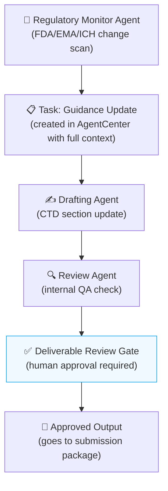

Regulatory affairs teams are building out agent workflows for real work. Monitoring FDA and EMA guidance updates. Drafting CTD module sections. Running gap analyses for new market submissions. This is not experimental — teams are running 6 to 12 agents on active regulatory projects right now.

The problem hits around the time you have your third agent. You have a monitoring agent scanning for regulatory changes, a drafting agent handling CTD Module 3, and a review agent checking outputs against your internal style guide. They all run. Nobody can tell you which agent last touched section 3.2.S.2.4, when it ran, or what it produced.

That is a compliance audit waiting to happen.

## The Specific Bottleneck

Three things break when regulatory affairs teams scale agents without a control plane:

**Audit trail gaps.** FDA submissions require version-controlled documentation and evidence of internal review. When a drafting agent updates a section and there is no record of what changed, who reviewed it, or when, you have a documentation gap. It shows up in review and it shows up in inspections.

**Broken handoffs between agents.** When your monitoring agent detects a change to FDA guidance on drug substance characterization, that context needs to reach your drafting agent intact. Without task orchestration, someone manually copies the update into a new prompt and hopes the agent picks up the right implication. They often do not.

**No cost visibility per filing.** You are paying for LLM calls across every agent. But which submission is consuming the most tokens? Which agent re-drafted the same section four times this week? You will not know until the month-end bill arrives and nobody can explain the numbers.

## How AgentCenter Maps to Regulatory Workflows

### Deliverable Review and Approval Workflows

Your internal QA process requires a signoff before content reaches the regulatory lead. AgentCenter's deliverable review gate fits that requirement directly.

When the drafting agent submits a CTD section, the output lands in a review queue. A regulatory specialist opens the task, reads the agent output, and either approves it or sends it back with specific comments. The agent sees what was wrong and can regenerate the section with the feedback in context.

Without this, outputs float through Slack or email. No clear record of which version got approved. No clear record of who reviewed it.

### Task Orchestration With @Mentions

When your monitoring agent detects that FDA updated its bioavailability testing guidance, that update needs to trigger specific work on the right filing. In AgentCenter, you configure a task dependency: the monitoring agent's output automatically creates a child task assigned to the relevant drafting agent, with the full guidance change as task context.

You can also @mention a human reviewer in the task thread when an update touches a filing that is in active review. They get the context directly, not a forwarded email with three paragraphs of background to reconstruct.

### Agent Monitoring and Cost Tracking by Filing

Each submission is its own project in AgentCenter. Each agent has cost tracking against that project. After two weeks, you can see which submission is consuming the most compute, which agents are running duplicate work, and where your token spend is actually going.

For regulatory affairs teams, this matters more than in most contexts. Per-client billing, per-filing cost attribution, and audit-ready spending records are part of the job. See [agent monitoring features](/features/agent-monitoring) for what that dashboard looks like.

## The Numbers

Most regulatory affairs teams running production agents work with 6 to 10 agents: one or two monitoring agents scanning FDA, EMA, and ICH channels; two to four drafting agents split by CTD module; one or two review agents; and sometimes a coordinator agent tracking submission deadlines across filings.

That fits the Pro plan at $29 per month, with room to grow. If you are managing simultaneous NDAs or MAAs across multiple markets, the Scale plan at $79 per month gives you 50 agents and 50 projects. One project per active filing works cleanly. See the [full plan breakdown](/pricing) to model it by filing count.

## Before vs After

| | Without AgentCenter | With AgentCenter |
|---|---|---|
| Visibility | No record of which agent touched which submission section | Full task history per agent, per section, per filing project |
| Task handoffs | Engineer manually bridges context from monitoring to drafting agent | Dependency triggers drafting agent automatically with guidance update as task context |
| Error detection | Formatting or completeness issues caught during regulatory lead review | Deliverable review gate catches issues before they reach the regulatory lead |
| Cost tracking | Monthly LLM bill with no breakdown by filing or agent | Per-agent cost tracking by project shows exactly which filing is consuming compute |
| Debugging time | Hours tracing logs to find which agent modified a section | Task audit trail shows exact agent, timestamp, output, and review decision |

## Where to Start

Set up deliverable review workflows before anything else. Before you wire up task orchestration or automated dependencies, every agent output needs a review gate that matches your internal QA process.

This is the single change that catches the most problems in the shortest time. You can configure it in AgentCenter in under 30 minutes, and it immediately gives you a visible record of what was reviewed and when. Orchestration comes after.

---

*Regulatory affairs teams that add a control plane early spend less time firefighting later. [Start your 7-day free trial](/pricing).*
