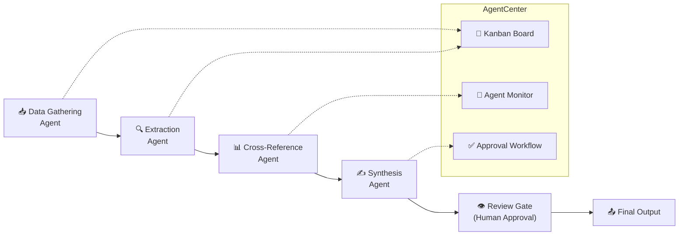

Research automation teams run a lot of agents. One to pull papers from an API. Another to extract structured data. A third to cross-reference findings. A fourth to draft summaries. A fifth to flag inconsistencies. By the time you've got a real pipeline running, you've got eight to twelve agents doing different things, and none of them know what the others found.

That's fine until something goes wrong. And something always goes wrong.

## The Specific Problem Research Teams Hit

The research pipeline is a chain. Each agent depends on the output of the one before it. If the data-gathering agent hits a rate limit and returns a partial dataset, every downstream agent works with bad input. They don't error out. They just produce confident-sounding garbage.

Three concrete failures that happen without a control plane:

**Silent partial runs.** The agent that fetches source documents retrieves 40 of the 200 expected results. No error is thrown. The synthesis agent processes what it got and produces a summary. Nobody flags it. The research report goes out based on 20% of the intended data.

**Broken handoffs.** One agent finishes but the next one never picks up the task. The handoff relies on a shared state variable that got reset. The task sits orphaned, no output, no error, no alert.

**No output review.** The synthesis agent produces a first draft. Nobody built a review gate. The output goes straight to the next stage. The first time a human reads it is when someone notices the citations don't match the claims.

All three of these are workflow problems, not agent problems. The agents worked as designed. The problem is the invisible space between them.

## How AgentCenter Fixes This

### Kanban board for pipeline visibility

Each stage in the research pipeline becomes a column on the AgentCenter [kanban board](/features/task-orchestration). Data gathering, extraction, cross-referencing, synthesis, review. Every task card shows which agent is working on it, what status it's in, and when it last updated.

When the data-gathering agent returns early with partial results, the task card sits in "Blocked" instead of moving to the next column. You see it immediately. You don't find out three stages later.

### Agent monitoring for cost and output volume

Research pipelines burn through tokens fast. A synthesis agent running over a large corpus can hit $40 in a single run if nothing is watching it. [Agent monitoring](/features/agent-monitoring) shows cost per task, tokens used, and time spent for each agent in the pipeline.

You set thresholds. If the synthesis agent exceeds the expected token budget, it flags an alert. You review whether it got stuck in a loop or whether the input corpus was larger than expected.

### Approval workflows for output review

This is the one that saves the most time. Before any synthesis output moves to the next stage, it lands in an approval queue. A researcher reviews it, adds comments directly on the task card, and either approves or sends it back. No separate email thread. No wondering which version is current.

The agent doesn't move forward until it's approved. That's the whole model.

### @Mentions and task threads for async coordination

Research teams often work across timezones. An agent finishes at 2am. The output needs a domain expert to review one section before it moves forward. With @Mentions on task threads, the reviewer gets notified when they wake up, adds their note directly on the task, and the agent gets the instruction on its next run.

## The Numbers

A mid-size research automation team runs between 8 and 20 agents. Typical breakdown: 3–4 data collection agents, 2–3 extraction agents, 2 cross-reference agents, 2–3 synthesis agents, and 1–2 quality-check agents.

At that scale, the Pro plan covers you comfortably (up to 15 agents, 15 projects). If you're running parallel research tracks or have seasonal scale, the Scale plan at $79/month handles up to 50 agents.

What it replaces: a mix of cron jobs, Slack alerts wired to agent logs, shared spreadsheets to track what's running, and a standing meeting every Monday to figure out why last week's pipeline half-finished.

## Before vs After AgentCenter

|                          | Without AgentCenter                                    | With AgentCenter                                              |
| ------------------------ | ------------------------------------------------------ | ------------------------------------------------------------- |
| **Visibility**           | Check agent logs manually; no status overview          | Live status on kanban board per agent and task                |
| **Task handoffs**        | Shared state files; breaks silently when misconfigured | Task cards advance between stages; blocked tasks stay visible |
| **Error detection**      | Discover failures when output looks wrong              | Flagged at the monitoring layer before downstream agents run  |
| **Cost tracking**        | Estimate from cloud bills at month-end                 | Per-task, per-agent cost in real time                         |
| **Time spent debugging** | Hours tracing logs across multiple agents              | Minutes: check the task thread, see the error, patch it       |

## Where to Start

Set up the kanban board first. Map your existing pipeline stages to columns. Add your agents to the board and assign each one to the stage it owns. Run one pipeline end-to-end and watch how the task cards move.

That first run will surface at least one handoff that you assumed was working but wasn't. It usually does.

Once the pipeline is visible, add monitoring thresholds for the agents that touch external APIs or large corpora. Then add an approval gate on any output that a human needs to sign off before it ships.

See the [full feature set](/features) to understand what's available once your pipeline is running cleanly.

---

_Research automation teams that build a control plane early spend less time tracking down where the pipeline broke. [Start your 7-day free trial](/pricing)._
