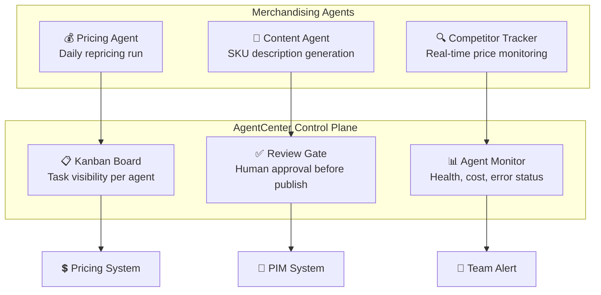

A merchandising team at a mid-size retailer told us they had 14 agents running across pricing, product content, and competitor tracking. When we asked who could tell us which one was performing well, nobody raised their hand.

That's the problem.

Retail merchandising is one of the fastest-growing use cases for AI agents. You have agents pulling competitor prices every few hours, agents generating product descriptions for new SKUs, agents flagging out-of-stock risks, agents drafting promotional copy. Each one is doing something genuinely useful. But once you have more than four or five running in parallel, the coordination overhead becomes its own full-time job.

## What Breaks When Merchandising Agents Scale Without a Control Plane

Retail moves fast. A pricing error or a bad product description can cost real money before anyone catches it. Here's where things fall apart at scale:

**Pricing agent drift nobody notices.** Your pricing agent runs every morning, pulling competitor data and adjusting prices according to margin rules. It works fine for weeks. Then it starts misclassifying a product category and underpricing a line of items by 12%. The agent completes successfully. No error. The problem surfaces during the weekly finance review, by which point you've sold 800 units at the wrong margin.

**Content agent output with no gate.** You have a product content agent generating copy for 50 new SKUs a week. It's faster than your copywriters. But fast doesn't mean correct. Without a review gate, agent-generated descriptions go directly to the PIM system. When a fabric gets mislabeled or a feature gets hallucinated, the first complaint is from a customer.

**Competitor tracking agents running blind.** You have three agents monitoring competitor prices across three categories. One of them gets throttled and starts returning stale data. Nobody knows because there's no visibility into agent health. Your pricing team is making markdown decisions based on data that's four days old.

These aren't edge cases. They're what happens when agents run without a control plane.

## How AgentCenter Fits a Merchandising Team's Workflow

**Kanban board for agent task tracking.** Each agent task gets a card. Pricing run completed. Product content in review. Competitor scan running. You can see where work is sitting and who owns the next step. When 40 SKUs have been generated but not reviewed, that's visible before it becomes a backlog.

**Deliverable review and approval workflows.** Product content agents submit output as deliverables. A merchandising manager reviews before anything goes to the PIM system. If the agent described a cotton shirt as polyester, you catch it at review, not after a customer complaint. The [approval workflow feature](/features/task-orchestration) is the single biggest risk reduction for merchandising teams.

**Real-time agent status monitoring.** The [agent monitoring dashboard](/features/agent-monitoring) shows each agent's status: running, idle, blocked, or erroring. When your competitor tracker returns a suspiciously fast run time, you notice. When a pricing agent is blocked waiting on a missing data feed, you know immediately.

**@Mentions for cross-team handoffs.** When the pricing agent flags a margin anomaly that needs human judgment, a team member gets mentioned in the task thread. The context is right there — the agent's reasoning, the specific SKU, the price it set and why. No Slack archaeology required.

**Cost tracking per agent.** Competitor tracking agents can get expensive if they're hitting external APIs at high frequency. AgentCenter shows cost per agent per task. When one tracking agent is consuming three times the tokens of the others, you find out before the bill arrives.

## The Numbers for a Merchandising Team

Most merchandising teams running agents in production have 8 to 20 agents across pricing, content, tracking, and promotional copy. The [Pro plan at $29/month](/pricing) covers up to 15 agents and 15 projects, which fits most teams comfortably. Larger teams running agents across multiple brands or categories will want the Scale plan.

What it replaces: a combination of Slack threads to track agent handoffs, spreadsheets to log agent runs, and manual review processes that slow everything down.

## Before vs. After AgentCenter

| Area | Without AgentCenter | With AgentCenter |
|---|---|---|
| Visibility | You ask around to find out if the pricing run completed | Dashboard shows every agent's current status |
| Task handoffs | Someone pings Slack when content is ready for review | @Mention in the task thread, context included |
| Error detection | Finance flags a pricing issue at week-end review | Monitoring alerts the same day the agent produces bad output |
| Cost tracking | Token costs are a black box until the invoice | Per-agent cost visible in real time |
| Debugging time | Hours tracing back through logs to find what went wrong | Activity feed shows exactly what each agent did and when |

## Where to Start

If you're a merchandising team just adding a control plane, start with **deliverable review workflows**.

Product content errors that reach your storefront are the highest-stakes failure for a merchandising team. Before you worry about monitoring dashboards or cost tracking, set up a review gate between your content agents and your PIM system. Connect the agent output to AgentCenter, require a human approval step, and let the rest of the coordination layer come after.

That single change will catch more problems than any other first step.

---

*Retail merchandising teams that add a control plane early spend less time firefighting later. [Start your 7-day free trial](/pricing).*
