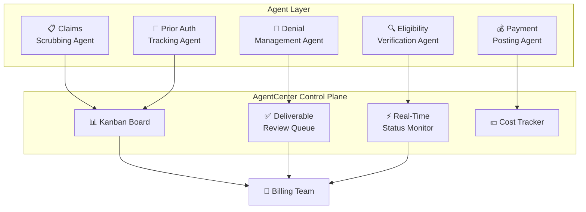

Revenue cycle management teams run some of the highest-stakes automation in healthcare. A missed denial, a stuck eligibility agent, or an uncaught coding error doesn't just cause rework — it can delay cash collections for weeks.

If your RCM team is running AI agents for claims scrubbing, denial management, or prior auth tracking, you've probably hit a familiar wall: the agents themselves aren't hard to build. The hard part is keeping track of what they're actually doing.

## AI Agents for Revenue Cycle Management: The Visibility Problem

Most RCM teams start with one or two agents. A claims scrubbing agent catches obvious errors before submission. A denial management agent categorizes rejection codes and queues appeals. That's manageable when you can hold the whole thing in your head.

Then you add a prior authorization tracking agent. An eligibility verification agent for new patients. A payment posting agent for EOBs arriving in flat files. Suddenly you have six agents touching different parts of the revenue cycle with no clear view of where things stand.

Three specific problems show up:

**Stuck eligibility checks hold up claims upstream.** Your eligibility agent queries payer APIs before claims go out. When a payer rate-limits responses, the agent slows — but you only find out when someone notices the claim backlog two days later.

**Denial agents complete without catching everything.** A denial management agent can report "task complete" and look healthy, but the output — the prioritized appeal queue — may have missing denial codes or misclassified payers. Without a review step, those bad outputs hit the billing team's queue directly.

**You can't see cost per claim type.** Agents call LLMs to classify denial reasons, suggest appeal language, or validate CPT codes. When you're processing 500 claims a day through three agents, the LLM costs are real but invisible unless you've built cost tracking yourself.

## How RCM Teams Manage AI Agents with AgentCenter

**Kanban board for claim workflow visibility.** Each claim batch moves through stages: Eligibility Verified → Claims Scrubbed → Submitted → Denial Processed → Appeal Filed. Your billing team sees where every batch sits without asking anyone. When a batch stalls at "Claims Scrubbed" for four hours, it's visible immediately.

**Real-time agent status catches stuck agents before backlogs build.** When your eligibility agent stops producing output because a payer API is slow, [AgentCenter's agent monitoring](/features/agent-monitoring) shows it as blocked. You find out in minutes, not days. That single improvement changes the daily rhythm for most RCM teams.

**Deliverable review for denial coding.** Before your denial management agent's output hits the billing queue, a reviewer can spot-check classifications in AgentCenter's review interface. Flag the wrong ones. Track which payer codes the agent consistently misclassifies. Over two weeks of this feedback loop, you'll know exactly which denial types need human review and which the agent handles cleanly.

**Cost tracking per task.** AgentCenter logs token usage per task. You can see what it costs to process a Cigna claim versus a Medicare claim versus a self-pay account. If one payer keeps returning malformed responses that force retries, the activity feed shows that pattern before it becomes a budget problem.

**@Mentions for exceptions.** When a denial agent flags something it can't categorize, it creates a task with an @mention to the right billing specialist. No more checking Slack to see if the denial exception got picked up. The task exists, it's assigned, someone owns it.

## The Numbers for RCM Teams

A mid-sized RCM team processing 300-600 claims per day typically runs 6-12 agents: eligibility verification, claims scrubbing, denial management, prior auth, payment posting, and usually some mix of coding support or patient statement generation.

The [Pro plan at $29/month](/pricing) covers 15 agents and 15 projects — enough for most RCM teams to organize each payer category or department as a separate project. Teams processing higher claim volumes with more specialized agents tend to move to Scale when agent count approaches 20.

What AgentCenter replaces for most teams: the spreadsheet tracking which agent ran which batch, the Slack threads asking "did eligibility finish for the 9am batch?", and the manual cost estimates someone pulls from the LLM API dashboard at month-end.

## Before vs After

| | Without AgentCenter | With AgentCenter |
|---|---|---|
| **Visibility** | Ask someone if the batch is done | Kanban shows claim batch status in real time |
| **Task handoffs** | Slack message or email to billing team | Task card with @mention to assigned reviewer |
| **Error detection** | Found when billing team complains | Blocked agent visible in status within minutes |
| **Cost tracking** | Monthly API invoice, no per-task breakdown | Cost per task, per claim type, per agent |
| **Debugging time** | 2-4 hours tracing logs across agents | 20-30 minutes in the activity feed |

## Where to Start

Connect your denial management agent to [AgentCenter's deliverable review queue](/features/agent-monitoring) first. Denial agents are the ones most likely to report success while producing subtly wrong output — bad payer mappings, missing denial codes, incorrect appeal priorities.

With the review queue active, have a billing analyst spot-check ten outputs per batch for the first two weeks. You'll know exactly which denial codes the agent handles well and which ones need a second look. That's real, actionable data — the kind that doesn't come from logs alone.

Once you've seen what that visibility gives you on one agent, connecting the rest of the fleet is an easy decision.

---

*RCM teams that add a control plane early spend less time firefighting later. [Start your 7-day free trial](/pricing).*
