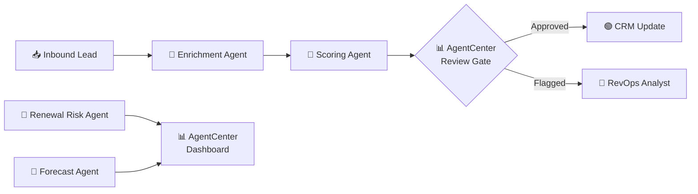

RevOps teams don't plan to run twelve AI agents. They just end up there.

There's one scoring inbound leads. One enriching company data before records hit the CRM. One running renewal risk models on customer health signals. One generating weekly pipeline forecasts. One summarizing call transcripts for sales reps. And none of these were part of a formal AI rollout — they just got built because someone on the team knew how to spin up an OpenClaw agent and had a problem to solve.

The building isn't the hard part. The hard part is knowing which agent is doing useful work, which one is costing $400 a month in token spend for outputs nobody reads, and which one has been producing bad pipeline numbers for three weeks without anyone noticing.

## The Specific Bottleneck for RevOps

**You find out an agent is broken when the forecast is already wrong.** Lead scoring agents drift. Enrichment agents start pulling stale data from a vendor API that changed six weeks ago. The renewal risk model gets flagged as wrong by the CS team on a Tuesday morning — but by then you've already used that data in an exec report. There's no alert. There's no task history. Just a bad number that nobody caught in time.

**Handoffs between agents are invisible.** RevOps workflows are sequences. An enrichment agent processes a lead, passes it to a scoring agent, which flags it for human review. When that chain breaks — because the enrichment step timed out or the payload was malformed — nobody knows where it stopped. You find out when a rep asks why their prospect list hasn't updated.

**You can't attribute cost to agents.** Your CFO asks how much the AI stack costs per quarter. You can pull the Anthropic invoice. You cannot tell which agent drove which charges. If your forecast agent is running a 32k context window for every record in your CRM, that's expensive. Without per-agent cost tracking, you'll never know.

## How RevOps Teams Use AgentCenter

**Real-time agent status** is the first thing RevOps teams need. The [agent monitoring dashboard](/features/agent-monitoring) shows whether your scoring agent is working, idle, or blocked. If the enrichment agent timed out at 2am, you see a blocked status before your reps start their day — not at the Monday forecast call when someone asks why the numbers look off.

Each agent has a status card. When the renewal risk agent stops producing outputs, its card turns red. Click through and you see the last task it completed, the error it threw, and how long it's been stuck.

**Task orchestration** handles the sequencing problem. RevOps pipelines aren't one agent — they're three or four agents in a chain. AgentCenter's [task orchestration layer](/features/task-orchestration) coordinates tasks across agents, so when the enrichment agent completes, it hands off to the scoring agent with a tracked record. If the chain breaks, you see exactly where.

A task for "Score Q2 pipeline batch" shows which agents touched it, in what order, and which step failed. You're reading a task card, not digging through four sets of logs.

**Deliverable review workflows** matter when agent outputs feed executive reports. Before the forecast agent's output goes into the board deck, you add an approval step. A RevOps analyst reviews the summary, approves it, and it's marked as reviewed — with a timestamp and a name attached. Unreviewed outputs are flagged until someone signs off.

**Per-agent cost tracking** is how you answer the CFO's question. AgentCenter tracks token spend by agent, so you can see the transcript summarization agent costs $23/month while the pipeline forecasting agent costs $180/month — and decide if that's proportionate to the value each one delivers.

## The Numbers for RevOps Teams

Most RevOps teams running agents land between 8 and 15 agents. A few for lead management and enrichment, 2–3 for customer health and renewal, and a couple for reporting and forecasting.

That puts most teams in the [Pro plan at $29/month](/pricing) — up to 15 agents across 15 projects. Scale ($79/month) fits teams that have pushed past 15 agents or need cloud VM provisioning for heavier workloads.

What it replaces: Notion task logs that nobody updates, Slack threads where someone posts "the enrichment agent is down again," and the Google Sheet someone built to track token costs by manually copying Anthropic invoices.

## Before vs After

| | Without AgentCenter | With AgentCenter |
|---|---|---|
| **Visibility** | Ask the person who built the agent or check Slack | Real-time status for all agents from one dashboard |
| **Task handoffs** | Hope the next agent picks up where the last one stopped | Tracked handoffs with full chain history per task |
| **Error detection** | Find out when output is already wrong | Agent shows as blocked before the damage spreads |
| **Cost tracking** | Export the Anthropic invoice and guess | Per-agent cost breakdown, updated in real time |
| **Debugging time** | 2–3 hours tracing logs across multiple systems | Under 15 minutes reading task history in one place |

## Where to Start

Set up [agent monitoring](/features/agent-monitoring) first. Connect your existing agents, give each one a name in the dashboard, and watch the status cards for a week before changing anything else. You'll quickly find out which agents are running consistently and which ones have been silently failing for longer than you'd like.

After that, add deliverable review to any agent output that touches an executive report or a rep's working list. That one step catches the most expensive mistakes.

---

*RevOps teams that add a control plane early spend less time firefighting later. [Start your 7-day free trial](/pricing).*
