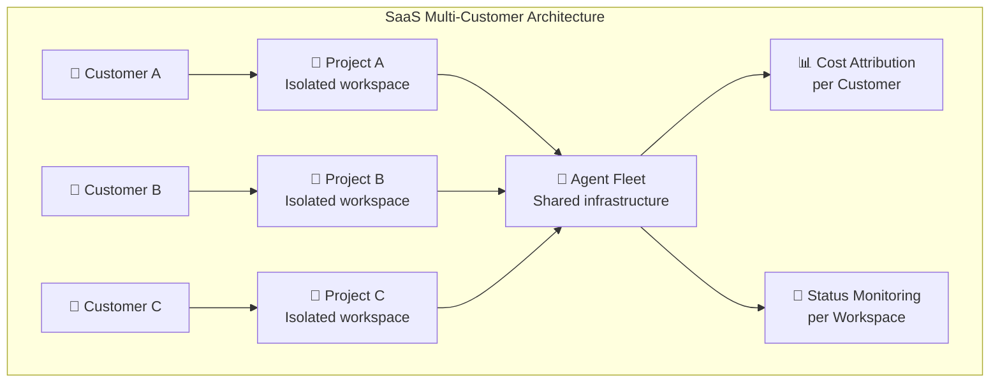

SaaS product teams adding AI agents to their products face a different set of challenges than internal teams running agents. You're not just keeping your own agents healthy — you're responsible for agent reliability across all of your customers. One agent failure affects your entire customer base. One cost spike affects your unit economics.

The stakes are higher. The visibility requirements are stricter.

## The Specific Bottlenecks SaaS Teams Hit

**Per-customer isolation.** When multiple customers use your AI features, their agent work needs to be isolated. Customer A's data shouldn't influence Customer B's agent outputs. Task queues, context, and deliverables need per-customer separation.

**Cost per customer.** In SaaS, you charge customers for value delivered. If your AI agents are a feature, you need to know the cost of running them per customer. Your gross margin depends on understanding whether the $29/month customer is costing you $8/month in AI compute or $35/month.

**SLA commitments and reliability.** You probably have uptime commitments to customers. AI agents can fail in ways that don't show up as "the service is down" — they keep running but produce degraded outputs. Your SLA monitoring needs to capture this.

## How AgentCenter Addresses SaaS Team Needs

**Project-based isolation.** Each customer gets their own project in AgentCenter. Tasks, agents, deliverables, and history are scoped to that project. Customer A's research agent doesn't share context with Customer B's. The isolation is built into the data model.

**Per-project cost tracking.** The cost monitoring in AgentCenter tracks spend by project, not just by agent. You can pull cost data for a specific customer's project and see exactly what their AI usage cost you this month. That feeds directly into your unit economics analysis.

**Scale plan for multi-tenant deployments.** The [Scale plan](/pricing) at $79/month handles 50 agents across 50 projects. For SaaS teams, 50 projects can mean 50 customers, each with their own isolated workspace. That's a reasonable starting point for early-stage SaaS products.

## Feature-to-Workflow Mapping

| SaaS Concern                 | AgentCenter Feature         | How It Helps                       |
| ---------------------------- | --------------------------- | ---------------------------------- |
| Customer isolation           | Project-based workspace     | Separate context per customer      |
| Cost per customer            | Per-project cost tracking   | Know unit economics                |
| Agent reliability monitoring | Real-time status            | Catch failures before customers do |
| Agent fleet management       | Multi-agent dashboard       | See all customers' agent status    |
| Feature flag rollouts        | Project-level configuration | Pilot with specific customers      |
| SLA documentation            | Task audit trail            | Prove reliability to customers     |

## The Numbers

A SaaS product with 20-40 customers using AI agents needs roughly:

- 20-40 projects (one per customer)
- 1-5 agents per customer depending on features
- Scale plan handles 50 agents, 50 projects at $79/month

If your per-customer AI cost through a purpose-built management platform is $2/customer/month and your AI feature is part of a $49/month plan, that's a very different gross margin than discovering your per-customer cost is $20 with no way to track it.

What AgentCenter replaces for SaaS teams: custom tenant isolation logic, ad-hoc cost attribution queries against LLM provider bills, per-customer monitoring setups, and the engineering time to maintain all of it.

## Before vs After AgentCenter

|                 | Without AgentCenter           | With AgentCenter                  |
| --------------- | ----------------------------- | --------------------------------- |
| Visibility      | Aggregate logs only           | Per-customer, per-project         |
| Task handoffs   | Custom per-customer logic     | Standardized across all customers |
| Error detection | Customer support tickets      | Real-time monitoring              |
| Cost tracking   | Provider bill by service      | Per-customer, per-month           |
| Debugging time  | Requires customer data access | Dashboard lookup                  |

## Where to Start

Start by migrating your highest-value customer's agents to AgentCenter. Run both the old system and AgentCenter in parallel for two weeks. At the end, compare: is the visibility better? Is the cost attribution accurate? Is agent reliability measurably improved?

If yes, expand to all customers. The template you build for the first customer applies to everyone else.

_SaaS teams that add a control plane early spend less time firefighting later. [Start your 7-day free trial](/pricing)._
