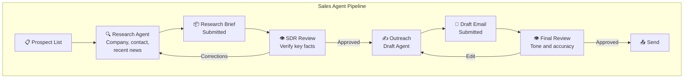

Sales teams adopt AI agents for the obvious reasons: research takes time, outreach personalization doesn't scale manually, and pipeline analysis is tedious. An AI agent that can research a prospect, draft a personalized email, and summarize the relevant talking points in 3 minutes versus 45 minutes of manual work — that math is compelling.

The problem is that sales outreach is public-facing and relationship-sensitive. A wrong detail in a prospecting email, an off-tone message to a VP, a hallucinated company fact in an intro email — these don't just fail quietly. They damage relationships and can get your domain flagged for spam.

Sales agent management is as much about quality control as it is about throughput.

## The Specific Bottlenecks Sales Teams Hit

**Factual accuracy in prospect research.** AI agents researching prospects can hallucinate details — wrong company size, incorrect recent news, non-existent product launches. A sales rep who sends an email referencing a company milestone that didn't happen looks foolish at best. Without a review gate, this goes out.

**Personalization at scale without sounding like spam.** An agent that sends 200 personalized emails per day is either genuinely personalized (slow, hard to scale) or template-personalized (fast, but detectable). The line between "impressive personalization" and "obviously AI-generated" is narrow, and it shifts as LLM outputs become more recognizable.

**Handoff from AI research to human conversation.** The agent researches the prospect and drafts context for the sales rep. If the handoff is poor — too much noise, missing the key insight, wrong format for the rep's workflow — the rep ignores the agent output and does the research themselves. The agent's work is wasted.

## How AgentCenter Addresses Sales Team Workflows

**Two-stage review for outreach quality.** Research goes through one review gate (SDR verifies facts). The outreach draft goes through a second review gate (final check on tone and accuracy). Two gates, two minutes each, dramatically reduces the risk of bad outreach going out.

**Structured research brief format.** The research agent's deliverable follows a template: company overview, recent news, relevant talking points, contact background. The SDR reviews a structured brief, not a wall of text. Review is faster when the format is consistent.

**Task coordination from research to outreach.** When the research brief is approved, the outreach agent picks it up automatically. The SDR doesn't need to copy-paste or manually trigger the next step. The [task orchestration](/features/task-orchestration) handles the handoff.

## Feature-to-Workflow Mapping

| Sales Challenge              | AgentCenter Feature      | How It Helps                       |
| ---------------------------- | ------------------------ | ---------------------------------- |
| Factual accuracy             | Research review gate     | SDR verifies before outreach       |
| Outreach quality             | Draft review workflow    | Final approval before sending      |
| Research to outreach handoff | Task orchestration       | Automatic context passing          |
| Prospect volume              | Multiple agent pipelines | Process many prospects in parallel |
| Cost per prospect            | Per-task cost tracking   | Know your AI cost per outreach     |
| Campaign segmentation        | Multi-project management | Separate projects per campaign     |

## The Numbers

A SDR team running AI-assisted prospecting typically runs 3-6 agents: research, outreach drafting, follow-up sequencing, meeting prep, and possibly a CRM update agent. The [Starter plan](/pricing) at $14/month handles 5 agents — enough for a pilot workflow. Pro at $29/month handles 15 agents for teams running multiple parallel campaigns.

What AgentCenter replaces: manual handoffs between research and outreach tools, Notion or Google Docs for tracking which prospects have been researched, ad-hoc review via Slack messages, and the cognitive load of remembering where each prospect is in the pipeline.

## Before vs After AgentCenter

|                       | Without AgentCenter       | With AgentCenter            |
| --------------------- | ------------------------- | --------------------------- |
| Visibility            | Spreadsheet tracking      | Real-time pipeline status   |
| Research handoff      | Manual copy-paste         | Automatic via orchestration |
| Error detection       | Rep notices after sending | Review gate catches before  |
| Cost tracking         | Subscription costs only   | Per-prospect AI cost        |
| Outreach coordination | Slack back-and-forth      | Structured review queue     |

## Where to Start

Start with research review only. Don't automate outreach drafting until you've confirmed the research agent produces accurate, usable briefs consistently. Use AgentCenter's review workflow to have SDRs verify research quality for 30 days. When the verification rate drops (fewer corrections needed), that's your signal the research agent is reliable enough to extend to outreach drafting.

_Sales teams that add a control plane early spend less time firefighting later. [Start your 7-day free trial](/pricing)._
