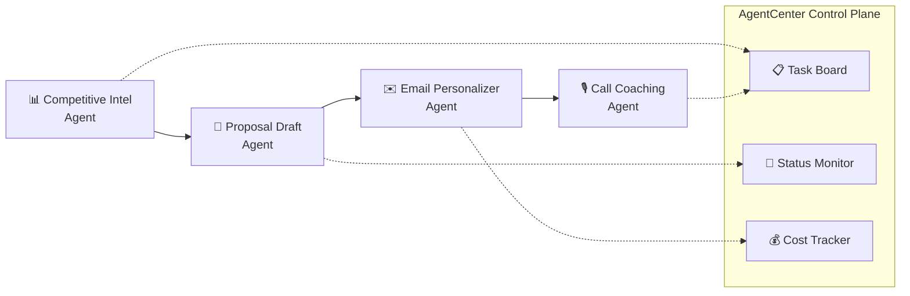

Sales enablement teams are some of the heaviest early adopters of AI agents in production. You're running agents for competitive intelligence, playbook generation, proposal drafts, call coaching summaries, and email personalization. Within two months of shipping your first agent, you have six. Within four months, twelve.

And then someone asks: which agents are actually helping reps close deals?

You don't know. Not because you're not tracking it, but because there's no single place to look.

## The Problem No One Warned You About

Sales enablement runs agents that hand off to other agents. The competitive intel agent finishes a summary, and then the proposal agent is supposed to pull from it. But if the proposal agent can't reach the data, or the intel agent ran late, the whole chain stalls. You find out three days later when a rep submits a deck with outdated competitor pricing.

Here's what breaks when you don't have a control plane:

**No task handoff visibility.** You have no way to tell if the playbook agent finished its draft before the personalization agent picked it up. The two systems don't communicate. Someone has to check manually, and that someone is usually you at 6pm before a big meeting.

**Errors land in rep laps.** Your competitive intel agent started pulling stale data after hitting an API rate limit. You don't catch it in the agent. You catch it when a rep uses the wrong numbers in a meeting. The rep doesn't know the agent failed. They just know the data was wrong.

**Cost attribution is a blank check.** You're running 10 agents across 40 reps. The CFO wants ROI numbers. Your LLM bill is $2,800 per month and growing. You have no breakdown by agent, task, or team. You have a number and a shrug.

## How AgentCenter Fits Into a Sales Enablement Stack

Sales enablement teams aren't running one-off scripts. They're running pipelines where each agent's output feeds the next stage. That's exactly what [AgentCenter's task orchestration](/features/task-orchestration) is built for.

### Kanban board for task management

Every agent has tasks. Every task has a status: pending, in progress, blocked, done. When your proposal agent is blocked waiting on incomplete CRM data, you see it immediately. Not when a rep reports it. Not three days later. Right now.

For a team running six agents across 30 reps, this is the difference between proactive management and incident response.

### Real-time agent status

[Agent monitoring](/features/agent-monitoring) gives you online, working, idle, and blocked states per agent. When the call coaching agent goes idle for four hours during peak hours, that's a signal. Maybe it lost its API connection. Maybe the task queue ran dry. Either way, you know before a rep notices.

### Cost tracking per agent and per task

Your call coaching agent costs $0.11 per task. Your proposal generator costs $1.40 per task. The coaching agent gets used 4x more often. That gap isn't obvious until you can see it in a dashboard. Once you can, budget conversations become real conversations, not guesswork.

### Deliverable review before content reaches reps

An agent-generated proposal going to a rep without any review is a risk. AgentCenter's approval workflow lets a human spot-check outputs before they land in a rep's hands. Not every output, but the ones you flag. You build trust in the agents by reviewing enough to know where they tend to slip.

## The Numbers

A typical sales enablement team runs 6 to 10 agents: competitive intel, playbook generator, proposal draft, call coaching, win/loss analysis, email personalizer, and sometimes a rep training agent. That fits on the [Pro plan ($29/month)](/pricing) with room to grow.

If you're supporting multiple product lines or more than 20 reps, the Scale plan ($79/month) gives you 50 agents and project separation by product line or sales territory.

What it replaces: shared spreadsheets tracking agent status, Slack threads asking "did the intel agent run yet?", and the weekly 30-minute debugging session trying to figure out why a rep got the wrong deck.

## Without AgentCenter vs With AgentCenter

| | Without AgentCenter | With AgentCenter |
|---|---|---|
| Visibility | No way to see if an agent ran, stalled, or failed | Real-time status per agent across all workflows |
| Task handoffs | Manual checks, Slack messages, rep complaints | Structured dependencies with automatic notifications |
| Error detection | Learn about failures after a rep uses bad content | Alerts before content reaches any rep |
| Cost tracking | Monthly LLM bill with no breakdown | Per-agent, per-task cost visible in the dashboard |
| Debugging time | 2-3 hours tracing what happened and why | Activity log with every step recorded |

## Where to Start

Pick your highest-volume agent, probably the proposal generator or email personalizer, and connect it to AgentCenter first. Set up a Kanban column for it, map its tasks, and get baseline cost data.

Once you can see one agent's task flow clearly, the others follow the same pattern. You'll find the bottlenecks in the first week: usually task handoffs that were never formalized, or error states that were silently dropping without anyone knowing.

Sales enablement doesn't need more agents. It needs visibility into the ones already running.

---

*Sales enablement teams that add a control plane early spend less time firefighting later. [Start your 7-day free trial](/pricing).*
