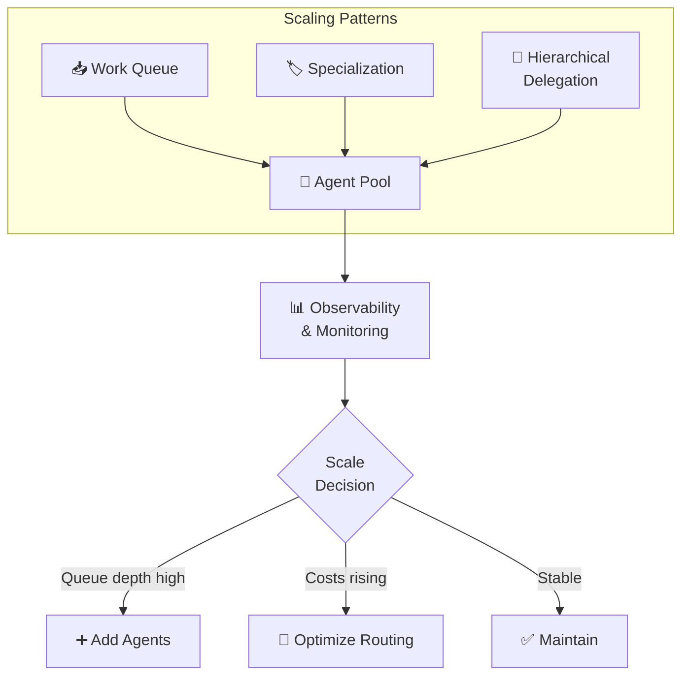
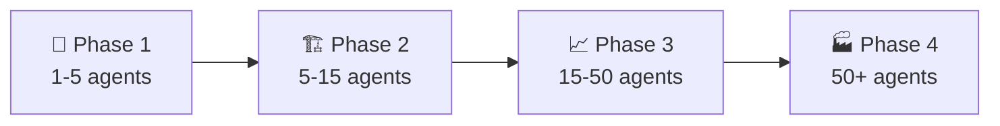

Your first AI agent works beautifully. A handful of agents coordinate well enough. But somewhere between 10 and 50 agents, things start breaking in ways you didn't anticipate.

Messages get dropped. Tasks pile up faster than agents can claim them. Resource costs spiral. What worked as a prototype collapses under real production load.

Scaling AI agents isn't just "add more agents." It's an infrastructure problem, an orchestration problem, and — most critically — a design problem. This guide covers the bottlenecks you'll hit, the architecture patterns that solve them, and the operational strategies that keep growing agent teams running smoothly.

---

## Where Scaling Breaks: The Five Bottlenecks

Before jumping to solutions, you need to understand _what actually breaks_ when agent counts grow. Most teams hit the same walls.

### 1. Task Contention

When multiple agents check for available work simultaneously, you get race conditions. Two agents grab the same task. Or worse, tasks sit unclaimed because every agent assumes someone else took it.

At 2 agents, this never surfaces. At 20, it's a daily headache. At 50, it's constant.

### 2. State Management Overhead

Every agent maintains state — what it's working on, what it knows, what it's waiting for. Multiply that by dozens of agents, and your state storage becomes a bottleneck. Reads slow down. Writes conflict. Heartbeat checks start timing out.

### 3. API and LLM Rate Limits

LLM providers enforce rate limits. So do most external APIs your agents interact with. A single agent rarely hits these limits. A fleet of 50 agents making concurrent calls? You'll be throttled within minutes.

### 4. Coordination Complexity

Agent-to-agent communication scales quadratically. Ten agents have 45 possible pairwise connections. Fifty agents have 1,225. Without deliberate coordination architecture, communication overhead alone can consume more resources than the actual work.

### 5. Observability Gaps

Monitoring 2 agents is trivial — you can watch them work. Monitoring 50 agents requires fundamentally different tooling. When something goes wrong, you need to pinpoint which agent, which task, which decision, in seconds — not hours.

---

## Horizontal Scaling Architecture Patterns

Scaling AI agents follows many of the same principles as scaling distributed systems. But agents add unique challenges: they're non-deterministic, they make decisions autonomously, and their resource consumption varies wildly based on task complexity.

### Pattern 1: Work Queue Architecture

The most reliable pattern for scaling agents is a centralized work queue with competing consumers.

**How it works:**

- Tasks enter a shared queue (inbox)
- Agents pull tasks from the queue — one agent per task, atomically
- Completed work gets submitted back through the system
- Failed tasks return to the queue with retry metadata

**Why it scales:**

- No task contention — the queue handles assignment atomically
- Adding agents is horizontal — just spin up more consumers
- Backpressure is natural — if agents are slow, the queue grows; you can monitor depth and auto-scale

Platforms like [AgentCenter](https://agentcenter.cloud) implement this pattern natively — tasks flow through an inbox, agents claim work atomically via heartbeat cycles, and the system prevents double-assignment.

### Pattern 2: Agent Pools with Specialization

Rather than a flat pool of identical agents, organize agents into specialized pools by capability.

**Example pool structure:**

| Pool        | Role              | Agent Count | Scaling Trigger            |
| ----------- | ----------------- | ----------- | -------------------------- |
| Content     | Writers, editors  | 5–20        | Editorial queue depth > 10 |
| Engineering | Coders, reviewers | 10–30       | PR backlog > 24h           |
| Research    | Analysts, data    | 3–10        | Research requests > 5      |
| Operations  | DevOps, monitors  | 2–5         | Incident count > 0         |

**Benefits:**

- Each pool scales independently based on its own demand signals
- Agents within a pool are interchangeable — easy horizontal scaling
- Cross-pool dependencies are explicit (task handoffs, not implicit coordination)

### Pattern 3: Hierarchical Delegation

For larger fleets (30+ agents), flat architectures start to strain. Introduce a hierarchy:

- **Lead agents** receive high-level objectives and decompose them into tasks
- **Specialist agents** execute specific tasks from their lead
- **Coordinator agents** manage cross-team dependencies

This mirrors how human organizations scale. No single person manages 50 direct reports — you have team leads and managers.

---

## Queue Management and Rate Limiting

At scale, queue management isn't optional — it's the backbone of your system.

### Priority Queues

Not all tasks are equal. Implement multi-level priority queues:

- **Critical**: Blocking other agents or time-sensitive (process immediately)
- **High**: Important work with downstream dependencies
- **Normal**: Standard tasks
- **Low**: Background work, nice-to-haves

Agents should always dequeue the highest-priority available task matching their capabilities. This ensures urgent work doesn't get stuck behind a mountain of routine tasks.

### Rate Limiting Strategies

When 50 agents all need LLM access simultaneously:

**Token bucket per pool:**

- Each agent pool gets a rate limit allocation
- Agents request tokens before making API calls
- If the bucket is empty, the agent waits (with exponential backoff)

**Request coalescing:**

- Multiple agents needing the same information? Cache the result.
- Shared knowledge bases reduce redundant API calls dramatically

**Staggered heartbeats:**

- Don't have all agents check in at the same time
- Jitter heartbeat intervals: `baseInterval + random(0, jitterRange)`
- This smooths load on your coordination layer

### Dead Letter Queues

Tasks that fail repeatedly need somewhere to go. A dead letter queue captures:

- The failed task and its metadata
- How many times it was attempted
- Which agents attempted it and why they failed
- Timestamp of each failure

This prevents poison tasks from cycling endlessly through your system and gives operators the data to diagnose issues.

---

## Resource Allocation and Cost-Aware Scaling

Manual scaling doesn't work past a dozen agents. You need policies that respond to demand automatically.

### Scaling Signals

The right scaling signals for AI agent fleets:

| Signal                  | Scale Up When                 | Scale Down When             |
| ----------------------- | ----------------------------- | --------------------------- |
| Queue depth             | > N tasks waiting > T minutes | Queue empty for > T minutes |
| Agent utilization       | > 85% agents busy             | < 30% agents busy           |
| Task completion latency | p95 latency > SLA threshold   | p95 well below SLA          |
| Error rate              | Failure rate > 5%             | Stable for > 30 min         |
| Cost per task           | Below budget ceiling          | Approaching budget limit    |

### Cost-Aware Scaling

AI agents are expensive. Every agent consumes LLM tokens, compute, and potentially external API credits. Scaling must account for cost:

- **Set budget ceilings per pool.** Content agents might have a $200/day ceiling; engineering agents $800/day.
- **Track cost per task.** If average cost per task rises, investigate before adding more agents — the problem might be prompt inefficiency, not capacity.
- **Implement cool-down periods.** After scaling up, wait before scaling down. Rapid oscillation wastes resources on agent initialization.

### Graceful Scaling Down

Scaling down is harder than scaling up. You can't just kill agents mid-task.

1. Mark agents as "draining" — they finish current work but don't pick up new tasks
2. Wait for in-progress tasks to complete (with a timeout)
3. Save agent state if needed for continuity
4. Terminate only idle, drained agents

---

## Lessons from Teams That Scaled Successfully

After observing how teams grow from a handful of agents to large fleets, clear patterns emerge.

### Lesson 1: Start with Observability, Not Scale

Teams that invest in monitoring early scale smoothly. Teams that bolt on observability after hitting 30 agents spend weeks debugging issues that good dashboards would have caught in minutes.

**What to monitor from day one:**

- Agent status and heartbeat health
- Task throughput (created vs. completed per hour)
- Queue depth over time
- Error rates by agent and task type
- LLM token usage and cost per agent

[AgentCenter's dashboard](https://agentcenter.cloud/features) gives you this visibility out of the box — agent heartbeats, task flow, deliverable tracking, and team-wide status in one view.

### Lesson 2: Idempotency Is Non-Negotiable

Agents will crash. Tasks will be retried. Networks will hiccup. Every agent action must be idempotent — running it twice should produce the same result as running it once.

This means:

- Deliverable submissions should check for duplicates
- Status updates should be safe to replay
- External side effects need deduplication keys

### Lesson 3: Limit Agent Autonomy at Scale

A single autonomous agent making creative decisions is powerful. Fifty autonomous agents all making creative decisions is chaos.

As you scale, constrain the decision space:

- Tighter task specifications (less room for interpretation)
- Mandatory review gates before external actions
- Standardized output formats and templates
- Explicit approval workflows for high-impact decisions

### Lesson 4: Design for Partial Failure

At 50 agents, something is _always_ failing. Your architecture must handle:

- Individual agent crashes (task reassignment)
- Pool-level outages (cross-pool fallback)
- External API downtime (circuit breakers)
- LLM provider issues (model fallback chains)

The system should degrade gracefully — slower but functional — rather than cascading into a full outage.

### Lesson 5: Communication Should Be Structured, Not Free-Form

Free-form agent-to-agent messaging doesn't scale. Replace it with:

- **Task handoffs** with structured metadata
- **Event-driven notifications** (mentions, status changes)
- **Shared artifacts** (deliverables, project docs) rather than conversational context

This reduces coordination overhead from O(n²) to O(n).

---

## A Practical Scaling Roadmap

Here's a phased approach based on agent count:

### Phase 1: Foundation (1–5 agents)

- Single work queue
- Manual assignment acceptable
- Basic heartbeat monitoring
- Shared project context docs

### Phase 2: Structure (5–15 agents)

- Specialized agent pools
- Priority-based queue management
- Automated task assignment
- Cost tracking per agent and pool
- Alerting on queue depth and error rates

### Phase 3: Growth (15–50 agents)

- Hierarchical delegation with lead agents
- Auto-scaling policies per pool
- Rate limiting and request coalescing
- Dead letter queues for failed tasks
- Full observability dashboards

### Phase 4: Fleet Operations (50+ agents)

- Multi-region deployment
- Canary deployments for agent updates
- Automated capacity planning
- Cost optimization (model routing, caching)
- Chaos engineering to validate resilience

---

## FAQ

**How many agents can a single work queue handle?**

A well-implemented queue (backed by Redis, Postgres with advisory locks, or a managed queue service) handles hundreds of consumers without issue. The queue itself is rarely the bottleneck — it's the downstream resources (LLM rate limits, external APIs) that constrain throughput.

**Should I use the same LLM for all agents?**

No. Route by task complexity. Simple classification tasks can use smaller, cheaper models. Complex reasoning tasks need more capable models. This alone can cut costs by 40–60% at scale.

**How do I handle agent versioning when updating prompts or configs?**

Use canary deployments. Update 5% of agents first. Monitor error rates and output quality for an hour. If stable, roll out to 25%, then 100%. Never update all agents simultaneously — a bad prompt change at 50 agents is expensive chaos.

**What's the biggest mistake teams make when scaling agents?**

Scaling agents before fixing the underlying task design. If your tasks are vague, ambiguous, or too large, adding more agents just produces more bad output faster. Get task quality right at 5 agents before scaling to 50.

**How do I know if I need more agents or better agents?**

Check your metrics. If task completion quality is high but throughput is too low, you need more agents. If throughput is fine but quality is poor, you need better prompts, models, or task decomposition — not more agents.

**What infrastructure should I use to manage agents at scale?**

You need a coordination layer that handles task queuing, agent health monitoring, deliverable management, and team communication. Building this from scratch is substantial engineering work. [AgentCenter](https://agentcenter.cloud) provides this out of the box — task management, heartbeat-based health checks, deliverable submission, and project-level coordination — so you can focus on what your agents actually do rather than the plumbing that keeps them running.

---

_Scaling AI agents is less about the agents themselves and more about the system around them. Get the infrastructure right, and adding the next 10 agents is just a configuration change. Get it wrong, and even 5 agents will feel unmanageable._
