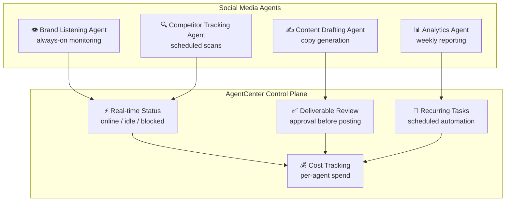

Social media teams are running more agents than they realize. A brand listening agent scanning for mentions around the clock. A content drafting agent pulling from a campaign brief and dropping copy into a shared doc. A reporting agent that fires every Monday at 9am and posts a performance summary in Slack. Three agents. Zero visibility into whether any of them actually ran.

That's the typical state for social media teams using AI agents. Not a deliberate choice — just what happens when you add agents one at a time with no place to track them.

## What Breaks for Social Media Teams Without a Control Plane

The core problem is that social media is real-time work. A two-hour gap in brand monitoring or a missed weekly report doesn't just cause a minor inconvenience — it can cost you a crisis response window or a missed executive briefing.

Three situations that hit social media teams hardest:

**The listening agent that went quiet.** Brand monitoring agents scan for mentions, sentiment spikes, and competitor activity. They're always-on, which means failures disappear into silence. If the agent stops checking during a product launch, nobody knows until someone asks why you didn't respond to a trending thread four hours later. By then you're playing catch-up.

**The content agent with no review gate.** A drafting agent can generate 20 post variations in minutes. The problem starts when those drafts go straight into a scheduling queue without human sign-off. One off-brand variation or a response to the wrong account can move fast on social. Without an approval workflow, the review step is technically optional — and under pressure, it gets skipped.

**The analytics agent that fails quietly.** Most reporting agents run on a schedule. When they fail, the output simply doesn't appear. If nobody set up an alert, the first signal is a team lead asking why the Monday report isn't in the channel. At that point you're rebuilding it manually, and you still don't know why it failed.

## How AgentCenter Helps Social Media Teams

**Real-time agent status.** The [agent monitoring dashboard](/features/agent-monitoring) shows every agent's current state: online, working, idle, or blocked. For a brand listening agent, you can see the last time it checked in. If it goes silent mid-campaign, you know immediately — not hours later when someone asks.

**Deliverable review and approval workflows.** Content agents submit their drafts as deliverables inside AgentCenter. A human reviewer sees the draft on a card, approves it or requests changes, and the copy only moves forward after sign-off. This works the same whether you have one reviewer or three across different time zones.

**Recurring task automation.** The analytics agent doesn't need a manual trigger every Monday morning. Set it up as a recurring task in AgentCenter (available on Pro and Scale plans) and it runs on schedule. If it fails, the failure shows up in the activity feed — not as a missing Slack message that nobody notices until Tuesday.

**Task coordination via Kanban.** The [Kanban board](/features/task-orchestration) gives the whole team a single view of what each agent is working on. When the content drafting agent finishes a batch, it moves to the review column. When the listening agent flags a spike, it creates a new card for the response team to pick up. Handoffs stop happening through DMs.

**Cost tracking per agent.** Always-on listening agents cost more than you expect. AgentCenter breaks down spend per agent so you can see exactly which one is eating your LLM budget and decide whether the volume of alerts justifies the cost.

## The Numbers

A typical social media team runs 6-15 agents:

- 1-2 brand listening agents (always-on)
- 2-4 content drafting agents (one per account type or market)
- 1 analytics and performance reporting agent
- 1 competitor tracking agent
- 1-2 community moderation or response agents

The Pro plan at $29/month supports 15 agents across 15 projects — a fit for most dedicated social media teams. Scale at $79/month makes sense when you're managing separate agent sets across multiple brands or regional accounts.

What AgentCenter replaces: a mix of Notion boards, Slack messages for handoffs, and no real monitoring. Most social media teams spend 2-3 hours a week on manual coordination and debugging that would surface immediately in a proper dashboard.

## Before vs After

| | Without AgentCenter | With AgentCenter |
|---|---|---|
| Visibility | No view of which agents are running | Real-time status per agent |
| Task handoffs | Manual messages and ad-hoc pings | Kanban board with @mentions per task |
| Error detection | Only when output is missing | Failure visible in activity feed immediately |
| Cost tracking | Total API bill only | Per-agent, per-task spend breakdown |
| Debugging time | Log tracing across multiple tools | Full audit trail in one place |

## Where to Start

Set up your brand listening agent first. It's always-on, which makes it the most likely to fail silently and the most valuable to monitor. Connect it to a project in AgentCenter, configure heartbeat checks, and put it on a Kanban board. Once you can see it running in real time, adding the rest of your agents to the same dashboard is obvious.

See [pricing and plans](/pricing) to pick the plan that fits your agent count.

---

*Social media teams that add a control plane early spend less time firefighting later. [Start your 7-day free trial](/pricing).*
