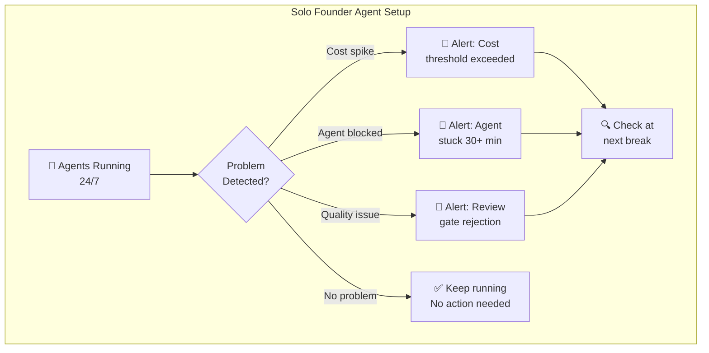

Solo technical founders have a specific relationship with AI agents: they see the productivity leverage immediately, they build and deploy fast, and then they're alone when something breaks at 11pm on a Friday.

No on-call rotation. No dedicated MLOps engineer. No team to share the debugging burden with. Just you, the logs, and an agent that's been quietly failing for who knows how long.

The tools and practices that work for a 10-person engineering team aren't always right for a solo founder. Here's what actually helps when you're doing everything yourself.

## The Real Problem with Solo Agent Operations

The problem isn't technical sophistication. Solo technical founders can usually debug agents — they built them, they understand the code. The problem is bandwidth.

When you're building features, talking to customers, running the business, and writing code, you don't have time to check on every agent every day. You need agents that surface problems to you rather than waiting for you to find them.

The asymmetry: agents run 24 hours a day. You're available maybe 8-10 hours. That 14-hour gap is when things go wrong and nobody's watching.

## What You Actually Need

**Proactive alerts over passive dashboards.** A dashboard you have to remember to check is useless when you're in the middle of a customer call. You need alerts that come to you: Slack messages, emails, or PagerDuty when something needs attention. You check the dashboard when investigating, not to discover problems.

**One review gate you actually use.** You don't have time to review every agent output. You have time for one. Pick your most customer-facing or highest-risk agent output and put a review gate on that one. Everything else runs with automated format validation.

**Costs you can see and cap.** A runaway agent at 3am can rack up a surprising bill by morning. Set per-task cost alerts and per-day budget caps. You don't want to wake up to a $200 unexpected charge because an agent got into a retry loop on an edge case input.

## The Minimum Viable Monitoring Stack for Solo Founders

Three things, set up in one afternoon:

**1. Slack or email alerts for critical events:** Agent offline for more than 15 minutes. Single task cost over $5. Any task running more than 3x the normal duration. These three alerts catch most production problems before they become expensive.

**2. A review gate on one agent.** Your most customer-facing output — a support response, a content piece, a research brief — gets reviewed by you before it goes out. Not every output: the first one of each new type, and a random 5% ongoing.

**3. A weekly 20-minute review.** Set a recurring calendar block: Friday morning, 20 minutes. Check the cost summary, check the rejection rate on sampled outputs, check task completion counts. That's it. Most weeks, nothing needs attention. The habit means you're never more than a week away from noticing drift.

## Where AgentCenter Helps Solo Founders Specifically

AgentCenter's [Starter plan](/pricing) at $14/month handles 5 agents across 3 projects. For most solo founders, that covers everything: a customer support agent, a content agent, a research agent, and a couple of utility agents.

The value for solo founders specifically is operational: you don't have to write custom monitoring code. The dashboard exists. The review queue exists. The cost tracking exists. You set it up once and it surfaces problems to you rather than waiting for you to go look.

The time you'd spend writing heartbeat monitoring scripts or cost alert logic is time you're not building the product.

## Before vs After AgentCenter

|                           | Without AgentCenter                 | With AgentCenter      |
| ------------------------- | ----------------------------------- | --------------------- |
| How you discover problems | User complaints or manual log check | Alert comes to you    |
| Task handoffs             | Custom code or manual               | Automatic             |
| Review workflow           | Ad-hoc, often skipped               | Structured queue      |
| Cost visibility           | Monthly provider bill               | Per-task, with alerts |
| Time to diagnose incident | 2-3 hours                           | 30-45 minutes         |

## What to Prioritize First

You have limited time. Here's the priority order:

1. Cost alerts first. These have immediate financial consequence.
2. Offline/blocked alerts second. These affect your users most directly.
3. Review gate third. Pick your one most-important output and gate it.
4. Everything else when you have capacity.

Don't try to build a comprehensive monitoring setup on day one. The three items above, implemented in one afternoon, give you 80% of the protection at 20% of the complexity.

_Solo founders that add a control plane early spend less time firefighting later. [Start your 7-day free trial](/pricing)._
