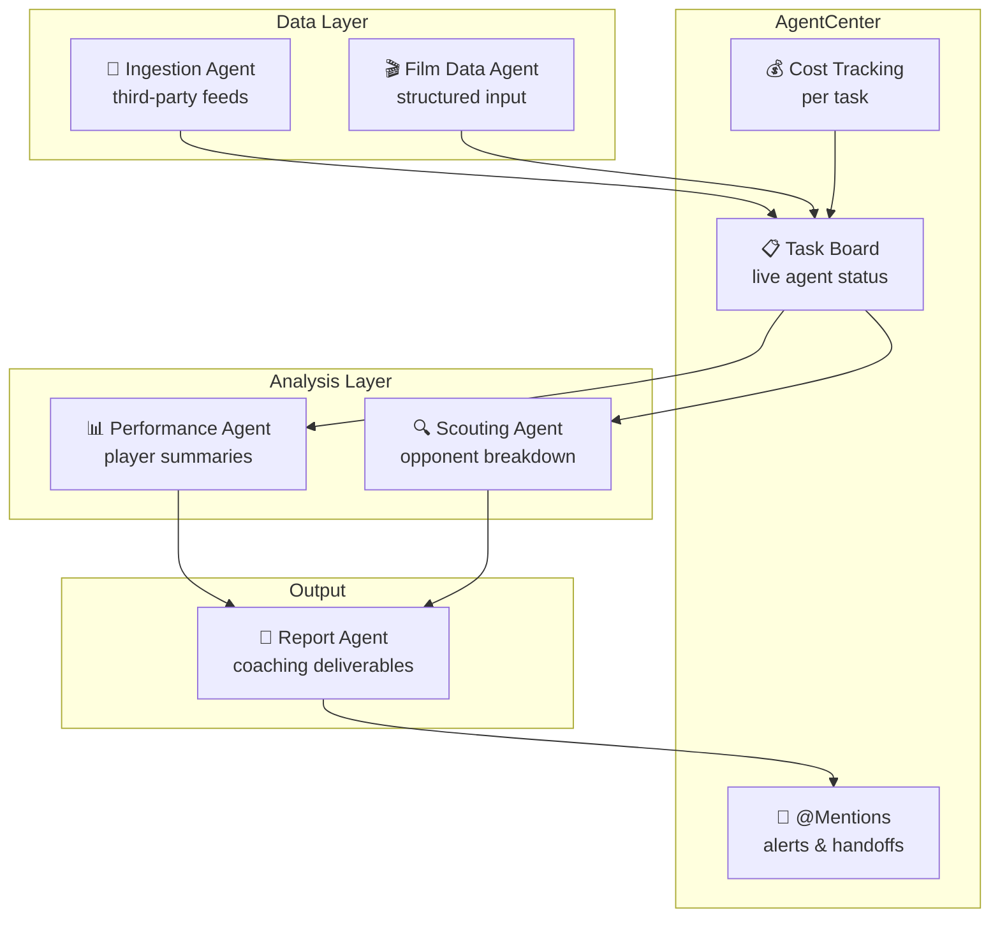

Sports analytics teams have been running AI longer than most people realize. Before "agents" was even the term, you had pipelines ingesting play-by-play feeds, computing shot quality models in real time, and generating post-game reports nobody had time to write manually.

Now those pipelines are actual agents. And the teams running them are hitting the same wall everyone hits when they scale past five or six: nobody really knows what's running, what it costs, or which one broke last Tuesday.

## The Real Problem Isn't the Models

The models are fine. The problem is coordination.

A typical mid-size analytics team runs agents across a few distinct workstreams at once. Game-day data ingestion agents pull from third-party feeds and normalize into internal schemas. Performance agents run on roster data between matches, generating weekly player summaries. Scouting agents process opposition film data — or at least the structured data that comes with it. And there's usually a catch-all reporting agent someone built six months ago that nobody fully remembers.

When one of those breaks, here's what happens. The error shows up as a missing report. Or a downstream dashboard that looks stale. Or a data scientist notices a number looks wrong and starts tracing it upstream manually. Three hours later, someone finds that the ingestion agent hit a rate limit on the third-party API and silently completed without full data.

This isn't a model failure. It's a visibility failure.

Three specific places it bites hard:

**Game-day timing.** You can't have a scouting summary agent stalled at kickoff. If it's blocked on upstream data and nobody sees it until 20 minutes into the match, you've lost the use case entirely. Real-time visibility into agent status matters in a way that no logging dashboard shows you clearly.

**Cascading data dependencies.** Your performance model agents consume output from your ingestion agents. If ingestion produces a partial dataset, performance agents complete successfully but on bad input. They don't know. You don't know. The numbers just quietly drift.

**Cost spikes on one-off requests.** When coaching staff asks for a fast opponent breakdown before a big match, someone kicks off an ad-hoc agent run. No budget visibility, no task-level cost tracking. Three days later you see a $400 token bill with no context for what triggered it.

## How AgentCenter Fits Into This Workflow

**Real-time agent status.** The kanban board in [AgentCenter](/features/agent-dashboard) shows every agent's current state: online, working, idle, or blocked. On game day, your data lead can see at a glance whether the ingestion agent completed before the scouting agent started. No log scraping, no asking around. If it's stuck, you know before it matters.

**Task dependencies that enforce order.** You can set the performance agent's task to depend on ingestion completing successfully. If ingestion produces an error or runs long, the downstream task stays queued. Nobody runs analysis on partial data because the control plane prevents it. The [task orchestration features](/features/task-orchestration) handle this at the workflow level, not in your agent code.

**@Mentions for human handoffs.** When the report agent finishes a pre-match scouting summary, it can trigger a mention to the analyst responsible for review. The deliverable lands in a task thread with context attached — what the agent ran, what inputs it used, where the output is. Review happens inside the tool instead of someone forwarding a Slack message with a file link and no explanation.

**Cost tracking per task.** Every agent run in AgentCenter logs token usage at the task level. When a coaching request triggers an ad-hoc opponent breakdown, that run is tracked separately. You see exactly what it cost. Over a season, you get cost data by task type and can make informed decisions about which agent runs are worth it versus which ones you should pre-compute and cache.

## The Numbers

A typical sports analytics team at a professional club runs somewhere between 8 and 20 agents in production across ingestion, performance modeling, scouting support, and reporting. The Pro plan at $29/month covers up to 15 agents across 15 projects. A larger analytics department with separate football, recruitment, and broadcast workstreams would fit the Scale plan at $79/month.

What it replaces: custom status dashboards built in Grafana or Retool, manual Slack pings for agent handoffs, per-project cost spreadsheets nobody keeps updated, and whatever ad-hoc logging setup the engineer who left six months ago had running.

## Before vs After AgentCenter

| | Without AgentCenter | With AgentCenter |
|---|---|---|
| **Visibility** | Check logs to know if agents ran | Live status on every agent in the board |
| **Task handoffs** | Manual Slack messages with file links | @Mentions trigger on task completion |
| **Error detection** | Analyst notices wrong number hours later | Blocked agent shows immediately on board |
| **Cost tracking** | Monthly token bill with no task context | Per-task cost visible in real time |
| **Debugging time** | 2-3 hours tracing a bad output upstream | Agent input/output logged per task |

## Where to Start

Set up the [agent monitoring](/features/agent-monitoring) view first. Before you add orchestration or dependency rules, you need visibility into what's already running. Import your existing agents, get them reporting status, and spend one week just watching them. You'll find at least one that's been silently failing — probably one you haven't thought about in months.

Once you know your agents are visible, add task dependencies for your main game-day pipeline. That one change — enforcing ingestion before analysis — removes the most common class of bad-data errors without touching a single model.

---

*Sports analytics teams that add a control plane early spend less time firefighting later. [Start your 7-day free trial](/pricing).*
