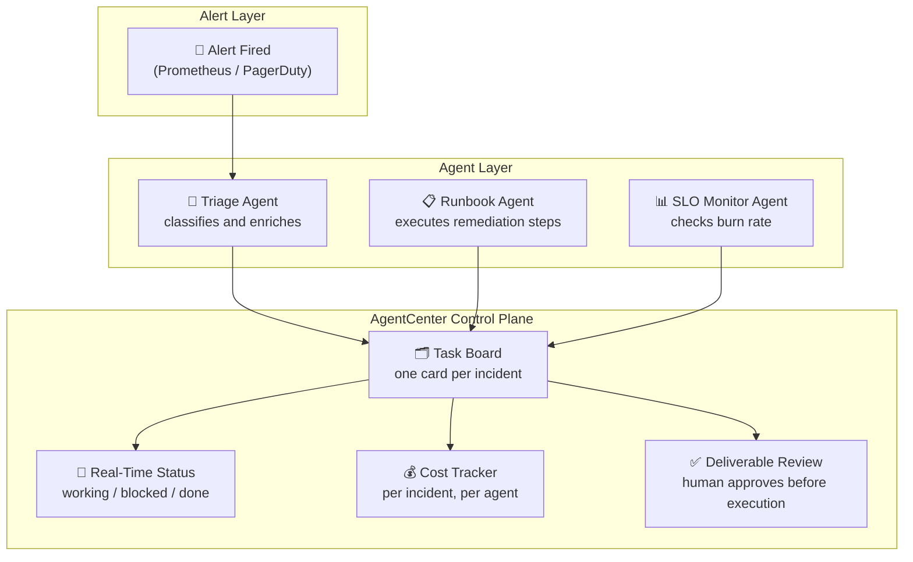

Your incident response agent went quiet 20 minutes into a P1. Is it working? Is it stuck? Did it finish and nobody noticed?

That's the SRE version of the AI agent problem. You've deployed agents to handle alert triage, run runbooks, check SLO budgets, and draft post-mortems. The automation is real. But without a control plane to manage those agents, you're flying blind during the moments that matter most.

## Why AI Agent Management Is an SRE Problem

SRE teams are a natural fit for agent automation. Alert triage, runbook execution, SLO burn rate checks — these are repetitive, logic-driven tasks with predictable inputs and outputs. AI agents handle them well.

The problem isn't running agents. It's knowing what they're doing while they do it.

Here are three things that break without a control plane:

**Agents disappear during incidents.** An LLM-backed triage agent processing alert context takes 3-8 minutes per task. During a P1, that's 3-8 minutes where your on-call has no signal: is it working, or did it silently fail? Most SRE engineers end up doing the triage manually anyway, because waiting on an opaque agent is worse than just doing it yourself.

**Duplicate pickup with no coordination.** If you have three agents watching different alert streams, there's nothing to stop them from all picking up the same correlated event. Without a shared task board, two agents can process the same incident simultaneously, produce conflicting runbook outputs, and make a bad situation worse.

**No cost visibility until the bill.** A major incident can trigger 200+ LLM calls across your agent fleet. You won't know what that cost until the monthly statement — and you can't break it down by incident, by agent, or by alert type.

## How AgentCenter Works for SRE Teams

### Real-Time Agent Status

AgentCenter shows each agent's current state: online, working, idle, or blocked. During a P1, your on-call opens the [agent dashboard](/features/agent-dashboard) and sees exactly which agent is mid-task — and what task it's on. No more guessing whether to wait or step in.

**What this looks like in practice:** Your triage agent picks up a database alert. The task card shows "Triage Agent — working" with a timestamp. If it's been sitting at "working" for 12 minutes on a task that normally takes 3, the on-call knows to check it immediately. Without this view, they'd wait 30 minutes before realizing the agent failed silently.

### Task Board for Incident Coordination

Each incoming alert gets a task card on the [task orchestration board](/features/task-orchestration). Agents are assigned to cards, not to alert streams. This prevents duplicate pickup — if Agent A is already working on incident #4432, no other agent will claim it.

The board also makes handoffs clean. When the triage agent finishes, the runbook agent picks up its output automatically. The on-call engineer can see the full chain without digging through logs.

### @Mentions and Threads Per Task

When an agent produces output that needs a human decision, you can @mention the on-call directly from the task thread. They get notified, see the agent's output in context, and respond — no separate Slack thread, no copy-pasting alert details.

### Deliverable Review for Runbook Outputs

SRE teams need human sign-off before an agent applies a fix to production. AgentCenter's deliverable review workflow holds agent output in a "pending review" state until an engineer approves it. Think of it as a `--dry-run` with a real human in the loop before anything executes.

This matters most for runbook agents that write to infrastructure. One wrong config pushed without review costs more than the time you saved.

### Per-Incident Cost Tracking

Every task card tracks the LLM cost of all agents that worked on it. After a major incident, you can pull up the card and see the breakdown: triage agent ran 24 calls, runbook agent ran 47 calls, SLO monitor ran 12 calls. Total: $2.14.

Over time, this data tells you which incident types are expensive to automate and which agents have costs that don't match the value they're returning.

## The Numbers for SRE Teams

A typical SRE team runs 6-12 agents in production:

- 1-2 alert triage agents (one per major alert source)
- 1 runbook executor agent
- 1 SLO burn rate monitor
- 1 post-mortem drafting agent
- 1-2 capacity or anomaly detection agents

That's a clean fit for the **Pro plan at $29/month** — 15 agents, 15 projects. Larger SRE organizations with dedicated agents per service will want **Scale at $79/month** for 50 agents and 50 projects. Full details at [agentcenter.cloud/pricing](/pricing).

AgentCenter replaces the combination of watching CloudWatch logs and hoping agents finish with a proper control plane — one view for status, handoffs, cost, and review.

## Before vs After

| | Without AgentCenter | With AgentCenter |
|---|---|---|
| **Visibility** | No way to tell if an agent is running or stuck during a P1 | Real-time working / blocked / done status per agent |
| **Task handoffs** | Agents can pick up the same alert twice | Task board assigns one agent per incident card |
| **Error detection** | Find out during the post-mortem | Blocked or failed status shows up immediately |
| **Cost tracking** | Monthly LLM bill with no per-incident breakdown | Per-task cost on every incident card |
| **Debugging time** | Recreate agent steps from memory or raw logs | Full audit trail in the task thread |

## Where to Start

Connect your primary alert triage agent first. Add it to a project in AgentCenter, point it at your main alert stream, and watch what happens during the next real incident. The status panel alone — seeing "working" vs "blocked" in real time — changes how your on-call team trusts and interacts with the agent.

Once that view is reliable, add your runbook agent and turn on deliverable review for any output that touches production systems.

---

*SRE teams that add a control plane early spend less time firefighting later. [Start your 7-day free trial](/pricing).*
