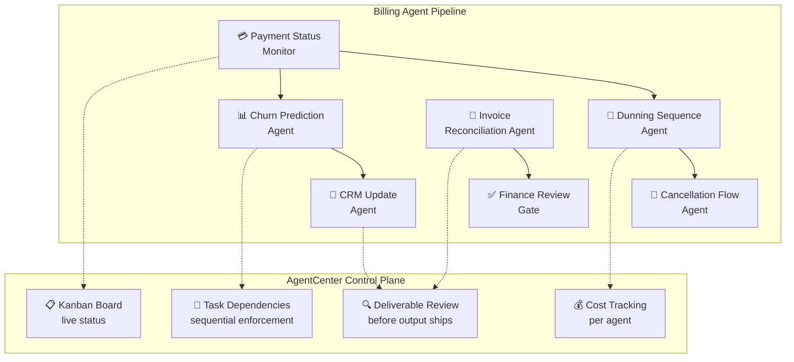

If your team runs AI agents for subscription billing — dunning sequences, churn prediction models, invoice reconciliation — you already know what Monday morning looks like. Somewhere between the dunning agent for monthly plans, the churn scoring model, and the overnight reconciliation job, something ran last night that you haven't confirmed yet.

The problem isn't the agents. They ran. The problem is that you have no idea which one produced useful output and which one quietly failed or ran into a bad input batch.

## The Specific Bottlenecks Subscription Billing Teams Hit

### Race conditions between dunning and cancellation

You have a dunning agent that sends retry emails for failed payments. You also have a cancellation flow agent that handles subscription termination requests. When they run without coordination, a customer can receive "We're retrying your payment" and "Your cancellation has been processed" within twelve minutes of each other.

This doesn't look like an error. Both agents completed successfully. But your support queue fills up because the customer is confused, and your churn numbers look wrong for that cohort.

### Silent failures in revenue reconciliation

Reconciliation agents are notoriously quiet when they fail. The agent runs, parses invoice records, generates totals, and writes the output to a file or database. No exception gets thrown. But if it missed a partial refund batch or misread a currency conversion, the output looks structurally correct while the numbers are wrong.

Finance teams often catch these by accident during a quarterly review — numbers looked slightly off — not because any alert fired.

### Churn scores that never make it downstream

Your churn prediction agent runs on schedule and scores 200 customer accounts. But the step that writes those scores to your CRM depends on an API call that started rate-limiting three days ago. The scoring agent logs success. The CRM shows stale scores from last week. Your account managers are working from outdated data.

The handoff failed. Nobody knew until someone checked manually.

## How Subscription Billing Teams Manage Agents in AgentCenter

### Real-time status on the Kanban board

The [AgentCenter dashboard](/features/agent-dashboard) gives you a live view of every agent's current state — running, idle, blocked, or completed. When you open the board on Monday morning, you see immediately that the churn prediction agent finished at 03:14, the dunning agent is idle, and the reconciliation agent is blocked on an upstream dependency.

You're not reading log files. You're looking at a board.

**Example:** The dunning agent for annual subscribers ran for 47 minutes and completed 312 tasks. Three tasks are marked blocked. You click in, see they're waiting on payment processor responses, and assign them to a human reviewer.

### Task dependencies that prevent race conditions

The [task orchestration features](/features/task-orchestration) let you configure agents so the cancellation flow can only start after the dunning sequence reaches a terminal state. No more simultaneous "we're retrying your payment" and "your account is closed" emails to the same customer.

**Example:** You set a dependency rule: the cancellation flow triggers only after the dunning sequence logs a final result — paid, cancelled, or exhausted retries. AgentCenter enforces this. The agents don't race anymore.

### Deliverable review gates before finance sees numbers

Before your reconciliation output reaches the finance dashboard, a reviewer can approve it in AgentCenter. You define which agents require a sign-off, and their output sits in a review queue until someone approves or flags it.

**Example:** The invoice reconciliation agent completes its run and submits a deliverable. Your finance analyst gets a notification, opens the output, checks totals against the previous month's baseline, and either approves or marks it for correction. Nothing goes to the dashboard until it's been reviewed.

### Per-agent cost tracking

Not all billing agents cost the same. Churn prediction using a larger reasoning model runs 6 to 8 times more expensive per task than the dunning email classifier. Without per-agent visibility, you're watching a monthly LLM bill go up without knowing which agent is responsible.

AgentCenter's [agent monitoring](/features/agent-monitoring) shows cost breakdowns by agent and project, so you know immediately where your token spend is concentrated and whether it makes sense relative to the work that agent is doing.

## The Numbers for Subscription Ops Teams

A typical subscription billing team runs 8 to 15 agents:

- 2 to 3 dunning sequence variants (monthly, annual, enterprise tiers)
- 1 to 2 churn prediction models
- 1 invoice reconciliation agent
- 1 to 2 upgrade trigger agents
- 1 cancellation flow agent
- 1 to 2 customer health scoring agents

The Pro plan ($29/month) supports up to 15 agents across 15 projects — enough for this full fleet without sharing quota across other teams. It replaces the combination of manual Slack check-ins, spreadsheet dashboards, and custom alerting scripts that most teams build once and then maintain forever.

## Before vs After AgentCenter

| | Without AgentCenter | With AgentCenter |
|---|---|---|
| **Visibility** | Check logs in each agent's environment separately | One Kanban board with live status for all agents |
| **Task handoffs** | Race conditions possible; no dependency enforcement | Dependencies configured; agents wait for upstream completion |
| **Error detection** | Silent failures caught accidentally during manual review | Blocked tasks visible on board; stalled agents flagged |
| **Cost tracking** | Monthly LLM bill with no per-agent breakdown | Per-task cost visible by agent and project |
| **Debugging time** | 2 to 4 hours tracing through logs when output looks wrong | Activity feed shows full task history; 20 to 30 minutes |

## Where to Start

Set up your reconciliation agent in AgentCenter first. It's the one where silent failures have direct financial consequences — wrong totals make it into real reports before anyone catches them. Add a deliverable review gate on its output, and connect the agent's run status to your Kanban board.

Once you see what visibility into a single agent actually feels like, the case for wiring up the rest of the fleet is obvious.

---

*Subscription billing teams that add a control plane early spend less time firefighting later. [Start your 7-day free trial](/pricing).*
