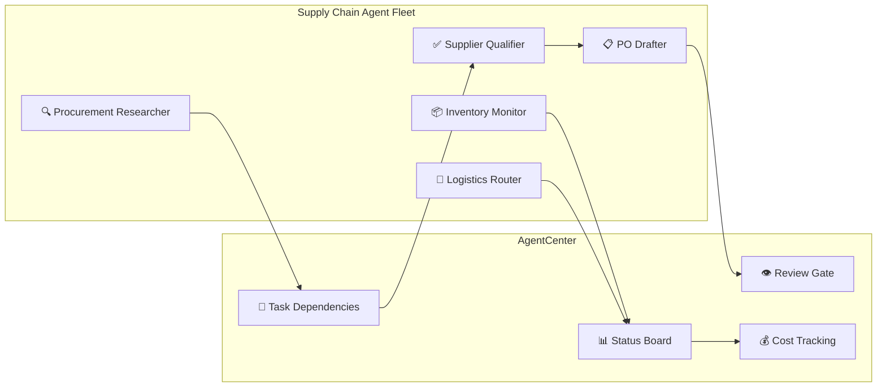

Running agents in a supply chain context is different from most software automation work. The agents aren't just reporting data. They're making decisions that ripple into inventory levels, purchase orders, and fulfillment queues. When one fails or produces bad output, the downstream cost shows up hours later, not immediately.

Most supply chain ops teams start with two or three agents: one watching inventory levels, one researching supplier quotes, maybe one flagging compliance issues in inbound shipments. Six months later they've got eight. Then twelve. And somewhere along the way, they lost track of what each one is actually doing on any given day.

That's the problem a control plane solves.

## Where Things Break Without a Control Plane

The failures don't look dramatic. That's what makes them expensive.

**Silent output drift.** An inventory monitoring agent that was accurately reporting stock levels starts producing numbers 10-15% off because a supplier changed their API response format. The agent doesn't crash. It keeps running. The discrepancy surfaces when a warehouse team reports a stockout on an item the system said was fully stocked.

**Broken task handoffs.** A procurement research agent finishes its work and is supposed to pass a supplier shortlist to a qualification agent. But the research agent failed halfway through, producing a partial list, and no dependency check was configured. The qualification agent runs on incomplete input. The resulting PO draft reflects partial data. Nobody catches the problem until someone reviews the draft manually, two days later.

**No cost visibility.** Eight agents running across your supply chain, and the only cost data you have is the monthly LLM invoice. Which agent is calling the model 400 times a day? Which one completes its tasks in two API calls? Without per-agent tracking, you can't make rational decisions about model selection or pipeline design.

## How AgentCenter Fits Into a Supply Chain Agent Workflow

### Real-Time Agent Status

Every agent in your fleet shows its current state on the [AgentCenter dashboard](/features/agent-dashboard): working, idle, blocked, or failed. You open the board and see that your inventory monitor has been in "failed" state for two hours. You catch it before the warehouse team runs their daily cycle count and gets wrong numbers.

Without this, you're waiting for the warehouse team to tell you something is off. With it, you're ahead of the problem.

### Task Orchestration with Dependencies

[Task orchestration](/features/task-orchestration) in AgentCenter lets you wire agents into a proper pipeline. Procurement research becomes a parent task. Supplier qualification is a child task that only starts when the parent completes successfully. PO drafting follows as the next step.

If the research agent fails, the chain stops. The qualification agent doesn't run on partial data. You get a failed task card on the board, not a bad PO in your ERP.

### Deliverable Review Workflows

When a supplier qualification report or logistics routing decision comes out of an agent, it shouldn't automatically go downstream without a check. AgentCenter's review workflows let you put a human-in-the-loop gate before specific task types proceed.

The agent submits its deliverable. A team member reviews it in the dashboard. It only moves forward when approved. For supply chain decisions that affect purchasing commitments or fulfillment routing, that gate matters.

### Cost Tracking Per Agent

The [agent monitoring](/features/agent-monitoring) view breaks down costs per agent and per task. You find out that your compliance checking agent costs $0.03 per run while your logistics routing agent costs $1.40. The routing agent runs 50 times a day. That's worth knowing, and it's not findable from a monthly invoice.

## The Numbers for Supply Chain Teams

A typical supply chain ops team running agents in production has:

- 8-20 agents across inventory monitoring, procurement research, supplier qualification, PO management, logistics coordination, and compliance checking
- A mix of always-on monitoring agents and task-triggered decision agents
- Multiple people who need to approve agent outputs before they affect purchasing or fulfillment

The **Pro plan** at $29/month handles up to 15 agents across 15 projects. Scale at $79/month covers up to 50. Most mid-size supply chain teams start on Pro and move to Scale as their automation expands.

What it replaces: spreadsheet status tracking, ad-hoc Slack messages between ops and engineering, manual log checking when something seems off, and end-of-month cost reconciliation that tells you nothing actionable.

## Before vs After

| | Without AgentCenter | With AgentCenter |
|---|---|---|
| Visibility | Check logs per agent when something seems wrong | Live status for every supply chain agent on one board |
| Task handoffs | Hope context passes correctly between agents | Enforced dependencies: downstream agents pause until upstream completes |
| Error detection | Noticed when downstream data quality fails | Alerts when an agent fails or stalls |
| Cost tracking | Monthly LLM invoice with no breakdown | Per-agent, per-task cost visibility |
| Debugging time | 2-4 hours tracing which agent failed and why | 15-20 minutes with audit trail and task history |

## Where to Start

Set up the status board first. Connect your inventory monitoring agent and your most active procurement or logistics agent. Run them for a week under AgentCenter's visibility.

After seven days, you'll have answers to questions you've been guessing at: How often does each agent actually complete successfully? Which one has the highest failure rate? What does each run cost?

That baseline is worth more than any tweaking you could do to the agents themselves. You can't fix what you can't see.

---

*Supply chain teams that add a control plane early spend less time firefighting later. [Start your 7-day free trial](/pricing).*
