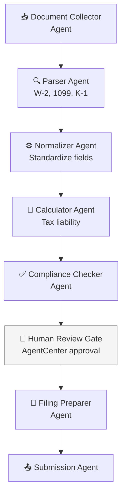

Tax season used to mean hiring temps and working weekends. Now it means deploying agents. Document parsers, calculation validators, compliance checkers, filing preparers — tax automation teams have gone from 2 agents to 15 in a single year.

The problem isn't the agents. It's knowing what they're doing.

When a W-2 extraction agent quietly starts misreading box numbers, it's not loud. No crash, no error message. It feeds wrong numbers downstream, and three steps later your filing preparer agent is generating returns with incorrect withholding figures. You find out when a client calls.

That's the problem with running a tax pipeline on loose agents: everything downstream trusts everything upstream. And you have no control plane watching the handoffs.

## What Breaks Without a Control Plane

Tax automation pipelines are long. A single client's return might touch eight agents: document collector, parser, normalizer, calculator, reviewer, compliance checker, preparer, and submitter. Each step passes data to the next. Each handoff is a failure point.

Here's what typically breaks first:

**Handoff failures go unnoticed.** The compliance checker finishes, but the preparer agent doesn't pick up the output because it's pointing at a stale task reference. Both agents show "complete" in your logs. The client's filing never happens.

**Errors compound before you see them.** If a parser agent misreads a 1099 on Monday, a dozen agents downstream have processed bad data by Friday. There's no breadcrumb trail showing where the error entered the pipeline. You debug from the output backwards.

**Peak-period cost spikes with no warning.** February through April, every client hits at once. Your calculation agent bills by token. Without per-agent cost tracking, you find out how bad it was when the billing cycle closes — not while you can still act on it.

## How Tax Teams Use AgentCenter

### Kanban Board for Pipeline Visibility

Each client filing becomes a parent task in AgentCenter. The agents working that filing each get a child task. The [Kanban board](/features/task-orchestration) shows you, in real time, where every client's return sits: Is it in parsing? Stuck at compliance? Waiting for human review?

Without this, you're pinging agents manually or reading logs to figure out where things are. With it, you see all 47 clients in flight, which step each one is on, and which have been idle for more than 30 minutes.

### Review Gates on High-Risk Steps

Tax automation isn't the place for fully autonomous pipelines. You want a human eye before a return gets submitted — especially for complex returns, amended filings, or anything over a certain dollar threshold.

AgentCenter's approval workflow lets you insert a human review gate between any two agents. The compliance checker submits its output, the task moves to "Pending Review," and a team member approves before the preparer runs. The gate is logged with timestamp and reviewer name, which matters when a client asks how their return was validated.

### @Mentions for Exception Handling

When a parser agent hits a document it can't read — a scanned PDF with rotated pages, a non-standard form — you want to know immediately. Agents can be configured to @mention a team member in the task thread when they hit an exception.

Instead of checking logs, you get a direct notification. You fix the document, the pipeline continues. No silent stall.

### Cost Tracking by Client and Phase

A useful question at the end of tax season: which client types cost the most to process? Complex returns with multiple documents? International clients with multi-form requirements? Basic W-2 filers?

AgentCenter's [agent monitoring](/features/agent-monitoring) gives you per-agent spend, which rolls up by project. Each client is a project. Each agent phase has a cost. At the end of the quarter, you know exactly where your AI spend went and which client segments are actually profitable to automate.

## The Numbers

A typical mid-size tax automation team runs 8 to 20 agents depending on how many client tiers they handle. Most teams in this range fit the Pro plan (15 agents, 15 projects) during steady periods and upgrade to Scale (50 agents) during peak season.

See [pricing](/pricing) for the full plan breakdown.

What it replaces: ad hoc Slack threads for tracking filing status, a shared spreadsheet of which clients are "done," and manual log reviews to find where something got stuck.

## Before vs After

| | Without AgentCenter | With AgentCenter |
|---|---|---|
| **Visibility** | Check logs per agent to find filing status | Kanban shows all clients and pipeline stage in real time |
| **Task handoffs** | Agents pick up outputs independently; silent misses happen | Task dependencies enforced; preparer won't run until compliance approves |
| **Error detection** | Found when client calls or submission fails | Parser exceptions surfaced immediately via @mention |
| **Cost tracking** | Monthly billing statement with no breakdown | Per-client, per-phase cost tracked throughout the season |
| **Debugging time** | 2 to 4 hours tracing backwards from bad output | Execution history shows exact step where error entered pipeline |

## Where to Start

Set up the Kanban board for one client type first. Map the agents in that pipeline to tasks, set task dependencies so each step waits for the previous one, and run five test filings through it. You'll find handoff gaps you didn't know existed.

Once the dependencies are working, add the review gate between the compliance checker and filing preparer. That single gate catches most of the errors that make it to submission.

From there, add recurring tasks to automate intake creation at the start of each new filing period.

---

*Tax automation teams that add a control plane early spend less time firefighting later. [Start your 7-day free trial](/pricing).*
