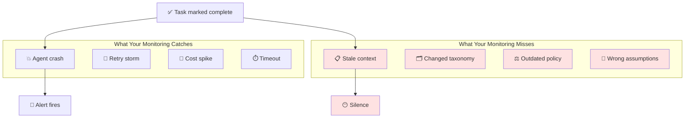

Twelve tasks. Zero errors. All completed.

That was our agent dashboard last Tuesday. The agent had been running for three weeks without a single failure. No retries, no timeouts, no cost spikes. Clean.

Then someone on the marketing team read through the outputs. The agent had been categorizing leads using a segmentation framework the company retired six weeks earlier. Every task succeeded. Every output was wrong.

## The Problem With Silent Correctness

Code fails loudly. An exception propagates. A test breaks. A status page goes red. You know something happened.

Agents fail quietly. They don't throw exceptions when they work from stale context. They don't retry when they misunderstand the task. They complete the work, mark it done, and move on. The only signal that something went wrong is the output — and if no one reads outputs regularly, you have no signal at all.

This isn't an observability gap in the traditional sense. You can have full [agent monitoring](/features/agent-monitoring) — latency, token usage, error rates, retry counts — and still miss this entirely. The failure isn't in execution. It's in what the agent knew when it started.

## What Agents Don't Know They Don't Know

There's a category of agent failure that doesn't look like failure. The agent:

- Has context from when it was set up, not from now
- Works from task instructions that made sense three months ago
- References internal categories or frameworks that have since changed
- Doesn't know that the team convention it's following was updated last week

The agent isn't malfunctioning. It's executing perfectly — against the wrong target.

We've hit this pattern three times in the last six months:

1. A research agent summarizing competitor updates from a list of sources that hadn't been reviewed since we added two new competitors.
2. A content tagging agent using category IDs from a legacy taxonomy after we migrated to a new system.
3. A contract review agent checking for clauses based on legal templates from before a policy change.

Each one produced outputs that passed every automated check. No errors. No slow runs. No anomalies in the metrics. The only way we found them was by reading the work.

## Why This Is Different From a Bug

When you find a bug in code, you fix the code and redeploy. The root cause is in the system.

When an agent fails this way, the root cause is in the context — the information the agent had access to when it ran. And context isn't versioned the way code is. It drifts. It ages. It goes stale in ways that nothing in your pipeline will tell you about.

This makes the failure mode different from what most engineers are used to debugging. There's no stack trace. No line to fix. The agent did exactly what it was told. The problem is that what it was told stopped being accurate.

You can't alert on stale context. You can't write a test that catches it before it happens. You can only catch it by looking at the work.

## The Two Habits That Catch It

We do two things now that we didn't do before.

**Output sampling.** Every week, someone on the team reads through a random sample of agent outputs — not looking for errors, but checking whether the work makes sense given current context. This takes about 20 minutes for a team running 8 agents. It's caught more problems than our alert rules have.

**A context review calendar.** Every agent that runs recurring tasks has an entry in our calendar: a monthly prompt to check whether the instructions, sources, and taxonomy are still current. Not because they'll always need updating, but because someone actively asks the question.

Neither of these is a technical solution. They're habits.

[AgentCenter's features](/features) make the first habit easier — you can set up deliverable review gates that route agent outputs to a human before they move forward. It's not a fix for stale context, but it creates a forcing function for the reviews you should be doing anyway. When a task is waiting for review, someone actually reads it.

## Who This Hits Hardest

Teams running agents on recurring tasks without regular output reviews. This is the exact situation where the problem compounds: the agent runs daily, produces outputs that look fine in the dashboard, and no one reads the work closely until something downstream breaks.

If you set up an agent once and left it running, this is your risk category. The agent works. But "works" just means the execution completed. It doesn't mean the outputs are still useful.

Solo founders and small teams get hit hardest here because there's no one downstream to notice the drift. The agent runs, the queue stays empty, and nobody realizes the work has been quietly wrong for weeks.

## The Honest Caveat

There's no complete fix for this. You can build context refresh workflows, set up review gates, add scheduled audits — and an agent will still occasionally run from assumptions that have quietly become wrong.

The goal isn't zero drift. It's catching drift before it compounds. And the thing that catches it isn't better monitoring. It's a human reading the work.

AI agents aren't static. The context they depend on changes. The teams using them change. The products they're operating on change. Treating an agent as a one-time setup that runs forever is where this pattern starts.

---

*The dashboard won't fix a broken agent. But it will tell you which one is broken at 3am. [Try AgentCenter free](/pricing).*
