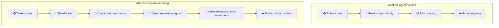

Six weeks after deploying their first agent, a support team was spending more time per ticket than before.

The agent was routing incoming support tickets: reading the subject line and first two sentences, picking a category, dropping it into the right queue. It was right about 85% of the time. The team was proud of that number. Then they looked at what the support reps were actually doing each morning.

Reps were opening tickets from queues that weren't theirs. They were re-routing them manually. They'd started keeping a spreadsheet on the side because they didn't trust the category labels. When someone asked why, the answer was: "The agent doesn't know what happened last week with this customer."

That's the failure mode nobody talks about when planning a first agent deployment.

## The Agent Did Its Job. The Workflow Didn't.

The agent was doing the visible part of the work: read the ticket, pick a category, route it to a queue. That's exactly what it was built to do.

But the human who used to handle that step was also doing something else. When a ticket came in from a customer who had complained three times that month, the human recognized it. They'd route it differently. Maybe flag it for a senior rep, or escalate immediately instead of waiting for the standard queue. That judgment wasn't written down anywhere. It wasn't in a spec. It just happened, invisibly, dozens of times a day.

The agent had no access to that context. It routed everything the same way: 85% correct by category, and created downstream problems that took longer to fix than the routing itself would have.

The technical part worked. The workflow design didn't.

## Three Places Where the Work Piled Up

**The review queue nobody planned for.** Once reps started doubting the routing, they added a buffer step: check the ticket before working it. That pass added 10 to 15 minutes per rep per day. Across a team of 12, that's two hours of daily overhead that didn't exist before the agent.

**The context gaps that reached customers.** A follow-up complaint arrived from a customer who had contacted support twice that month. The agent read it as a first-time inquiry and routed it to a general queue. The rep who received it had no history. They gave a standard first-contact response. The customer escalated to a manager. Three people worked the issue that one person would have caught at the routing step.

**The shadow spreadsheet.** Someone on the team started a shared doc to track tickets the agent got wrong. Four weeks later it had 80 rows and three people were updating it daily. The team had rebuilt a manual categorization system alongside the agent, not instead of it. The overhead doubled.

None of this was the agent failing. The agent ran fine. The problem was that the workflow assumed the agent would capture everything humans were doing. It captured the visible part.

## What to Actually Do Before You Deploy

Map the invisible work first. Before an agent takes over a task, list every decision the human makes that isn't in the job description. Customer history. Escalation signals. Relationship context. Edge cases learned from months of experience. That list tells you what the agent won't handle, and what you need to design for separately.

Build structured review from day one. An informal review process (where reps check routing because they don't trust it) costs more than a formal one. If you know 15% of decisions will need a second look, build that into the workflow at the start. Tools like [AgentCenter's task orchestration](/features/task-orchestration) let you automatically route flagged outputs to a review queue so oversight is structured, not improvised. Ad-hoc oversight tends to grow invisibly until someone notices it's consuming half the team's time.

Measure the adjacent work, not just accuracy. 85% accuracy sounds good. "How many hours are reps spending on re-routes and corrections?" tells you whether it's net positive. Those two numbers often don't match.

Set a review budget before you ship. If correcting the agent's 15% takes more effort than doing the task manually, you don't have an automation win. You have a new step in the process. Knowing that number before deployment is the difference between a planned rollout and an incident you discover six weeks later.

## Who Gets Hit By This Most

Team leads who deploy an agent into someone else's workflow. You understand the task. You might not know all the judgment that surrounds it.

Engineers who hand off to ops. The agent works in staging because staging has clean inputs and no history. Production has both, plus six months of customer context that the agent has never seen.

PMs whose agents are technically working but whose downstream teams are quietly complaining. The signal is a new spreadsheet or a new Slack channel that appeared after the agent went live. Someone rebuilt coordination work manually that didn't exist before the deployment.

Product teams who measure the agent in isolation. Task completion rate, category accuracy, routing speed. None of those metrics show you the review burden, the shadow documentation, or the escalations that slipped through.

## The Honest Part

Agents can reduce workload significantly when the workflow is properly designed. The teams that get this right spend time before deployment asking one question: "What breaks downstream if this is wrong 15% of the time?" They design for that answer. They build [review gates](/features/agent-monitoring) and approval workflows from the start, not after the complaints come in.

The fix isn't always a better agent. Sometimes it's a better workflow design around the agent you already have. And the invisible work your humans are currently doing? That's not in any requirements doc. You have to go find it.

---

*The dashboard won't fix a broken agent. But it will tell you which one is broken at 3am. [Try AgentCenter free](/pricing).*
