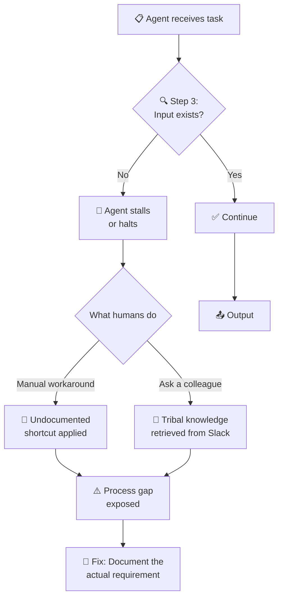

We gave an agent a task we'd done manually for two years. It failed in 20 minutes.

Not because the model was wrong. Not because the prompt was bad. It failed because the process we handed it was held together by informal rules nobody had written down. Three people on the team each did the step slightly differently. One person used a spreadsheet that only they had access to. Another applied a mental filter at step 4 that had never been documented.

The agent exposed all of it.

## What teams mean when they say a process works

When humans run a process manually, they paper over gaps. They ask each other questions on Slack. They skip steps they know are redundant. They apply judgment calls so quickly those decisions don't register as decisions.

That process "works" in the sense that it produces output. But it was never a real process. It was a collection of habits, workarounds, and muscle memory.

Hand that to an agent and you get an instant audit. The agent doesn't skip redundant steps. It doesn't ask for help when it's stuck. It follows the instructions you gave it, which turn out to be 40% of the actual instructions needed.

## The three failure modes

Here is what shows up most often when an agent reveals a broken process:

**Missing preconditions.** The agent gets to step 3 and the required input doesn't exist yet. Humans knew to go get it first. Nobody wrote that down.

**Undocumented exceptions.** "Send approval unless it's a weekend or under $500." The agent sends approval at 11pm on a Saturday for $300. Humans knew not to. The agent didn't.

**Process debt moved upstream.** The agent faithfully executes step 7, but step 7 was created to fix a problem in step 2 that nobody ever addressed. Humans worked around it. The agent amplifies it.

None of these are model failures. They're process failures that the agent made visible.

## What to do with the failure

The wrong response is to patch the agent prompt.

Adding exceptions and edge cases to a prompt is the same as adding them to the broken process. You've moved the debt somewhere harder to see. Three months later you have a prompt with 40 edge cases that nobody can read and everyone is afraid to change.

The right response is to fix the process before you fix the agent.

That means:
- Writing down the preconditions for the task to start
- Documenting the exceptions, not hiding them in the prompt
- Finding the upstream problem that caused the downstream workaround

Most teams skip this. They patch the prompt and ship. The agent runs fine for two weeks, then hits a new exception nobody anticipated, and the cycle starts again.

## What this looks like in practice

A team we know ran a contract review agent. It failed on a specific contract type they hadn't anticipated. The first instinct was to add a "skip if type = vendor amendment" rule to the prompt.

But they dug in. The reason vendor amendments were different came down to a missing approval step that happened outside the documented process, in email. The agent had found a compliance gap their manual review was hiding.

Patching the prompt would have hidden it again.

They fixed the process instead. The agent now catches vendor amendments and routes them correctly, because the rule is documented and the agent can follow it.

[Agent monitoring in AgentCenter](/features/agent-monitoring) shows you where agents stall, loop, or fall back to defaults. That failure map is a process audit. The spots where agents struggle most are the spots where your process documentation is thinnest.

## What to take away

Run your process on paper before you give it to an agent.

Not a flowchart. Not a high-level summary. The actual steps, in order, with the preconditions listed, with the exceptions named.

If you can't write that down in an hour, the process isn't ready for an agent. The agent will find every gap you couldn't name.

That's useful, not a disaster. The audit is free if you treat failures as information instead of blocking issues.

## Who this matters most for

Teams automating processes they've run manually for more than six months. Those processes have accumulated informal knowledge that's invisible to any new participant, human or agent.

If your team's answer to "why do we do it this way?" is "because we always have," the agent is going to struggle. And the things it struggles with are worth knowing.

## Honest caveat

Not every agent failure reveals a process problem. Sometimes the model genuinely doesn't have enough context. Sometimes the prompt is the problem.

But in our experience, when an agent fails consistently on a specific type of task, the process explanation is the more common one. It's worth ruling it out before you reach for prompt engineering.

AgentCenter shows you where failures cluster across your agent fleet. That pattern, across many tasks, is more diagnostic than any single failure. It's not magic. It's just a cleaner view of what's breaking and where.

[Start with the free trial](/pricing) if you want to see your own process gaps before they become production incidents.

---

*The dashboard won't fix a broken agent. But it will tell you which one is broken at 3am. [Try AgentCenter free](/pricing).*
