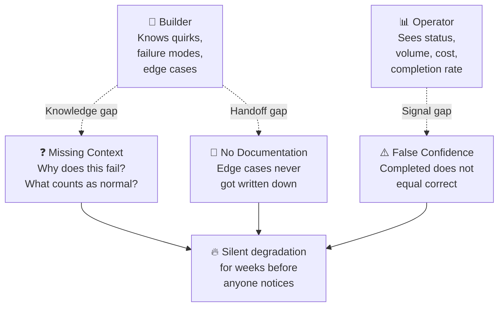

Six months ago, one of our engineers built the research AI agent. She knew everything about it in production. She knew it needed a 45-second timeout on the first API call or it would hang. She knew the output format changed if you gave it more than 3 documents at once. She knew that on Mondays, the source API returned rate limit errors that looked like content errors.

She built it, tested it, handed it off, and moved on to the next thing.

Three months later, the agent started failing about 8% of the time. Nobody knew why. The person monitoring it had never spoken to the person who built it. A ticket got filed. The ticket sat for four days before it reached the right person.

That's the builder-operator split. It's coming for every team that runs AI agents at scale.

## What the Split Looks Like

In the early days of any agent project, the person who builds the agent is the same person who monitors it. They know the quirks. They catch the failures. They fix things without creating a ticket.

Then the team grows. The agent becomes a dependency. Other workflows attach to it. Someone moves to a new project. You end up with 12 agents running, built by 6 different engineers, and the team monitoring them wasn't involved in any of those original builds.

Traditional software has always had this pattern. With AI agents it's sharper for two reasons.

First: agent failure modes are harder to document than code failure modes. Code fails at a specific line. An agent fails because of context, input shape, output interpretation, external API behavior, or a combination of factors that only becomes visible after you've watched it run 500 times. The builder carries that knowledge. When they move on, it goes with them.

Second: the gap between what an agent looks like it's doing and what it's actually doing is wider than with code. A function either returns or it doesn't. An agent returns *something* whether or not that something is right. The operator sees a completed task. The builder knows which completed tasks to trust.

## The Three Gaps That Actually Hurt You

**Knowledge gap.** The operator doesn't know what normal looks like for this specific agent. They can't tell when it starts drifting. They set up a completion rate alert. The agent completes. The alert stays green. But the outputs have been subtly wrong for three weeks. [Agent monitoring](/features/agent-monitoring) can surface anomalies in cost, latency, and volume, but it can't surface the domain knowledge the builder never documented.

**Signal gap.** Builders often know which metric actually matters for their specific agent. "Watch the output length. If it drops below 200 tokens, something's wrong." That observation never made it into the dashboard because it was never written down. Generic monitoring catches generic failures. Idiosyncratic failure modes stay invisible.

**Handoff gap.** When the builder eventually gets pulled into a failure, they spend the first 20 minutes re-explaining context that should have been documented from day one. The fix takes 10 minutes. The explanation takes an hour. Multiply that across a team with a dozen agents and this tax compounds quickly.

## What Teams Usually Try (And Why It Partially Works)

The default response is documentation requirements. Write a runbook. Fill in the agent profile. Add a README.

This helps, but it's incomplete. You're asking builders to document edge cases they won't fully remember until the edge cases actually happen. The first version of any runbook is always missing the thing that will eventually break.

A few practices that work better in combination:

**Shared monitoring from day one.** The builder should be watching the [same dashboard](/features/agent-monitoring) as the operator during the first two weeks in production. Not to fix things, but so knowledge transfer happens in real time as failures surface. When the builder says "oh that's normal, it does that when..." that's the moment you write it down.

**Agent-specific health signals, not just completion rates.** Every agent should have at least one metric the builder defined as the signal for "this is actually working right." Completion rate is the baseline. What's the builder's proxy for output quality?

**A 30-minute handoff conversation before the first production incident.** Record it or write it up. Cover the three most common failure modes, what normal output looks like, and who to call if something goes sideways. This conversation is worth 3 hours of debugging later.

## Who This Matters Most For

If you're the tech lead on a team running more than 5 agents in production, you're probably already in this situation. Some of those agents were built by people now on different projects. Some of the monitoring is done by engineers who didn't build any of them.

The split also hits fast-moving teams hard. You build an agent in a sprint, deploy it, and immediately move to the next thing. Six weeks later something breaks. Nobody's entirely sure who built it or what it was supposed to do.

The answer isn't slowing down. It's making the knowledge transfer part of the deployment process, not an afterthought.

## The Honest Caveat

A tool like [AgentCenter](/features) gives operators visibility into what's running: status, cost, output volume, task history. That's useful context. But it can't fill in the gap between what a builder knows and what an operator knows. No dashboard can tell you that Monday rate limit errors look like content errors on this specific data source.

That transfer happens between people. The tool just makes it easier to notice when the transfer hasn't happened yet, because you can see exactly when agent behavior changes.

---

*The dashboard won't fix a broken agent. But it will tell you which one is broken at 3am. [Try AgentCenter free](/pricing).*
