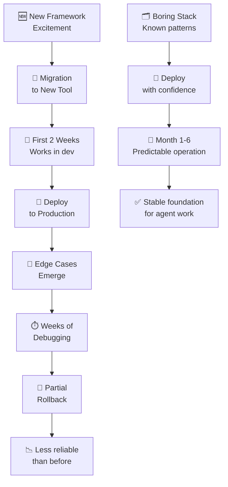

There's a lot of excitement about new AI frameworks, new model architectures, new orchestration patterns. Every week brings something that sounds like it'll change how you build agents.

The teams I've watched run agents reliably in production for 12+ months are not the ones chasing the newest thing. They're the ones running boring infrastructure.

## What Boring Infrastructure Actually Is

Boring infrastructure is infrastructure where you already know what it does, where it fails, and how to fix it when it does. Postgres is boring. S3 is boring. A task queue that's been running for two years without an incident is boring.

Boring is not the same as simple. Boring means predictable.

New is exciting. New is also unproven. You don't know where the edges are. You don't know what the failure modes look like at scale. You don't know whether the team that built it will still be working on it in six months.

This matters for AI agent infrastructure because the rest of your system — the products, the customers, the business processes — depends on the agents working reliably. Experiments in the agent layer ripple through everything downstream.

## The Failure Pattern

I've seen this play out enough times to call it a pattern. Team gets excited about a new framework. Migrates their agents to it. The framework is genuinely impressive — the new features are real and the demos are good.

Then it hits production. Edge cases the docs don't cover. Upgrade breaks something. The GitHub issue queue has three unresolved bugs that affect them. The maintainer is "looking into it." Three weeks of instability, debugging, and partial rollbacks. The agents are less reliable after the migration than before.

This isn't a criticism of any specific tool. It's what happens when you adopt software before the operational patterns are established.

## What This Looks Like for AI Agents

For agent infrastructure specifically, "boring" means:

**Standard task queue, not a custom orchestration framework.** A reliable message queue you've run before is more trustworthy than a brand-new AI-specific orchestration library, even if the new library has more features.

**Pinned model versions.** Choose a model. Pin the version. Update deliberately, not automatically. Yes, you'll miss the latest improvements for a few weeks. You'll also avoid the situation where your agent's behavior changed because the provider updated the default and you weren't watching.

**Fixed prompts, version-controlled.** Treat prompts like code. They live in your repo. Changes go through review. You can see the diff between what ran last week and what's running now.

**A control plane you understand.** Whether that's AgentCenter or something you built, you should be able to answer "what is each agent doing right now" without digging through logs.

## The Performance Trap

There's a common objection: boring infrastructure means slower performance, fewer features, competitive disadvantage. This is usually wrong.

In my experience, the teams with the most capable AI agents are not the ones with the most sophisticated infrastructure. They're the ones who spent their engineering time on agent design, prompt quality, and task structure — because their infrastructure was stable enough not to require constant attention.

Boring infrastructure frees up engineering time for the work that actually differentiates your product.

## What the Reader Should Take Away

Three habits that make agent infrastructure boring (in the good way):

1. Choose tools that have been around for at least a year and have a known failure profile
2. Pin versions aggressively — models, libraries, everything
3. Don't migrate infrastructure when things are working; batch changes and do them deliberately

## Who This Matters Most For

This matters most for small engineering teams that don't have dedicated infrastructure or MLOps roles. When there's one person responsible for both building agents and keeping them running, stability isn't optional. Every hour spent chasing a framework bug is an hour not building something useful.

## Honest Caveat

Boring infrastructure can become technical debt if you never update it. The point isn't to never change anything. It's to change things deliberately, when you have time and capacity, not reactively when something breaks.

_The dashboard won't fix a broken agent. But it will tell you which one is broken at 3am. [Try AgentCenter free](/pricing)._
