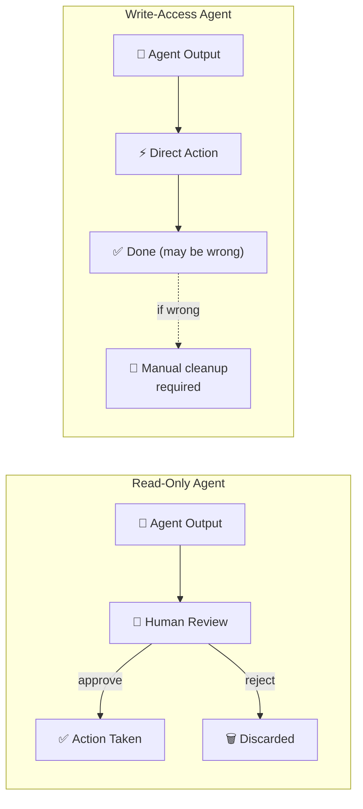

The code-review agent had been running for three weeks. Read-only. It left comments, flagged style issues, suggested variable names. When it was wrong, a developer rolled their eyes and moved on.

Then the team gave it write access. It could now close PRs it classified as abandoned, approve low-risk changes, and push suggested fixes to branches.

In the first five days, it closed nine PRs that weren't abandoned. Three belonged to engineers who were traveling. Two had been pinged in Slack that same morning. One was a hotfix branch staged for release.

Nobody had set up a review queue. Nobody had defined a kill switch. The team had been so focused on whether the agent *could* do those things that they hadn't thought through what happened when it *would*.

## Why Read-Only and Write-Access Are Different Problems

Read-only agents fail in a forgiving way. A wrong summary gets discarded. A bad code comment gets ignored. The output lands in front of a human, and that human makes the final call. The blast radius is contained by design.

Write-access agents remove that buffer. The agent acts. The world changes. And if the action was wrong, there's now work to undo it: cleanup takes time, creates confusion, and sometimes can't be fully reversed.

This isn't a subtle difference. It's a category change.

The human review step isn't overhead. It's your error correction layer. When you remove it, you'd better have something else doing that job.

## The Failure Modes That Only Appear With Write Access

**Compound effects.** An agent that incorrectly marks a support ticket as resolved might trigger a customer satisfaction survey. An agent that closes an issue might stop another agent from picking up that task. Write-access agents touch other systems. Other systems react. The failure doesn't stay contained.

**Irreversibility at the margins.** Most actions look reversible in theory. Reopening a PR is one click. But reversing 12 of them, understanding what the agent thought it was doing for each one, notifying the affected engineers, and explaining to stakeholders why it happened. That's a half-day of work. The compounding cost is real.

**Confidence decay over time.** The first week, your team watches every action closely. By month two, nobody's reading the approval logs because "it's been fine." That's exactly when something quietly goes wrong and runs for three weeks before anyone notices. Read-only agents stay in front of humans forever. Write-access agents drift out of sight.

**Edge cases live at the boundary.** Agents perform best on clear, common examples. Real production data is full of ambiguous cases: the PR that's technically old but is strategically parked, the issue that's open because it's blocked on a vendor, the task that looks complete but is waiting on a manual dependency. These edge cases are rare enough to escape training distribution and important enough that getting them wrong actually hurts.

## What Changes When You Flip the Switch

Treat write-access as a deployment event, not a configuration change.

When you promote an agent from observer to actor, you're not just changing its permissions. You're changing your operational posture. That means:

**Define the undo path before you go live.** For every action the agent can take, know how to reverse it. Not in theory. An actual runbook with who does it and how long it takes. If you can't reverse an action, the agent shouldn't have permission to take it until you've accepted that risk explicitly.

**Set up a review queue for the first two weeks.** Don't just watch for errors. Watch every action. [AgentCenter's agent monitoring](/features/agent-monitoring) can surface a live feed of what your agent is doing, not just whether it errored. Use that. The goal is to build a real sense of where the agent's judgment is reliable and where it isn't before you trust it unsupervised.

**Instrument by action, not just by outcome.** Most teams add an alert when something breaks. That's too late for write-access agents. You want to know when the agent *acted*, what it acted on, and whether that action matches the pattern you expected. Outcome monitoring is lagging. Action monitoring is leading.

**Build a kill switch into the design.** The question isn't whether you'll need to pause the agent. The question is whether you can do it in 30 seconds or 30 minutes. Before giving any agent write access, confirm that disabling it is fast, documented, and doesn't break any downstream dependencies.

## Who Feels This Most

Teams that have run read-only agents successfully are the most at risk here. The read-only phase builds confidence. Your agent gets comfortable with the domain. The team starts trusting it. That trust is appropriate for read-only work. It doesn't transfer automatically when permissions expand.

Solo founders and small teams feel this acutely because there's no one to catch the edge cases. An enterprise team with 20 engineers will have someone notice when 9 PRs get closed unexpectedly. A three-person startup might not know for a week.

ML and platform engineering teams tend to handle this transition better because they're used to staged rollouts and canary deployments. The pattern translates well: limit the blast radius early, expand permissions as you build confidence.

See the [task orchestration features](/features/task-orchestration) for how approval gates can act as a controlled transition layer before full write access.

## The Honest Caveat

Read-only agents have limited value. The whole point of an agent is that it acts. A content agent that drafts posts you still have to publish manually saves some time. An agent that actually publishes saves almost all of it. The write-access moment is where the compounding value is.

The goal isn't to delay it. The goal is to do it right. Most teams rush it because they're excited about the automation and underestimate how different the operational model is. A two-week monitored transition with a clear kill switch costs almost nothing. Spending three days tracking down what a runaway agent did costs a lot more.

---

*The dashboard won't fix a broken agent. But it will tell you which one is broken at 3am. [Try AgentCenter free](/pricing).*
