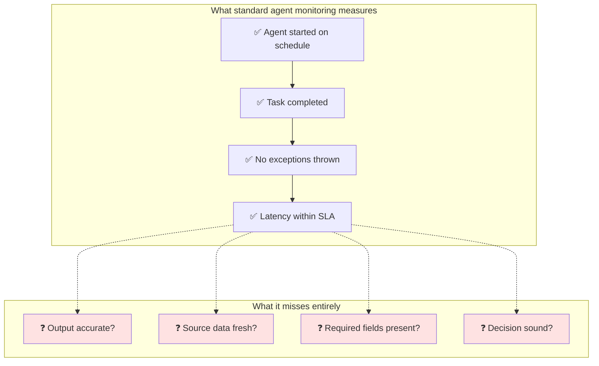

Three months into production, our dashboard looked perfect. Every agent: green. Latency: within SLA. Error rate: under 1%. Our agent monitoring setup showed no alerts, no spikes, nothing to investigate. The team moved on to building new things.

Then a product manager forwarded an email. A customer flagged that the competitor analysis reports our agents generated every week had been repeating stale data for six weeks. The agent was running. It was completing tasks. It was pulling from a cached data source that had stopped refreshing. Nobody noticed because every run finished clean.

Green. Every single time.

## Status and quality are not the same signal

This is the gap that catches teams off guard: your monitoring tracks whether agents are *running*, not whether they're *working correctly*.

An agent that starts on schedule, completes within 30 seconds, and exits with status 0 will show green on every standard health check. It doesn't matter if the output is wrong, stale, or missing half the information it was supposed to include.

Health checks confirm liveness. They say nothing about correctness.

## Three places quality slips past green

**Stale data sources.** Your agent runs fine. The API it calls runs fine. But that API is returning data cached three weeks ago. The agent processes what it receives and marks the task complete. Your dashboard logs a successful run. The output is worthless.

**Format drift.** An upstream agent changes its output structure slightly. Your downstream agent can still parse most of it — it doesn't crash. It generates a report with a few key fields silently dropped. The run is green. The report is incomplete. Someone downstream acts on it anyway.

**Prompt sensitivity.** A small context change — an updated system prompt or a new document added to the retrieval pool — shifts how your agent interprets its task. Outputs change in subtle ways. No errors. No latency spike. Just quietly different answers than the ones your team validated two months ago.

None of these show up as red on a standard dashboard. They're invisible until a human notices something feels wrong, or worse, until a customer does.

## What green actually tells you

When an agent shows green, it means:

- The process started
- It ran within the timeout
- It didn't throw an unhandled exception
- It returned a clean exit code

That's it. Green says nothing about the decisions the agent made, the sources it drew from, or whether the output would survive a five-minute review by someone who knows the domain.

Teams learn to conflate these things, especially in the first few months. The dashboard is calming. Everything's green. They stop checking outputs manually because the system looks stable.

But stability of operation and quality of output are not correlated. An agent can be perfectly stable and producing garbage. The two metrics don't talk to each other.

## The review habit that catches drift early

The teams that catch quality problems early share one pattern: a human looks at actual agent output regularly, not just the logs or the status board.

Not every output. Not a full audit every week. But someone reviews a sample of what agents actually produced — the deliverable itself, not the metadata around it.

In AgentCenter, the [deliverable review workflow](/features/task-orchestration) supports this directly. When an agent submits output, you can route it through a review step before the task closes. New agents go through 100% review while you build confidence. Established agents drop to spot-check frequency. Either way, you have a queue of real outputs and a record of what passed review and what didn't.

Combine that with [agent activity monitoring](/features/agent-monitoring) and you get two distinct signals: is the agent running, and is the agent producing work worth keeping. Both matter. Neither replaces the other.

The review queue also surfaces patterns. If the same output problem appears across multiple runs, it's a systemic quality issue, not a one-off. You can see that in AgentCenter before it becomes a customer complaint.

## Who this hits hardest

Teams running agents that produce reports, summaries, analyses, or decisions that reach a human or feed a downstream system. The more steps between the agent's output and a human's eyes, the longer quality problems go unnoticed.

Solo developers running internal tools are often the first to catch it — they're close to the work, they see the output. Larger teams with more abstraction layers find out from clients.

If your agents feed automatically into other systems with no human review step anywhere in the chain, that's your highest-risk configuration. You're relying entirely on the downstream system to catch what went wrong — and most downstream systems aren't built to do that.

## The honest caveat

Quality monitoring is harder to automate than latency or error rates. Latency has a number. Error rates have a number. Whether an agent's output is actually useful often doesn't.

You need either a human reviewing samples or a secondary validation agent, and both have real costs. There's no clean solution that makes quality visible the same way a status light makes uptime visible.

The point isn't to build a perfect quality monitoring system before you ship. It's to stop treating green lights as proof that things are working. Green means your agent ran. What it produced while running is a completely separate question, and right now, most dashboards don't answer it.

---

*The dashboard won't fix a broken agent. But it will tell you which one is broken at 3am. [Try AgentCenter free](/pricing).*
