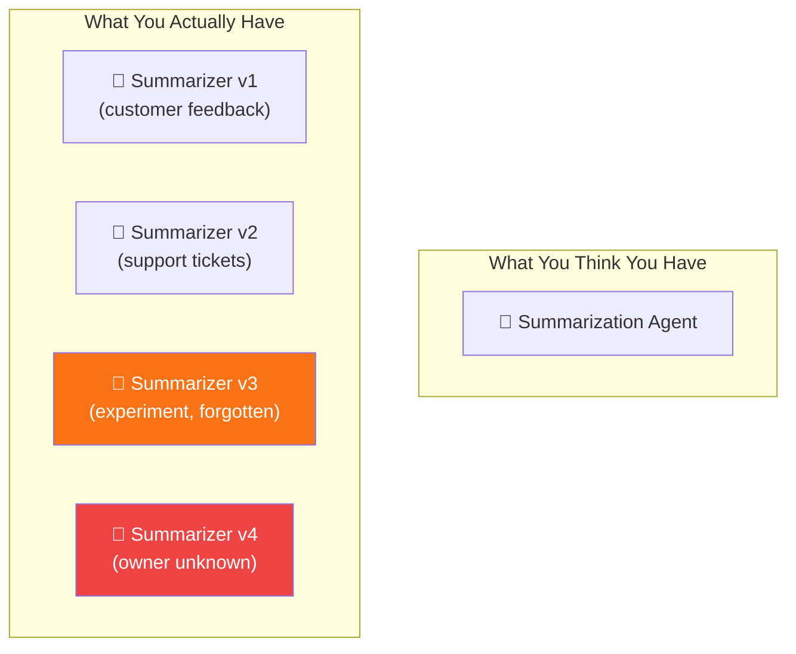
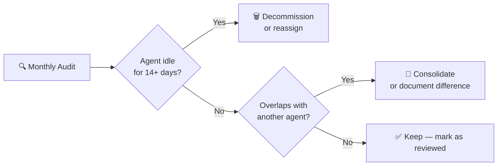

We had four summarization agents.

No one planned it that way. The first was built in January for customer feedback. The second appeared in March when someone from the support team wanted slightly different output formatting. The third was an experiment someone forgot to decommission. The fourth? Nobody was sure. It had a name, it showed up in the logs, it was running — but no one claimed it.

Four agents doing roughly the same job. Double the compute spend. Three different output formats. Zero documentation. One agent hadn't been touched in eight weeks but was still processing 200 tasks a day.

That's agent sprawl. And it's expensive in ways that don't show up on any dashboard by default.

## What Sprawl Actually Looks Like

Agent sprawl isn't about having too many agents. You might run 40 agents with no sprawl at all if each one is clearly scoped and owned. Sprawl is about duplication: multiple agents doing similar jobs that weren't designed to coexist.

It happens naturally. Teams move fast. Someone needs a thing, they build an agent. Someone else needs a slightly different version, they clone the first one and tweak a few lines. Six months later you've got five variants of the same pipeline, each with different prompt versions, different retry logic, and different owners — or no owners at all.

The orange one is forgotten. The red one is a ghost. Both are burning compute every hour.

## The Costs Nobody Counts

**Compute duplication.** When multiple agents process similar inputs, you're paying for the same work more than once. If each summarization run costs $0.03 in tokens and you have four agents each running 500 tasks daily, that's roughly $60/day when $20/day would have been enough. Not catastrophic on its own. But over a year, it's $14,600 you didn't need to spend — and it shows up as a mystery in your LLM bill with no obvious source.

**Inconsistent outputs.** Four agents, four different prompts, four different output formats. If downstream systems consume those outputs, they're getting inconsistent data. Users start noticing quality variations that seem random. Teams blame the model quality before realizing they've been pulling from four different sources with different instructions.

**The ownership vacuum.** When nobody owns an agent, nobody monitors it. When something goes wrong — a silent failure, a cost spike, an output drift — there's no one to page. You find out when a user complains, not when it breaks.

**Hidden tech debt.** Each agent is a dependency. It has a prompt tied to a specific model version, a tool integration that breaks when an API changes, and a config that no one knows how to update safely. Four agents means four surfaces to maintain, four things that can degrade without anyone noticing.

## What Good Looks Like

The fix isn't complicated, but it requires discipline.

**Maintain an agent registry.** Before building an agent, check if one already exists for this job. That sounds basic. Most teams don't do it because there's no central place to check. A shared doc works at first. AgentCenter's [agent dashboard](/features/agent-dashboard) gives you this visibility in real time — every running agent, when it last ran, who owns it, and how much it's costing per task.

**Name agents by function, not by date or creator.** "summarizer-v3-karim-march" tells you nothing useful at 2am. "customer-feedback-summarizer" does. Good naming makes it obvious when you're about to create a duplicate.

**Audit your fleet every 30 days.** Look at which agents haven't run in two weeks. Look at which agents have overlapping task types. Look at agents with no owner. That 30-minute review will find the ghost agents before they become a problem. AgentCenter's [agent monitoring](/features/agent-monitoring) flags idle and unowned agents automatically, which makes the audit faster.

## Who This Hits Hardest

Teams that have been running agents for 4-6 months and have crossed the 10-agent mark. At 5 agents, you can hold the whole picture in your head. At 15, you can't — and the gap between what you think you're running and what's actually running starts to matter a lot.

It's especially bad on teams where multiple engineers own different agents independently, without a shared view of the fleet. Each person knows their own agents. Nobody knows the whole system. [Multi-agent visibility](/features/multi-agent-workflows) across the whole team is what separates "we have agents" from "we manage agents."

## The Honest Part

Sometimes you genuinely need multiple agents doing similar jobs. A/B testing two prompt versions requires parallel agents. Processing fundamentally different data sources that need different logic means separate agents are the right call.

The problem isn't parallel agents. It's unplanned parallel agents.

The test is simple: can you name every agent you're running right now, explain what it does in one sentence, and tell me who owns it? If you can't do that in five minutes, sprawl has already started.

---

*The dashboard won't fix a broken agent. But it will tell you which one is broken at 3am. [Try AgentCenter free](/pricing).*
