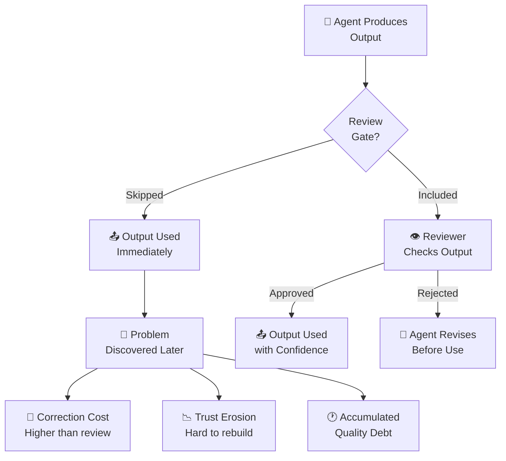

The review gate is always the first thing that gets cut when teams are under pressure. It feels slow. It feels like it defeats the purpose of automation. If the agent is doing the work, why do you need a human to check it?

Here's the cost you don't count when you make that decision.

## What "Unreviewed" Actually Means

Unreviewed doesn't mean nobody looks at the output. It means nobody looks at it before it's used.

The customer sees the support response before you do. The product ships with the copy the agent wrote before anyone on the marketing team read it carefully. The data analysis goes to the executive team before anyone validated the calculations. The code gets merged before a senior engineer checked if the agent's implementation was actually right.

The review happens eventually. It happens after the downstream impact is already in motion.

## The Real Costs

**Correction cost.** Finding a problem after deployment is not free. Rewriting copy after it's been emailed to 50,000 customers doesn't undo the send. Correcting a bug after it's in production takes more time than reviewing it before. Fixing a data analysis error after it's been presented to leadership requires re-presenting. The correction cost is almost always higher than the review cost would have been.

**Trust erosion.** One bad output from an AI agent that went unreviewed changes how your team and stakeholders think about using agents for that type of task. It might take months to rebuild confidence. The review gate is partly a trust mechanism — it signals that a human is responsible for what the agent produces.

**Accumulated quality debt.** Skipping reviews consistently doesn't just risk occasional bad outputs. It removes the feedback signal that keeps agents calibrated. Reviews catch drift. Without reviews, you don't know if output quality is declining. By the time you notice, you've accumulated months of quality debt.

## The Time Math That's Usually Wrong

The argument against review gates: "review takes 2 minutes per output. We have 50 outputs per day. That's 100 minutes per day of review time. We don't have capacity for that."

This math is real but incomplete.

What gets left out: the time spent on corrections for unreviewed outputs that go wrong. The support tickets from customers who received bad answers. The reputation management when something goes publicly wrong. The time spent rebuilding stakeholder confidence after a notable failure.

Most teams that have tracked this find the actual break-even point much lower than they expected. Review catches problems worth more time than the review costs.

## When Skipping Review Is Actually Fine

Not every output needs human review. Some cases where you can skip:

- **Low-stakes, high-volume, easily reversible outputs.** Draft internal notes that go into a queue for human editors to revise later. Review the final version, not every draft.
- **Format validation, not quality review.** If you can automate the quality check (output must be valid JSON, output must not exceed 500 characters), automate it instead of reviewing manually.
- **Sandboxed outputs that don't affect customers or decisions.** If the agent is processing data for internal analytics that will be reviewed before any decisions are made downstream, the review can happen at the decision point, not at the agent output.

The pattern: skip the review gate when there's another gate downstream that catches problems before impact. Don't skip it when the output goes directly to customers, systems, or decisions.

## Building Reviews That Don't Kill Velocity

The review gate doesn't have to be a bottleneck. A few patterns that help:

**Async reviews with clear SLAs.** The reviewer has 4 hours to review. Agents queue deliverables. Reviewers work through the queue at their own pace. No one is blocked waiting for an immediate response.

**Sampling instead of reviewing everything.** For high-volume, lower-stakes outputs, review 15% randomly. Rejection rate on the sample tells you about quality across all outputs without reviewing every one.

**Tiered review based on output type.** Standard outputs go to a junior reviewer. High-stakes or novel outputs go to a senior. Not every review needs the same expertise or time investment.

## Honest Admission

Review gates add friction. There are legitimate cases where the velocity cost is too high and the risk is low enough to accept. Make that tradeoff consciously, with full accounting of both sides. Don't make it by default because review feels slow.

_The dashboard won't fix a broken agent. But it will tell you which one is broken at 3am. [Try AgentCenter free](/pricing)._
