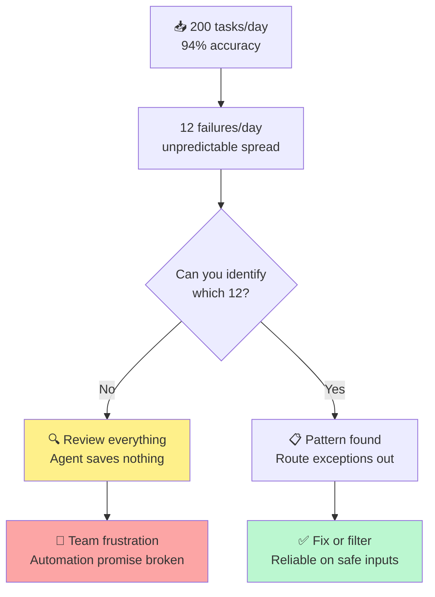

We had a customer feedback summarization agent. In testing, it handled 97% of tickets correctly. We shipped it.

Six weeks later, the support team was working harder than before. Not because the agent was breaking constantly. It wasn't. It was failing unpredictably on enough tickets that nobody trusted it, and the team was reviewing every output anyway.

That's the trap. An AI agent that's almost right is its own specific problem.

## Almost Right Is a Worse Failure Mode Than Wrong

When an agent fails reliably, you can route around it. You identify which inputs break it. You add an exception path. You fix it or contain it.

When an agent fails unpredictably at a 5-6% rate, you get something more expensive: mandatory review of everything. Because you cannot tell which outputs are wrong without checking them.

If the agent handles 200 tasks a day and 6% are wrong, that's 12 bad outputs. Spread across different ticket types. For different reasons each time. You either catch them all, which means reviewing all 200 (and the agent saved you nothing), or you let some through and accept risk you probably didn't budget for.

Neither outcome is what you had in mind when you shipped.

## Why 94% Accurate Feels Better Than It Is

The math doesn't hold steady. An agent that's 94% accurate overall gets worse in some conditions, and you may not notice until the damage is done.

New input types are the most common trigger. If a product update ships and customers start asking about it, the agent hasn't seen those tickets. That 6% baseline might spike to 25% on the new category. You find out when the support queue is backing up and someone starts reading the outputs carefully.

Downstream agents amplify the problem. If another agent in your pipeline consumes the summaries, it inherits the errors. A 6% failure rate in agent one becomes correlated failures in agent two. You see your [multi-agent workflows](/features/multi-agent-workflows) fail in clusters, not individually, because the bad output gets passed downstream before anyone catches it.

And the failures don't distribute evenly. They cluster. The same edge case type fails over and over. A customer segment with unusual terminology. A ticket category that triggers a specific blind spot. You don't have 12 random errors per day. You have 3 errors on the same input type, every day, until someone investigates.

## What Production-Ready Actually Means for AI Agent Accuracy

Most teams treat accuracy as a launch threshold. Get to 90% and ship. But the percentage isn't the real question. The question is: can you predict when the agent will be wrong?

A 90% accurate agent with predictable failures is manageable. It fails on multi-part questions, so you route those to a human queue. It fails on tickets under 20 words, so you add a length pre-filter. You know where the gaps are and you design around them.

A 94% accurate agent with random-looking failures is a review bottleneck in waiting. You can't write routing rules for "sometimes it just gets it wrong." The failure condition isn't capturable in logic.

This is why [agent monitoring](/features/agent-monitoring) needs to show you more than error rate. Error rate tells you the volume of failures. It doesn't tell you whether those errors are patterned or scattered. Patterned errors are fixable. Scattered ones tell you the agent has a general weakness, not a specific one.

## The Diagnostic to Run Before You Trust the Output

Before you give any agent a role in a workflow that real people depend on, spend time on the failures, not the successes.

Pull a sample of the tasks the agent got wrong. Read them. Look for what they have in common. If you can find a shared characteristic in 80% of the failures, you have a predictable failure mode and you can design around it.

If you read 20 failures and they look like 20 different problems, that's a signal to pay attention to. The agent doesn't have a specific weakness. It has a structural one. No routing rule will fix structural.

Three things to look for:

1. **Input characteristics**: ticket length, customer segment, issue category, language used
2. **Output type**: was the agent confidently wrong, vague, or clearly unsure
3. **Timing**: do failures cluster after product changes, at certain times, for certain users

If the same input characteristics appear across most failures, you have a filter to add. If output confidence correlates with accuracy, you have a threshold to set. If failures spike after product updates, you have a retraining trigger.

You need this diagnostic before you're at 500 tasks per day. At 500 tasks, a 6% failure rate is 30 bad outputs daily and a team that has stopped trusting the system.

## Who Gets Hurt by This Most

Teams shipping their first production agent are most exposed to this problem.

The demo works. The test suite looks solid. You're ready to go. You ship.

The problem is that test environments have clean, representative inputs. Production has the full distribution, including the edge cases your examples never covered. That 94% accuracy becomes visible as a problem around week three, when someone asks "why are we reviewing all of these?" and the honest answer is "because we can't tell which ones are wrong."

Solo founders and small teams feel this hardest. You don't have the capacity to review everything and fix the agent at the same time. The agent creates work rather than removing it.

If you're in that position, the practical move is to narrow the agent's scope before chasing accuracy improvements. Use it only on the input types where it's most reliable. Track which categories require the most human intervention. That pattern is your accuracy map. Fix those categories before expanding scope.

AgentCenter's task status and activity feed shows you where humans are stepping in to correct or re-assign tasks. That data is more useful than an aggregate accuracy score because it tells you which categories are actually failing in the context your team uses them.

## The Honest Part

Better visibility into agent failures doesn't make the agent more accurate. What it does is give you the data to stop treating "almost right" as a launch condition and start treating it as a diagnostic.

The goal isn't 94% accuracy. The goal is knowing which 6% will go wrong and having a plan for those inputs before they end up in your workflow.

An agent that fails 10% of the time on predictable inputs is easier to run in production than an agent that fails 4% of the time on inputs you can't identify in advance.

---

*The dashboard won't fix a broken agent. But it will tell you which one is broken at 3am. [Try AgentCenter free](/pricing).*
