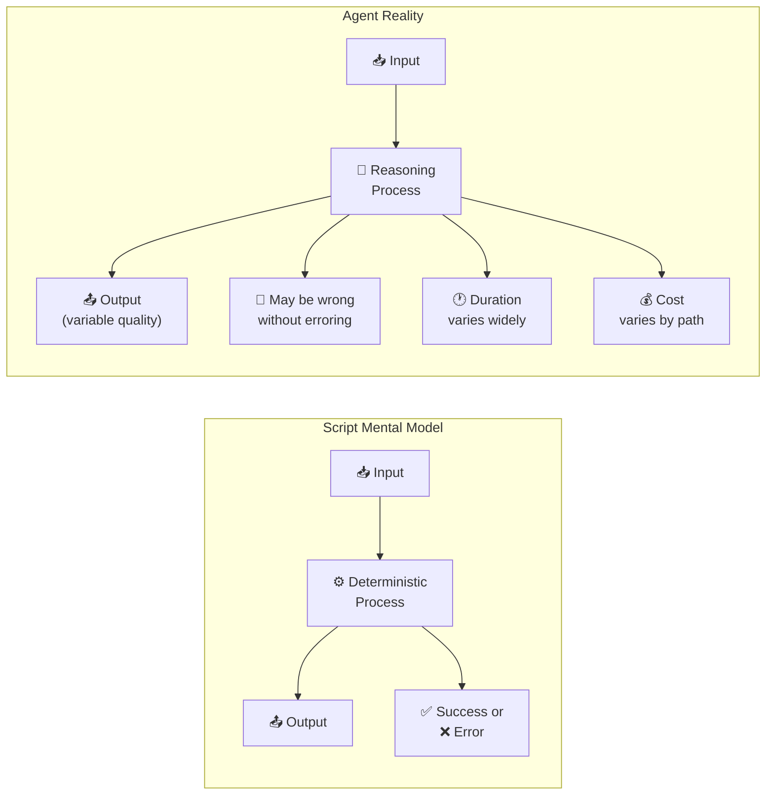

The first time you ship an AI agent, you probably treat it like a really smart script. Schedule it, run it, check that it didn't throw an error. Move on.

That works fine until it doesn't. And it stops working in ways that are easy to miss.

## What a Script Actually Is

A script runs deterministically. Same inputs, same outputs. It either succeeds or it fails. When it fails, there's usually an exception or an error code. You fix the bug, rerun, done.

That mental model is baked into every monitoring and deployment tool we have. Health checks, retry logic, circuit breakers — all of these assume something closer to determinism.

## What an Agent Actually Is

An agent is a reasoning process. It interprets a task, decides what to do, and produces output based on judgment, not fixed logic. The same input can produce different outputs on different runs. "Success" doesn't mean the output was correct. It means the agent ran to completion without crashing.

This is the mismatch. You monitor agents like scripts, and you get script-level visibility into a non-deterministic process. Which means: no errors, no alerts, no indication that anything is wrong — and quietly degrading output quality.

## Concrete Failure Modes

**The silent drift.** An agent produces good output for weeks. Gradually, output quality degrades — maybe a model update changed calibration, maybe input distribution shifted. No error. No alert. You find out from a downstream user complaint.

**The successful failure.** An agent completes every task with exit code 0. The task completion rate is 100%. The outputs are wrong. Your monitoring says everything is healthy.

**The runaway retry.** An agent hits a transient error and retries. And retries. And retries. Your retry logic doesn't cap cost, just attempts. You wake up to a $300 charge from an agent that retried 900 times overnight.

**The coordination mismatch.** Agent A passes output to Agent B. A changes its output schema. B keeps running but interprets the input incorrectly. Both agents succeed. The pipeline output is garbage. Nobody knows which agent to blame.

## What You Have to Change

**Add output quality monitoring, not just execution monitoring.** Did the task complete? Yes. Was the output correct? Unknown. These are separate questions. You need to answer both.

This means building a review gate. Even a rough one. Something that catches obvious failures before they propagate. In [AgentCenter's multi-agent workflows](/features/multi-agent-workflows), deliverable review is built into the pipeline — outputs are submitted for review before the next agent starts. That's the gate.

**Track agent state, not just process state.** "The process is running" is not the same as "the agent is making progress." Agents can be technically alive while stuck. Track task duration. Track whether the agent has submitted anything recently. Track cost-per-task as a proxy for behavior.

**Set cost alerts, not just error alerts.** Runaway cost is often the first signal that something is wrong. An agent that's suddenly costing 5x more per task is doing something different — even if no error is raised.

## What the Reader Should Take Away

Agents need different operational patterns than scripts. Not harder ones. Just different.

Three things to do this week:

1. Add a deliverable review step to your most important agent pipeline
2. Set a cost-per-task alert, even if the threshold is generous
3. Build a task duration baseline so you know when an agent is running longer than normal

None of this requires a big investment. It requires treating agents as processes you manage, not scripts you fire and forget.

## Who This Matters Most For

This matters most for solo engineers and small teams who built the agents themselves and are now also running them in production. You're wearing every hat. You don't have time to babysit agents, but you also don't have a team to catch problems you miss.

The lower the headcount, the more important the tooling is.

## Honest Caveat

Better tooling catches problems faster. It doesn't eliminate the underlying challenge of working with non-deterministic systems. You'll still need to think carefully about task design, prompt stability, and output validation. Tooling shortens the feedback loop. It doesn't replace the engineering judgment.

_The dashboard won't fix a broken agent. But it will tell you which one is broken at 3am. [Try AgentCenter free](/pricing)._
