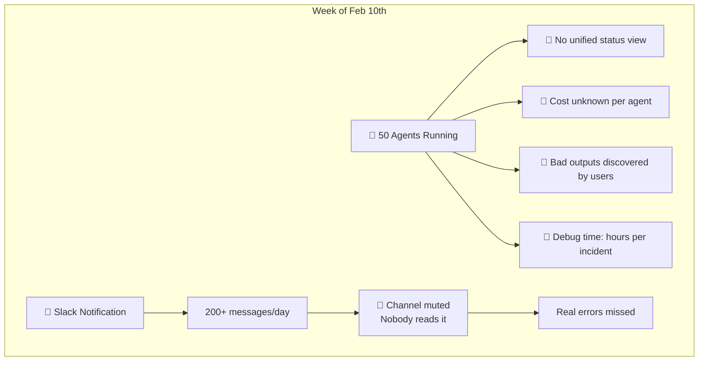

We hit 50 active agents the week of February 10th. I know because I counted them from the deployment logs. There was no dashboard. There was no status page. There was just: 50 agents, running somewhere, doing things we'd defined for them weeks ago.

That week was the clearest illustration I've had of what "zero visibility" actually feels like at scale.

## How We Got Here

The scale-up wasn't planned. It was opportunistic. We had a backlog of use cases — research agents, content agents, analysis agents, a few support agents. We had engineers with capacity. We deployed them in batches over three weeks.

Each batch had basic monitoring: a Slack notification when the agent started, a log if it errored out. That was fine when we had 8 agents. We knew each one. We checked on them manually.

At 50, the manual model broke. There were too many to watch individually. The Slack notifications, once useful, became noise. 200 "agent started" messages per day, mixed in with the actual errors, mixed in with the approvals. By the end of week one, I had stopped reading the agent Slack channel because I couldn't tell signal from noise.

## What We Couldn't Answer

Simple questions became hard.

"Which agents are currently running?" — No single answer. Check deployment logs. Check process manager. Check cloud console. Add them up.

"Is Agent 34 (the market research agent) working today?" — Check its last log entry. When was that? Was it a success or an error? What did it produce?

"What did we spend on agents this week?" — Provider dashboard shows total tokens. Doesn't break it down by agent. Build a query against our logs to estimate. Usually right within 20%.

"The sales team says the prospecting agent sent some bad emails yesterday — which ones?" — Pull all prospecting agent tasks from our logging database. Filter by timestamp. Export. Manually review. 2 hours.

## The Incident That Forced the Change

On Wednesday of that week, we got a report from a customer that one of our content agents had been producing outputs with the wrong company name — ours instead of theirs. It had been doing this for 3 days.

Three days. The agent ran correctly in every other way. It submitted deliverables on time. No errors. No cost anomalies. Just one field, wrong, consistently, for three days.

We found it because the customer told us. Not because we caught it. That's the worst version of discovery.

The investigation took four hours. Finding the affected tasks, identifying when the issue started, tracing it to a template variable that hadn't been set correctly in one specific workflow. Four hours that could have been 30 minutes if we had task history with agent configuration snapshots.

## What We Changed

We moved all 50 agents to AgentCenter over the following two weeks. The work involved was less than I expected — the agents already had APIs, we just needed to route them through the platform.

Three months later, the difference was stark.

"Which agents are currently running?" — Dashboard, 10 seconds.

"Is Agent 34 working today?" — Real-time status: working, last task completed 18 minutes ago.

"What did we spend this week?" — Per-agent cost breakdown, by project.

"The sales team says the prospecting agent sent some bad emails yesterday" — Pull the task history, filter by date, see the deliverables, find the problematic ones in 15 minutes.

The last incident — an agent producing outputs with the wrong formatting — was caught by the review gate before it reached the customer. The reviewer flagged it. We fixed it. The customer never saw it.

## What I'd Tell Someone Earlier in This Journey

Don't scale agents without first scaling visibility. Every new agent you add that you can't see is a new failure mode you won't catch until a user tells you.

You don't need a sophisticated system. You need:

1. A unified view of what's running
2. Per-task cost tracking
3. A review gate on customer-facing outputs
4. A way to pull task history for any agent in under 5 minutes

Those four things prevent most of the expensive incidents. They also make debugging dramatically faster when incidents do happen.

We learned this the expensive way. You don't have to.

## Who This Matters Most For

This matters most for teams scaling agent deployments without dedicated ops support. When you add your 30th agent, the operational patterns you used for the first 10 don't work anymore. The people who recognize this early and adapt have a very different experience than the people who recognize it after an incident at scale.

## The Honest Part

We still have incidents. Agents still produce bad outputs. The difference is: we find out faster, we fix faster, and the blast radius is smaller because we catch more things before they reach customers. The system isn't perfect. It's much better than having 50 agents and zero visibility.

_The dashboard won't fix a broken agent. But it will tell you which one is broken at 3am. [Try AgentCenter free](/pricing)._
