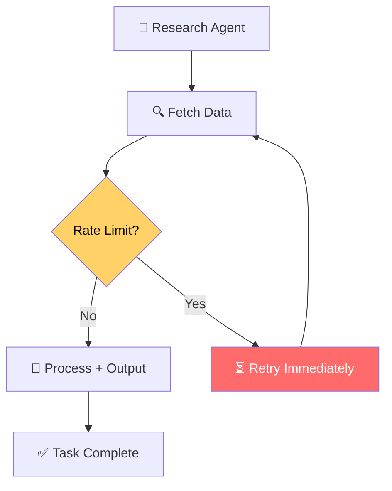
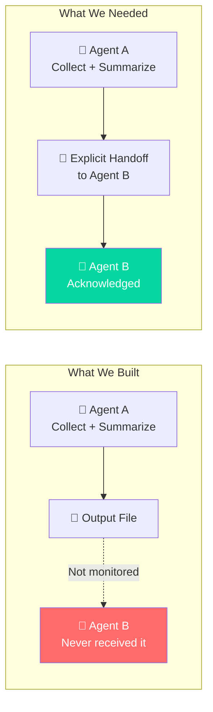

Three months into running agents in production, we had our first real crisis. Not a minor glitch. A full pipeline failure where four agents were running, outputs were being generated, and none of them were actually doing anything useful.

We didn't know that for six hours.

That was failure number one. The other two came later. Each one looked different on the surface. But the pattern underneath was the same: we were flying blind because we had no way to tell the difference between an agent working and an agent stuck.

Here's what each failure taught us.

## Failure One: The Silent Loop

We had a research agent collecting competitive intelligence. It was set up to search, analyze, and summarize, cycling through a list of companies.

For six hours, it appeared to be running. Status showed "working." The task was open. The agent was active.

What it was actually doing: hitting a rate limit on the data source, catching the error, retrying immediately, hitting the limit again. Repeat, 3,200 times.

The agent was working extremely hard at absolutely nothing.

What we learned: "working" as a status means nothing. You need to know *what* the agent is working on: how many cycles it has run, what is producing output, what is looping without progress. After this, we configured cycle counts and output checkpoints on every long-running task using [AgentCenter's monitoring panel](/features/agent-monitoring).

The fix was boring: add a max-retry count and a backoff delay. But we wouldn't have added it without seeing the failure.

## Failure Two: The Handoff That Never Happened

Two agents working in sequence. Agent A collected data and wrote a summary. Agent B was supposed to take that summary and produce a final report.

Agent B never started.

Not because of an error. Not because of a timeout. Because Agent A's output landed in a directory that Agent B wasn't watching. Two agents, one task, zero coordination.

We found out when a stakeholder asked for the report. It arrived 24 hours after it should have been done.

The lesson: agent handoffs are not automatic. Writing a file does not equal delivering it. You need explicit handoff acknowledgment, visible in the dashboard, with a timestamp. After this failure, every multi-agent task in our pipeline got a required "received" confirmation logged to the [task thread](/features/task-orchestration).

This is one of those failures that is embarrassing in retrospect. The fix took about an hour. The damage to stakeholder trust took longer to repair.

## Failure Three: The Timeout That Was Never Set

Roughly 40 tasks queued, an agent processing document summaries. Somewhere around task 23, the source document was a 200-page PDF. Our agent was configured without a processing timeout.

It ran for four hours on that one document. Every other queued task waited.

The cost wasn't catastrophic. We caught it before the next morning. But the downstream effect was real: 17 other tasks delivered late, one client SLA missed, one awkward conversation.

The timeout wasn't missing because we forgot. It was missing because we hadn't decided what "too long" actually looked like for that agent. That's a design decision nobody had made.

We now set explicit timeout thresholds for every agent class. Not defaults. Deliberate decisions, reviewed quarterly. Short-lived agents get tight limits. Long-running research agents get more headroom, with escalation alerts at 80% of their allowed time.

## What These Three Failures Have in Common

None of them were model failures. The AI performed as expected. The failures were all infrastructure: missing observability, missing coordination, missing constraints.

In each case, we had a working agent and a broken system around it.

The pattern that shows up in production most often:

- **Observability gap**: You can see that an agent is running. You can't see what it's doing.
- **Handoff gap**: Agents produce output. Nothing confirms the next agent received it.
- **Constraint gap**: Agents have no concept of "this is taking too long."

If you're running more than 3 or 4 agents, you've probably hit at least one of these. If you haven't noticed it yet, that's not luck. That's a gap in your monitoring.

## Who Needs to Read This

If you're a technical founder or ML engineer who just got agents working: this is the next 30 days of your production life. The initial setup will seem fine. The failures arrive quietly, not loudly.

If you're on a DevOps or platform team now responsible for agent infrastructure: these are the failure modes to plan for upfront. Add timeout constraints before you need them. Build handoff confirmations into the design, not after the first miss.

## An Honest Caveat

Better tooling helps. Dashboards help. But these failures happened because of design decisions we hadn't made. No dashboard can substitute for that.

The value of a good [monitoring setup](/features/agent-monitoring) is that it shows you the failure faster. You still have to decide what counts as failure and build in the right constraints. That part remains on you.

---

*The dashboard won't fix a broken agent. But it will tell you which one is broken at 3am. [Try AgentCenter free](/pricing).*
