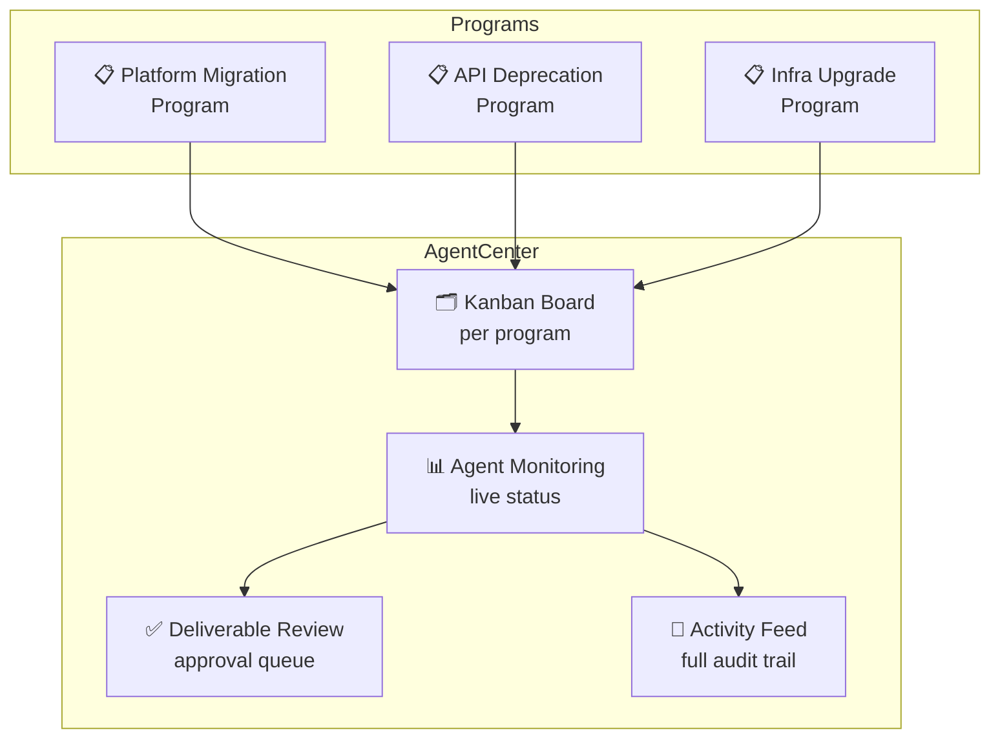

Technical Program Managers run some of the highest-coordination work in engineering. You're tracking deliverables across 5 to 15 teams simultaneously, chasing dependency blockers, and keeping milestone reviews from turning into surprises. A lot of that is repetitive information synthesis: pull status from Jira, Slack, and three Notion docs, then synthesize it into something a VP can read.

AI agents do that work well. Status summarizers. Meeting note extractors. Risk flaggers. Dependency scanners. A TPM running three programs might have 12 agents working in parallel by month two.

The problem shows up at month three, when you have no idea which one stalled last Thursday.

## What Breaks When TPMs Scale Agents Without a Control Plane

### Visibility Is Per-Agent, Not Per-Program

You built a status-summary agent for the platform migration. It runs every Monday and posts to a Slack channel. You built another for the API deprecation project. And another for the infra upgrade. Each one has its own output location, its own run cadence, its own failure mode.

When the platform migration slips by four days, you find out because a stakeholder asks. The agent didn't fail. It ran fine. But you had no single place to see that it had been reporting the same "no blockers found" status for six days straight while a team was actually stuck.

### Task Handoffs Between Agents Fall Through

A common TPM pattern: an intake agent parses new engineering requests and routes them to the right team's queue. A dependency agent checks whether upstream work is done before marking a task ready. A reporting agent generates the weekly rollup.

In theory, clean pipeline. In practice, the dependency agent stalls on a bad API call, and the reporting agent doesn't know. It generates a rollup with missing data. You send it to leadership. Someone asks why Program 3 has zero updates. You spend two hours tracing back what happened.

### You Find Out About Failures From Deadline Slips, Not Alerts

Most TPMs running agents without a control plane find out an agent failed the same way they'd find out about a missed deadline: something that was supposed to happen didn't happen. There's no alert when an agent goes idle, no notification when a run errors out, no breadcrumb showing you what the agent was doing when it stopped.

This means debugging time is measured in hours, not minutes. You're reading logs, checking API call histories, trying to reconstruct what happened from scattered output files.

## How TPM Teams Use AgentCenter

### Kanban Board: One View Across All Programs

The [task orchestration board](/features/task-orchestration) lets you create one project per program. Each agent running under that program gets its own tasks. You can see at a glance: which agents have open items, which are blocked, which have finished and are waiting on review.

For a TPM, this replaces the habit of checking three Slack channels and two Notion pages to understand program state. Everything is in one view. When Program 2's dependency scanner shows "blocked" while Programs 1 and 3 are green, you know where to look before anyone asks.

### Real-Time Agent Monitoring: Know Before the Deadline

[Agent monitoring](/features/agent-monitoring) in AgentCenter shows live status: online, working, idle, or errored. For each agent, you see the last time it ran, what it did, and whether the run succeeded.

A TPM who sets up a status-summary agent for Monday runs will notice by Monday afternoon if one of the agents shows "idle - last run failed." That's hours before the Tuesday stakeholder sync, not hours after.

### @Mentions and Task Threads: Loop In the Right People

When an agent hits a blocker, the task thread in AgentCenter becomes the place to resolve it. You @mention the team lead, they respond in the thread, the agent picks up the resolved context on the next run. The full conversation stays attached to the task.

This matters for TPMs specifically because program work crosses team boundaries. The conversation about why the dependency agent stalled isn't in one team's Slack channel. It's in the task where the dependency lives.

### Deliverable Review: Don't Ship AI-Generated Status Reports Unread

A status-summary agent that runs weekly generates a report. That report goes to VPs. It should not go out without a human reading it. AgentCenter's deliverable review queue holds agent outputs for approval before they propagate downstream.

You review the draft, catch the paragraph where the agent hallucinated a completion date, fix it, and approve. The agent's output history stays in the system. If someone asks why last month's report said the infra upgrade was 80% done when it was actually 60%, you have a record.

## The Numbers for a Typical TPM Setup

A TPM supporting three programs in a mid-size engineering org typically runs 8 to 20 agents:

- 1 status summarizer per program (3 agents)
- 1 dependency scanner per major milestone (4-6 agents)
- 1 meeting notes extractor (1 agent)
- 1 risk flag reviewer (1 agent)
- Several ad-hoc report generators (3-5 agents)

The **Pro plan at $29/month** fits most TPMs: 15 agents, 15 projects. One project per program, one for shared tooling. What it replaces: hours of manual status collection per week, scattered Slack threads, stale Notion docs, and the mental overhead of remembering which agent lives where.

## Before vs After

| | Without AgentCenter | With AgentCenter |
|---|---|---|
| Visibility | Check each agent's output location manually | Dashboard shows all agent tasks across programs at once |
| Task handoffs | Stale Notion pages or missed Slack messages | Task threads with full history per handoff |
| Error detection | Discovered when a deliverable is missing | Real-time status alerts when an agent goes idle or errors |
| Cost tracking | No per-agent or per-program cost data | Token cost logged per task, per agent |
| Time spent debugging | 2-4 hours tracing what happened | Activity feed shows every agent action with timestamps |

## Where to Start

Set up the Kanban board first. Create one project per active program. For each agent you're running, create a task card and assign it to that agent. Label the columns by program phase: Planning, In Progress, Review, Done.

You'll immediately see program state without opening a single Slack channel. Once you can see everything in one place, you'll notice which agents need monitoring rules set up next.

See the full [features overview](/features) to understand what's available before you build out the rest of your setup.

---

*TPM teams that add a control plane early spend less time firefighting later. [Start your 7-day free trial](/pricing).*
