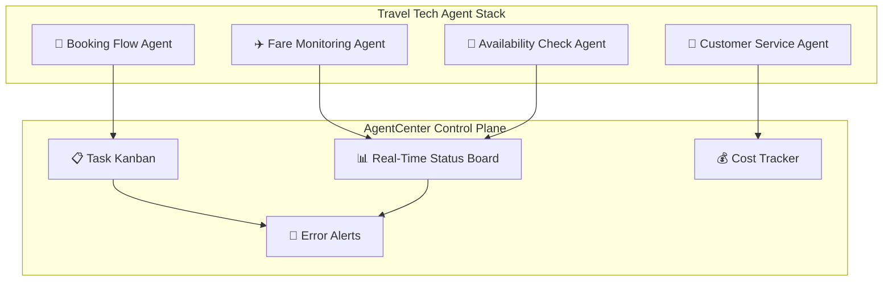

Travel tech teams run a lot of agents quietly. There's one watching fare prices across 40 routes. Another catching booking anomalies before they turn into complaints. A third drafting customer service responses from policy documents. And a fourth handling refund logic that used to take a support agent 20 minutes per ticket.

That works fine at 4 agents. It stops working at 14 - when you have no single place to see if they're running, what they last did, or which one just doubled its token costs because a partner API changed its response format.

## The Problem with Agents Nobody Can See

Travel is a vertical where timing matters. A fare pricing agent that's stuck or looping doesn't fail loudly - it just stops updating. A customer service agent returning stale policy information doesn't crash - it just starts giving wrong answers.

Three things break specifically in travel tech when you manage agents without a control plane:

**Pricing agents drift without any signal.** A fare monitoring agent might be fine by every error metric - no exceptions, normal response times. But route coverage quietly shrinks because an upstream data feed changed its schema. You find out three days later when the product manager asks why some routes aren't showing competitive prices.

**Handoffs between agents go silent.** A booking flow typically involves 3 or 4 agents in sequence: validation, pricing lookup, availability check, confirmation. When the chain breaks in the middle - say the availability agent times out - the failure surfaces to the customer first and your engineering team second. There's no place to see that the handoff at step 3 never happened.

**Cost spikes hide in background agents.** Customer service response agents run all day. If one starts hitting edge cases requiring 10x more tokens than usual - because someone uploaded a new 50-page policy PDF without telling the team - you won't see it until the monthly bill arrives.

## How Travel Tech Teams Use AgentCenter

### Real-Time Agent Status

[AgentCenter's agent monitoring](/features/agent-monitoring) shows every agent's status - online, working, idle, blocked - in one view. For a travel tech team, this means when the availability check agent silently stops responding, you see it immediately as "blocked" rather than learning about it through a customer complaint.

A typical scenario: 8 agents running across 3 product areas. Monday morning you open AgentCenter and the refund processing agent has been idle for 6 hours. Not erroring - idle. Someone changed a webhook endpoint on Friday and didn't update the agent config. Without visibility, that's a customer complaint waiting to happen. With AgentCenter, it's a 5-minute fix before business hours.

### Task Kanban for Booking Flow Coordination

Travel booking flows are sequential, and sequence failures are hard to detect. [AgentCenter's task orchestration](/features/task-orchestration) makes task state visible across agents. Each handoff appears as a task moving across kanban columns. If the availability check agent completes but the confirmation agent never picks up the next step, the card stays in "waiting" - visible to anyone on the team.

This matters especially for refund workflows, where the order matters: the refund agent must complete before inventory updates run, and that must complete before the customer notification goes out. A stuck card in the middle of that sequence is easy to spot. A stuck agent in a log file is not.

### Per-Agent Cost Tracking

AgentCenter tracks token costs per agent and per task. For a customer service agent processing 300 tickets a day, you can see average cost per ticket - and spot when a batch of complex queries pushed cost up 40% without volume changing.

When the policy response agent's per-task cost doubles because someone updated the knowledge base, you get an alert before the bill does. That's the difference between a billing surprise and a 15-minute investigation.

### @Mentions for Incident Response

When a pricing agent misfires at 11pm before a flash sale, @mentions let you pull in the right engineer on the specific task thread - with the full context of what the agent was processing, what it returned, and what failed. No reconstructing context from three different Slack threads.

## The Numbers for Travel Tech Teams

A mid-sized travel tech team typically runs 10-25 agents across pricing, booking, customer service, and reporting automation. That maps to the [Pro plan (15 agents, $29/month) or Scale plan (50 agents, $79/month)](/pricing) depending on team size.

What it replaces: a mix of cron job monitoring scripts, Slack error webhooks, and someone manually spot-checking agent outputs on rotation. That setup works until you have 8 or more agents - then things start slipping through.

## Before vs After AgentCenter

| | Without AgentCenter | With AgentCenter |
|---|---|---|
| **Visibility** | Individual logs per agent, no unified view | All agents in one dashboard with real-time status |
| **Task handoffs** | Silent failures between agents in a sequence | Kanban shows stuck or dropped handoffs |
| **Error detection** | Discovered by customers or manual log review | Alerts when agents go blocked or idle unexpectedly |
| **Cost tracking** | Monthly billing surprise | Per-agent, per-task cost visible daily |
| **Debugging time** | 2-4 hours reconstructing what happened | 20-30 minutes with task history and error context |

## Where to Start

Set up the agent monitoring dashboard first. Connect your existing agents - pricing, customer service, whatever you have running - and spend one week watching status. You'll find at least one agent that's been quietly unhealthy and nobody noticed.

Once you have visibility, the kanban board and cost tracking become obvious next steps. But the status dashboard is the one that pays back immediately.

---

*Travel tech teams that add a control plane early spend less time firefighting later. [Start your 7-day free trial](/pricing).*
