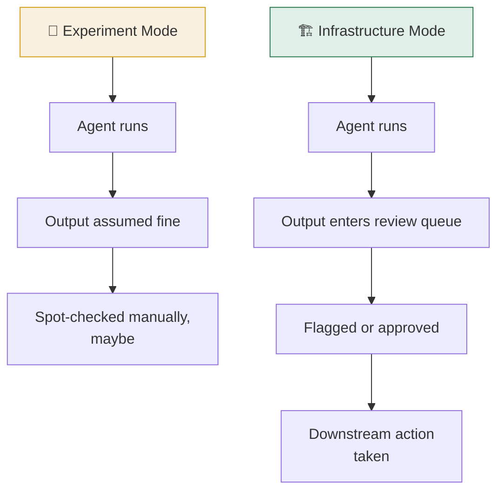

We started with one agent. A content summarizer that saved maybe 20 minutes a day. Nobody called it production. Nobody monitored it. If it broke, we'd notice eventually and fix it.

That was eight months ago. Today that same team runs 11 agents. Three handle customer-facing workflows. One runs on a 15-minute loop. Two were "just tests" that never got turned off. At some point — and nobody can tell you exactly when — they stopped running experiments and started running infrastructure.

They just didn't know it yet.

## The Sign You've Already Crossed the Line

Here's how you know an agent is infrastructure and not an experiment: someone *else* noticed when it stopped working.

Not you. A customer. A teammate. A downstream system that was expecting output.

When you have 1 agent and it fails silently for 8 hours, that's annoying. When you have 12 agents — some running on 15-minute schedules, some feeding approval queues, some generating reports that other agents consume — a silent failure is a cascade.

The thing that changes isn't the agents themselves. It's what depends on them.

## Three Things That Change When Agents Hit Production

This isn't about adding more tools. It's a mental model shift that changes three specific behaviors.

### 1. You stop assuming agents are fine unless they scream

Experiments fail loudly. They error out and you fix them. Infrastructure fails quietly — an agent produces output, just the wrong output. Nobody alerts on bad output. They only alert on no output.

Real [agent monitoring](/features/agent-monitoring) means tracking what the agent *produced*, not just whether it ran. Output quality, drift, cases where the agent finishes with a 200 but returns garbage. That's the gap most teams miss until it's too late.

### 2. You think about rollback before you need it

With experiments, rollback is "delete the output." With infrastructure, rollback gets complicated. What if an agent processed 400 records before you caught the error? What if a downstream agent already acted on those records?

Teams that treat agents as infrastructure plan rollback paths in advance. The teams that treat them as experiments scramble when the first real failure hits.

### 3. You review deliverables before they go anywhere important

This is the one most skip. When an agent is a test, you eyeball the output occasionally. When it's infrastructure, unreviewed deliverables have real consequences — wrong data in a CRM, a customer email that went out early, a report filed with bad numbers.

The shift isn't big. You don't need a QA department. You need a review step before output leaves the agent's control.

## Where Teams Get Stuck

The most common pattern: teams add observability *after* the first production incident.

They had 8 agents running, one went wrong in a way that hit real work, and then they scrambled to add monitoring. The problem is that you're learning from a fire. You add exactly the metrics that would have caught that specific failure — and you're still blind to the next one.

The teams that handle this well make monitoring part of the "going live" decision. Not a dashboard for every possible metric, but a clear answer to: what's the minimum signal that tells me this agent is doing its job? Status, output count, error rate, review queue depth.

The [task orchestration view](/features/task-orchestration) helps here because it shows you which agents have active downstream dependencies and which deliverables are sitting unreviewed. That's often how teams realize an agent crossed the line weeks ago without anyone declaring it.

## The Question That Forces the Decision

Don't count your agents. Ask this instead: what breaks if an agent fails silently for 4 hours?

If the answer is "nothing we'd notice right away" — it's still an experiment. Run it loose.

If the answer involves customers, revenue, other agents, or data that moves anywhere important — it's infrastructure. Treat it accordingly.

Most teams with 5+ agents have at least two that have quietly crossed this line. Nobody moved them into a different category. They just grew into it.

## Who Hits This Hardest

Teams in the 5–15 agent range feel this most. You're past "just testing" but haven't yet built the discipline of treating agents like services. You moved fast to get here, which was the right call. Now that speed becomes a liability if you don't shift the mental model.

Solo founders running 3–5 agents hit this too, usually later than they expect. The first sign is often finding an agent that's been running for weeks that you'd completely forgotten about.

## The Honest Caveat

Not every agent needs infrastructure treatment. Some genuinely are experiments and should stay that way. The goal isn't to add overhead to everything you run.

The goal is to be deliberate about the distinction. The teams that struggle aren't the ones who move fast. They're the ones who never stop to ask which agents have crossed the line.

Pick two of your current agents right now. Ask: if this broke silently tonight, would anyone notice before morning? The answer tells you everything.

---

*The dashboard won't fix a broken agent. But it will tell you which one is broken at 3am. [Try AgentCenter free](/pricing).*
