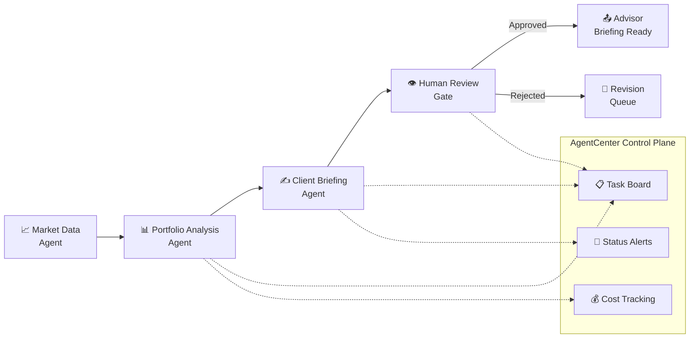

Wealth management teams run a lot of quiet AI agents. Portfolio rebalancing alerts. Market news digests. Client commentary drafts that advisors use to prep before calls. Risk exposure summaries generated every morning before the market opens.

They run quietly, and that's exactly the problem.

When one fails, nobody notices. The advisor walks into a client call with a stale briefing, or the risk summary never shows up, or the nightly rebalancing flag gets swallowed somewhere in a pipeline and nobody picks it up until the client asks why nothing happened.

AI agents for wealth management teams work best when they have a control plane behind them. Without one, you're flying on trust and hoping nobody asks where the Monday morning report came from.

## The Real Bottleneck

The problem most wealth management teams hit isn't building the agents. That part usually works fine in development. The problem is running them reliably in production, across real client portfolios, on a schedule that aligns with market hours and advisor availability.

Three specific patterns keep showing up:

**Client report agents that fail mid-run.** A briefing agent completes the market data pull but hits a timeout on the portfolio calculation step. It logs an error nobody reads, and the advisor gets nothing. They assume the briefing will arrive. It doesn't.

**Agents that succeed but produce outdated output.** A market news agent pulls from a cached API endpoint and reports a "success" status while delivering yesterday's data. No error fires. The advisor reads a summary that's 18 hours old and nobody knows until they fact-check it live with a client.

**Multi-agent pipelines that lose tasks between steps.** A risk-check agent completes, but the approval-gate agent never picks up the result. The trade recommendation sits in a queue that nobody is watching. The advisor is waiting on a signal to act. It never comes.

None of these show up as crashes. They look like normal operation until they don't.

## How AgentCenter Solves This for Wealth Teams

**Real-time agent status on the [agent dashboard](/features/agent-dashboard).** You can see which client briefing agents are running, which completed, and which are stuck. If an advisor's morning briefing hasn't arrived 30 minutes before their first call, someone can see that on the board and act. Not discover it when the advisor calls.

**Task dependencies.** You configure the risk-check agent as a required upstream step before the recommendation agent starts. If risk check fails, the recommendation agent doesn't run. No more half-complete pipelines reaching advisors with one step missing.

**Deliverable review gates.** For outputs that go directly to advisors or clients, you add a human review step before delivery. The agent submits the briefing as a deliverable. A reviewer approves or flags it. Only approved deliverables reach the advisor queue. This matters most for any output touching a client relationship.

**@Mentions and task threads.** When an agent flags an issue or a deliverable is ready, the relevant advisor or reviewer gets a notification via @mention in the task thread. Nobody has to check a separate system. The context stays attached to the task.

**Per-agent cost tracking.** Long-context analysis across a full portfolio can cost real money per run, especially when you're running it for dozens of clients on a daily cadence. The [monitoring features](/features/agent-monitoring) surface per-task costs so you can see which client portfolios are most expensive to analyze and adjust model choice or run frequency accordingly.

## The Numbers

A mid-size RIA or wealthtech product team typically runs 12 to 25 agents. You have market data agents, per-client briefing agents, shared risk calculation agents, and advisory workflow agents that trigger based on market events.

The Pro plan ($29/mo, 15 agents) covers smaller teams and firms. The Scale plan ($79/mo, 50 agents) fits enterprise wealth platforms or firms running per-advisor agent sets. Both come with a 7-day free trial on monthly plans.

What it replaces: ad-hoc cron jobs, shared spreadsheets tracking which report ran, Slack messages from advisors asking where their briefing is, and manual reconciliation of which client got which version of which output.

## Before and After

| | Without AgentCenter | With AgentCenter |
|---|---|---|
| Visibility | No way to see which client briefings are complete | Agent board shows real-time status per task, per client |
| Task handoffs | Pipelines chain via cron with no handoff confirmation | Task dependencies enforce correct sequencing |
| Error detection | Advisor discovers stale output during a client call | Failed agent surfaces immediately on the dashboard |
| Cost tracking | No per-client cost attribution; model spend is opaque | Per-task cost visible across every run |
| Debugging time | 2-3 hours per incident tracing logs across scripts | Activity feed shows exactly what ran and when |

## Where to Start

Set up deliverable review gates first.

Before you wire more agents into your advisory workflow, put a human approval step on any output that reaches an advisor or client directly. That single gate catches the highest-cost failures: outputs the agent marked "complete" that were wrong in a way that matters to a real person.

Once you can see what your agents are actually producing, you know what to fix next. The [features overview](/features) covers how review gates wire into task boards and monitoring so the whole workflow stays visible in one place.

---

*Wealth management teams that add a control plane early spend less time firefighting later. [Start your 7-day free trial](/pricing).*
