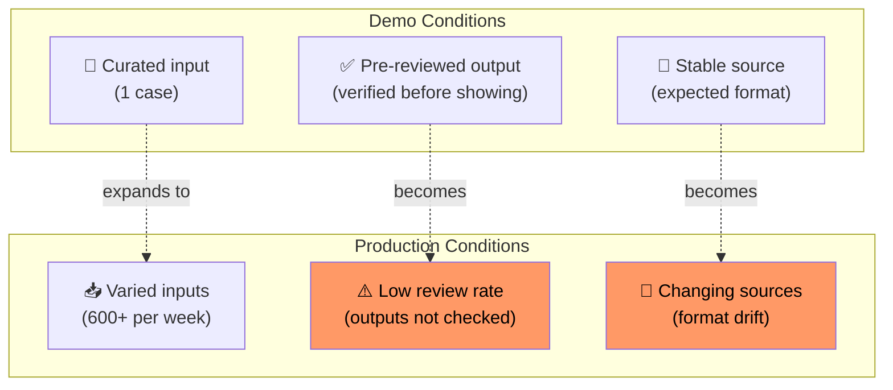

You ran the demo. The research agent pulled data from three sources, synthesized a clean brief, flagged two risks worth escalating. Total time: 4 minutes. The VP leaned forward and said "this needs to be in every workflow."

That was the beginning of a problem.

## The Demo Is a Sample Size of One

Here's what happened in that 4-minute demo: you picked the test case. You knew the inputs were clean. You had already verified the output before presenting it. The sources returned exactly the structure the agent expected. Nothing broke.

Production is not that.

In production, you get 600 cases per week, not 1. Inputs come from real users, which means some are malformed, some are unusually long, some reference context the agent has no access to. The sources your agent depends on change their API responses without warning. And nobody has 4 minutes to review each output — which means the bad ones travel further before anyone catches them.

The gap between the demo and production is not a technology gap. It's an exposure gap. The demo showed the best case. Production shows everything else.

## What Actually Breaks After the Demo

The failure modes that show up after a successful demo are usually not dramatic. They're quiet.

**Format drift**: An external data source starts returning an extra field, or renames a key. The agent keeps running. The output changes subtly. Three weeks pass before someone notices the brief template is missing a section.

**Edge case volume**: In staging, you tested 20 cases. In production, case 300 has an input type nobody anticipated. The agent produces something technically complete but logically wrong.

**Review gap expansion**: Right after launch, the team reviews outputs carefully. After week two, confidence builds. Review rates drop. The outputs that were marginal in week one are now going straight to users.

**Expectation creep**: The stakeholder who saw the demo now assumes all agents work like that. New requests arrive. Engineering ships fast to meet the expectation. The quality gates that existed in the first agent don't get replicated in the next three.

Each arrow above represents a transition that teams don't plan for because the demo gave no reason to.

## The Pressure a Successful Demo Creates

A clean demo doesn't just impress people. It sets a benchmark.

Once a stakeholder has seen the agent work, that performance becomes the expectation. Anything below it is perceived as regression, even if what they saw was never the typical case. When the research agent produces a malformed brief in week 4, it's not "expected variance in an early system" — it's "the agent broke."

This creates real pressure on engineering. Shipping speed increases to stay ahead of expectations. Review gates get lighter. Staging gets less thorough. These choices compound.

The decision you're actually making when you run a demo is: "I'm committing to this level of performance as the baseline." Make sure the baseline is real before you make that commitment.

## What to Do Instead

Run the demo. Show the work. But treat it as an existence proof, not a validation.

Before the demo becomes a deployment roadmap:

1. **Run 50 real cases, not 1.** Look at the distribution of output quality. If 20% of cases produce outputs you'd be uncomfortable sending to a stakeholder, that's your production failure rate, not a staging anomaly.
2. **Find the malformed-input behavior.** What does the agent do when an input is half-formed or ambiguous? If it fails silently, that needs to be addressed before any scale-up.
3. **Define passing output in writing before the demo.** If you can't describe what a passing output looks like in two sentences, you don't have acceptance criteria yet, and your review gate has no teeth.
4. **Show a failure case in the demo.** One that the system handles gracefully. This sets honest expectations and builds more durable confidence than a clean run ever could.

Setting up [approval workflows](/features/task-orchestration) before the first production run is where teams that avoid the demo-to-disaster pattern diverge from teams that don't. Review gates added after the first incident are always playing catch-up.

## Who This Matters Most For

This pattern is most damaging in two specific situations.

The first: technical founders demoing agents to investors or early customers. The demo goes well. Pressure to expand builds fast. The operational layer — [monitoring](/features/agent-monitoring), review workflows, version control for prompts — gets treated as something to add later. Later arrives when something fails in a customer meeting.

The second: ML engineers presenting a new agent workflow to a non-technical product lead or VP. The demo becomes an implicit commitment. "You showed me it works" is a hard argument to counter six weeks later when the same inputs produce worse results.

In both cases, the problem is not the demo itself. It's the distance between what the demo showed and what production requires, and whether anyone on the team is tracking that gap.

## The Honest Caveat

A clean demo is worth celebrating. It means the core capability is real. Agents that work in one controlled case can be made to work reliably in production — it takes test coverage, monitoring, review gates, error handling, and realistic load testing.

That work is not glamorous. It doesn't fit in a 4-minute presentation. But it's the work that determines whether the thing you demoed actually becomes a production system or becomes a story about the time the agent went rogue in week 3.

Agents don't fail loudly. They accumulate debt quietly. A successful demo is the moment to invest in that unglamorous layer, not the moment to skip it. The gap between the demo and production is where the real agent work happens. And it's rarely as small as it looks in the room after the demo goes well.

---

*The dashboard won't fix a broken agent. But it will tell you which one is broken at 3am. [Try AgentCenter free](/pricing).*
