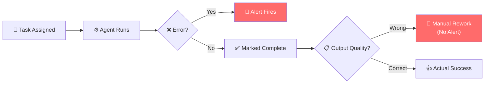
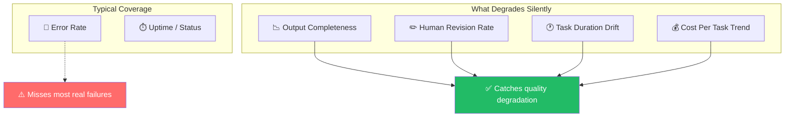

We had three months of sub-2% error rates. Alerts were quiet. The agent fleet felt stable.

Then someone actually read the outputs.

Thirty percent of completed tasks needed rework. Some were missing sections. A few had pulled from the wrong date range. One had been writing 200-word summaries when the brief asked for 600. None of these were errors. All of them showed up as "completed."

## Error Rate Is One Signal, Not a Health Score

An error rate tells you how often an agent crashes, times out, or explicitly fails. That number matters. A 15% error rate is a real problem worth fixing immediately.

But it doesn't tell you:

- Whether the output was correct
- Whether the agent finished the task or just stopped
- Whether it's taking twice as long as it did last month
- Whether it's burning three times the tokens per run

These aren't errors. They're degradations. And degradation is invisible to error-rate monitoring.

## What Silent Success Looks Like

There's a failure pattern worth naming: the agent runs without errors, marks the task complete, and produces output that looks plausible until someone reads it carefully.

A document summarizer that writes to the wrong length. A data agent that queries the right table but the wrong date range. A content agent that skips the conclusion. All pass the error check. None pass a human review.

This isn't edge-case behavior. Once you start sampling outputs regularly, you find it in most production agent setups. The rate varies by team and task type, but the pattern is consistent: error rate and output quality drift in different directions, and error rate gives you no warning.

## Three Signals That Error Rate Misses

**Output completeness.** Did the agent finish the full task or stop partway through? For structured outputs, count whether required fields are present. A report with four of five sections isn't done, even if the agent said it was. This can be automated for any output format with a defined schema.

**Human revision rate.** How often does someone edit an agent's output before using it? If you track this at all, watch the trend, not just the snapshot. Revision rate climbing from 20% to 40% over six weeks means something changed: the prompt, the model, or the upstream data. Error rate won't show that movement.

**Task duration drift.** [Agent monitoring](/features/agent-monitoring) that includes per-task wall-clock time is one of the most underused signals in production. An agent that takes 90 seconds to do what used to take 40 is telling you something: prompt bloat, model latency shifts, rate limit backpressure, or an upstream API slowing down. Cost follows duration, so this compound problem gets expensive quietly.

## What Good Coverage Looks Like

The agents that fail loudly are the ones you fix fast. The ones that drift slowly are the ones that erode team trust before anyone locates the source.

## The Habit That Actually Helps

Once a week, pull five completed tasks at random and read the actual outputs. Not the metadata. Not the status field. The content itself.

This sounds obvious. It's also something almost no team does on a schedule. Review happens reactively, when someone downstream catches a bad output and files a bug. By that point, the drift has been running for days or weeks.

[Surfacing completed tasks in a central review queue](/features/agent-monitoring) makes this habit lower-friction. If all outputs are visible in one place, random sampling takes five minutes. If you're digging through logs or calling separate APIs per agent, it won't happen consistently enough to matter.

Keeping the [task view](/features/task-orchestration) accessible to the whole team, not just engineering, helps too. The people most likely to catch a bad summary or a wrong date range are the ones who know what the output is supposed to look like.

## Who This Hits Hardest

Teams past their first few agents. When you have one agent doing one job, you tend to review its outputs by habit. At ten agents across three workflows, that habit breaks down and the dashboard becomes the default signal.

Engineers who inherit agent systems are especially exposed here. The original builder reviewed outputs as part of building. The person who takes over watches the dashboard, because that's what they have access to and what fires pages.

## An Honest Note

Error rate is still worth tracking. This isn't an argument to stop monitoring it. Real errors matter, and a rising error rate is a genuine signal.

The point is that low error rate is not the same as working correctly. It's a floor, not a ceiling. Most teams treat it as a green light. It's one signal among several, and it's the one that produces false confidence the most reliably.

AgentCenter gives you visibility into task status, output review, and monitoring metrics. It won't automatically score output quality. That judgment still takes a human. What it does is make the sampling habit easier to maintain by putting everything in one place, so the weekly review doesn't require a research project just to get started.

---

*The dashboard won't fix a broken agent. But it will tell you which one is broken at 3am. [Try AgentCenter free](/pricing).*
