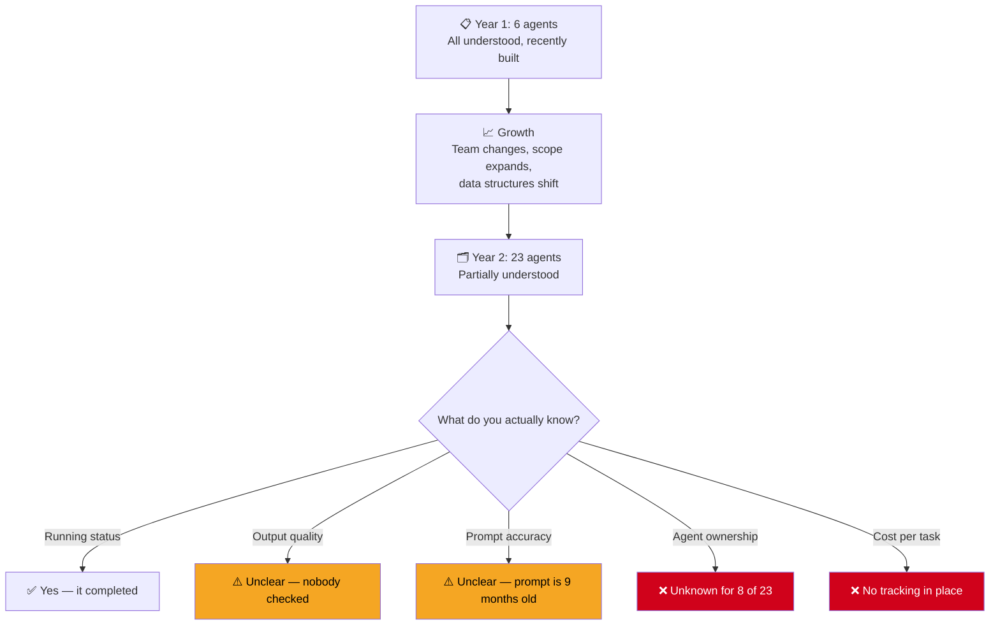

We ran our first agent in early 2025. By month three, we had six. By month fourteen, we had 23.

The jump from six to 23 didn't feel dramatic while it was happening. One agent for content drafts. One for competitive monitoring. A few for internal data workflows. Each one felt like a small addition. Then you look up and you have a fleet.

Year one of AI agent management is mostly about possibility. Year two is about accountability.

## What Changes When Your Fleet Outgrows Your Memory

In year one, everyone knows which agents are running. You built them. You remember why. The prompt is fresh in your head, the output quality is something you spot-checked last week.

By year two, three things have happened.

First, **people leave or shift roles.** The engineer who built your best-performing agent moved to a different team eight months ago. Nobody inherited the context. The agent still runs. It just runs without anyone who fully understands it.

Second, **the world changes but the agents don't.** Your CRM API updated its schema. Your data pipeline got restructured. The prompts your agents are running were written for an older version of reality. The outputs still look reasonable, so no one flags it. But "reasonable" and "correct" are not the same thing.

Third, **you can't answer basic questions anymore.** Which of your 23 agents is the most expensive to run? Which one last had a human review its output? Which one hasn't been touched in six months? In year one you knew this off the top of your head. In year two you have to dig.

## The Visibility Gap That Opens Up

The real problem with year two isn't any single agent. It's the gap between what you think your fleet is doing and what it's actually doing.

A green status light tells you an agent completed. It doesn't tell you the agent did the right thing. That distinction sounds obvious. Most teams don't act on it until something breaks badly enough to trace back.

## Three Things That Bite You in Year Two

**Agent ownership dies quietly.** When you have three agents, ownership is obvious. When you have 23, it gets murky. Someone built the agent. Someone deployed it. Someone reviewed it once. Now it runs, and if you asked "who owns this?", you'd get three different answers or a long pause.

Unowned agents don't get updated when they should. They don't get retired when they should. They accumulate drift, consume tokens, and produce outputs nobody is reviewing.

**Prompt drift is invisible until it isn't.** Agents don't fail dramatically when their prompt goes stale. They degrade. Output quality drops 10%, then 20%. If you're not reading the outputs regularly (and most teams aren't, because that defeats the purpose), you won't notice until something reaches a stakeholder who doesn't know to lower their expectations.

We had this happen with a market summary agent. The prompt referenced a data field that got renamed three months earlier. The agent was still producing summaries. They were coherent. They were also based on null values being interpreted as zeros. Nobody caught it for six weeks.

**Costs accumulate in places nobody is looking.** Year one, you know what your agents cost. Year two, you have agents running on schedules, on triggers, on recurring tasks. You've lost track of what the full number is. You're probably not overspending by a lot. But you also can't say you're not overspending at all, which is a different kind of problem.

## What Year-Two AI Agent Management Actually Requires

The teams that handle year two well have usually done a few things early that felt like overhead at the time.

They assigned explicit owners to each agent and tracked those owners somewhere visible. When someone left or shifted, ownership transferred. It took ten minutes to set up and saved hours of archaeology later.

They ran a simple review schedule. Not a full audit. Just someone reading a sample of agent outputs once a week. That habit catches prompt drift before it compounds. It also means someone stays close enough to each agent to notice when it stops making sense.

They tracked cost per agent, not just total spend. Knowing that your research agent costs $4.20 per task and your summary agent costs $0.18 changes how you think about which ones to run on what cadence. Knowing you have 23 agents and your total monthly bill is $X tells you very little.

None of this is technically hard. It's operationally disciplined. That gap between "technically possible" and "operationally disciplined" is what separates year-one teams from year-two teams.

## Who Feels This Most

If you've been running agents for six months or more and haven't formalized ownership, review cycles, or cost tracking, you're on this path.

You'll get there eventually. Something will break in a way that requires you to understand an agent you haven't looked at in four months. Or you'll get a stakeholder complaint about output quality and realize you have no history to trace it back through.

You can set that infrastructure up now, while things are calm. Or you can set it up under pressure after something goes wrong. The second option always feels more urgent. It's never the better one.

## The Honest Part

The [agent monitoring features](/features/agent-monitoring) in AgentCenter give you status, cost, and error visibility across your whole fleet in one view. The [Kanban board](/features/task-orchestration) makes ownership visible without spreadsheets. Those help.

But they won't fix a prompt that's stale or an agent that's solving the wrong problem. That's still your job. The tooling makes the operational habits easier to keep. The habits have to come first.

Year two of AI agent management is mostly about building the discipline year one didn't require. The earlier you start, the cheaper it gets.

---

*The dashboard won't fix a broken agent. But it will tell you which one is broken at 3am. [Try AgentCenter free](/pricing).*
