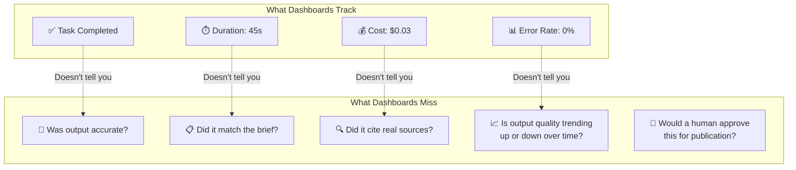

We had a monitoring dashboard. It showed green for six weeks. The agents were running. The tasks were completing. The error rate was near zero.

We also had an agent producing reports that, on closer reading, contained made-up competitor pricing from sources that didn't exist. The monitoring dashboard showed: healthy.

That's what most dashboards miss.

## What Dashboards Are Good At

Modern monitoring dashboards for AI agents do a reasonable job of showing:

- Whether the agent is running
- How long tasks take
- How many tasks completed vs failed
- API error rates
- Token usage trends

These are useful signals. An agent that's offline or throwing errors is clearly broken, and a good dashboard catches that.

## What Dashboards Are Bad At

Dashboards are bad at answering: was the output correct?

This is a fundamentally different question. An agent can complete successfully — no errors, normal duration, reasonable cost — and still produce work that is wrong, harmful, or useless.

The correctness of AI output is not a metric you can measure the same way you measure latency. It requires judgment. It often requires domain knowledge. Sometimes it requires reading the output and knowing what "right" looks like.

## The Three Gaps

**Gap 1: No ground truth comparison.** To know if output is wrong, you need to know what "right" looks like. For most agent tasks, this is either a human judgment call or a downstream system check. Neither integrates cleanly into a metrics dashboard.

**Gap 2: Quality drift is slow.** Infrastructure failures are fast — a server goes down, you know immediately. Quality drift happens gradually. An agent producing slightly worse outputs today than last month is a trend you catch by reviewing outputs, not by watching latency charts.

**Gap 3: The task might be fine, the decision might not be.** An agent summarizing a legal document might produce a well-written, correctly formatted summary that misses the key clause. The summary looks good. The missing clause is expensive. No metric catches this without someone reading the output.

## What Actually Closes the Gap

**Human review gates.** This is the most direct solution. Before any agent output goes downstream, a human reviews it. Not every output — a sample is often enough to catch systematic quality issues. AgentCenter's [deliverable review workflow](/features/agent-monitoring) makes this a structured step, not an afterthought.

**Rejection rate tracking.** If you have a review gate, track how often reviewers reject agent outputs. A rejection rate of 5% is normal. A rejection rate that climbs from 5% to 25% over two weeks is a signal that something changed. You can't get this metric without the review gate.

**Domain-specific quality checks.** For tasks where "correct" has a clear definition — output must be valid JSON, output must contain a specific field, output must not exceed 500 words — automate the check. These aren't quality judgments, they're format validations. Automate format; review substance.

**User feedback loops.** If agent outputs eventually reach users or downstream systems, build feedback into the loop. Did the customer find the support response helpful? Did the product manager accept the generated spec? These signals, even imperfect ones, tell you something about quality over time.

## What the Reader Should Take Away

Your monitoring dashboard is the floor, not the ceiling. It tells you the agent is running. It doesn't tell you the agent is useful.

Add at least one mechanism for quality feedback. A review gate, a rejection rate metric, a periodic manual audit. Something that requires a human to look at what the agent actually produced and decide if it was any good.

That's not dashboard work. It's operations work. And it's where most monitoring setups stop short.

## Who This Matters Most For

This matters for anyone whose agents produce outputs that matter: content that goes to customers, decisions that affect business operations, analysis that informs strategy. If nobody's going to read the output carefully, quality doesn't matter much. If someone is, it matters a lot.

## Honest Caveat

Adding a human review gate slows things down. That's the tradeoff. If you're reviewing 100 agent outputs per day, you need a reviewer. That's a resource cost. Decide whether the quality risk is worth the review cost based on your specific use case, not as a blanket policy.

_The dashboard won't fix a broken agent. But it will tell you which one is broken at 3am. [Try AgentCenter free](/pricing)._
