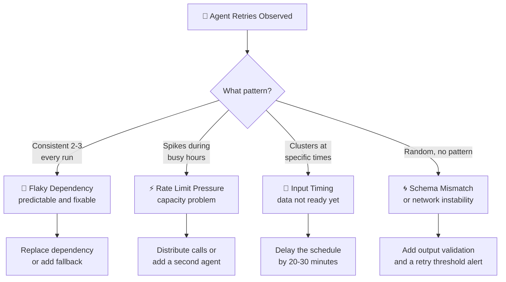

We had an agent running a daily competitor analysis. It pulled from five sources, summarized them, and dropped a report into a shared channel. Clean, useful, worked every morning.

Except it was retrying an average of four times per run. Every run. For three weeks.

Nobody noticed because the agent was completing successfully each time, so no alert fired. The report showed up in the channel every morning. Everything looked fine. We only discovered the retries because someone dug into logs while chasing a different problem entirely.

Four retries per run meant the agent was hitting a flaky API endpoint, backing off, retrying, and eventually getting through. Most days. Some days it hit the retry limit and the report just didn't come. We chalked those up to rare API outages. They weren't rare. They were predictable. And they were about to get worse as we added more tasks to that same agent.

## Retries Are Not a Sign the System Is Working

Most teams treat retries as a success. Agent retried three times, got through on the third try — great, the system did what it was designed to do. Move on.

That framing is wrong.

Every retry is your agent telling you something is broken upstream. It's not resilience. It's compensation. The retry mechanism is working fine. But the thing making retries necessary is not.

When you treat retries as noise, you miss the signal. And the signal usually gets louder before it turns into a complete failure.

## What Different Retry Patterns Mean in Production

The patterns retries reveal depend on where and when they happen.

**Consistent low retries on every run:** Two or three retries on every single execution almost always points to a flaky external dependency. An API that's slow to respond, a tool that needs a warm-up call, a parsing step where the first response occasionally fails format validation. It's not random. It's predictable. And that means it's fixable.

**Intermittent spikes:** Normal for days, then eight to ten retries for a period, then back to normal. This is usually rate limit pressure. The agent is hitting a provider's per-minute or per-day cap during high-traffic windows. Adding a second agent to share load, or spreading calls over a longer window, usually solves it. The underlying agent isn't broken. It's just fighting for capacity it doesn't have.

**Retries clustering at specific times of day:** Input timing problems. If an agent pulls from a live data source and most retries happen between 8am and 9am, the source is probably still being populated when the agent runs. The data isn't wrong — it just isn't ready. Shifting the schedule by 30 minutes often makes the retries disappear entirely.

**Random retries with no pattern:** Network instability, or the model returning outputs that don't match your expected schema often enough to trigger retries. The fix here is usually better structured output validation and an alert when the retry rate climbs past a threshold.

## The Per-Agent View Is What Matters

The real problem with retries isn't that they happen. It's that most teams only see aggregate retry counts.

An average of 1.2 retries per agent might mean every agent retries once occasionally. Or it might mean one agent retries six times every single run while the rest are clean. These are completely different situations. The aggregate hides both.

At five agents, you remember which ones tend to be flaky. You built them, you know their quirks. At 12 agents, you've lost that context. Someone built an agent three months ago and moved to another team. Another was added for a project that wrapped up, and it's still running. Retries are often the first sign something is quietly broken — long before the failure is visible enough to trigger a status alert.

The habit worth building: any agent with a consistent retry rate above two gets flagged for investigation. Not because it's failing — it might be completing just fine. But because it's working harder than it should, and that has a cost. Slower runs. Higher token usage. Occasional complete failures when retries run out. Degraded output quality when the agent succeeds on a retry but got incomplete data on the first attempt.

This is where [agent monitoring](/features/agent-monitoring) becomes a diagnostic tool rather than a green/red status board. When you can see retry counts per agent alongside runtime, cost, and error rate, the pattern jumps out immediately. Without per-agent visibility, you're reading an aggregate that tells you almost nothing.

## Who Hits This Problem First

If you're running fewer than five agents, you probably don't have this problem yet. You'll remember which ones tend to be flaky.

If you're running 10 or more in production, you've already hit it. You just might not know it yet. The agents that retry the most are often not the ones producing obvious failures. They're the ones that look fine on the surface — completing their runs, delivering outputs — while quietly eating through your API budget and setting up for a harder failure later.

This hits ML engineers and DevOps leads the hardest, because they're the ones responsible for the agents they didn't build. Inherited agents, agents from departed teammates, agents running tasks that nobody remembers commissioning. Retry patterns give you a fast way to see which of those deserve attention.

In [multi-agent workflows](/features/multi-agent-workflows), the agent retrying the most is usually creating a bottleneck downstream. Fixing that one agent often improves throughput across the whole pipeline.

## What This Won't Fix

Tracking retries doesn't fix anything on its own. If the upstream API is flaky, you still have to fix that. If your data source has timing issues, you still have to adjust the schedule. The retry data tells you where to look, not what to do when you get there.

There's also a real risk of over-investigating. Not every retry pattern is worth chasing. Some external APIs are just unreliable, and two retries is an acceptable cost given the value the agent delivers. The goal isn't to eliminate all retries. It's to catch the cases where retries are masking something that's about to break — before that something causes a real failure at the worst possible moment.

Retries are your agents trying to tell you something. The question is whether you're listening.

---

*The dashboard won't fix a broken agent. But it will tell you which one is broken at 3am. [Try AgentCenter free](/pricing).*
