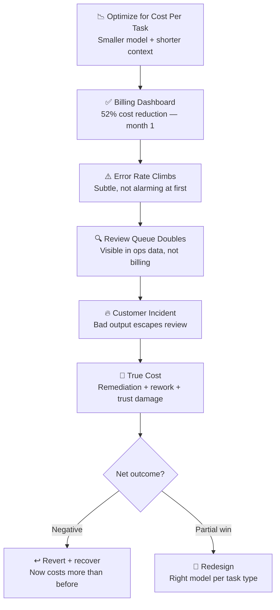

The cost report came back looking great. Twelve agents running in production, LLM spend down 52% after we moved eight of them to a smaller model and cut context windows from 128k to 32k tokens. Finance was happy. Engineering felt smart. We shipped a dashboard showing the savings.

Three weeks later, we had two customer-facing incidents, a 340% increase in output errors, and a human review queue taking twice as long to clear. The cost savings were real. The cost of those savings was not in any spreadsheet.

## What "Cut Costs" Actually Means for an Agent

When someone asks you to reduce agent costs, they usually mean: reduce your LLM spend. The levers are obvious. Smaller model. Shorter context. Fewer API calls. You see the results in your billing dashboard by end of month.

What you don't see in your billing dashboard: how many outputs the agent got wrong, how long a human spent reviewing and fixing them, and whether any bad outputs reached production before anyone noticed.

We changed eight agents. Here's what happened to three of them.

**Agent 1: Document summarization.** Moved from a 128k context window to 32k. Cost per task dropped 60%. The documents we were summarizing averaged 40k tokens. The agent started working with truncated input and producing summaries that missed the second half of every document. We didn't catch it for 11 days because the summaries looked right on a quick scan.

**Agent 2: Data extraction.** Switched to a smaller model. Error rate jumped from 0.5% to 8.3%. One in 12 records came back with hallucinated field names. We caught this fast because we had output validation, but each failed record needed manual remediation. The remediation labor cost more per task than the original model had.

**Agent 3: Multi-source triage.** This one pulled outputs from two upstream agents, both also switched to cheaper models with shorter context windows. The triage agent was now synthesizing truncated summaries from truncated summaries. It made confident decisions based on incomplete chains. That's what caused the customer incident.

## The Metric That Was Missing

The failure wasn't picking the wrong model. The failure was measuring the wrong thing.

Cost per task is not the same as cost per good output. If a task costs $0.02 with a small model but 1 in 10 results needs human correction at 15 minutes per correction, your real cost is nothing like $0.02.

We were chasing the number we could see and ignoring the number that mattered. AgentCenter's [agent monitoring](/features/agent-monitoring) showed task completion rates above 95% for all eight agents throughout this period. Nothing looked wrong in the status view. The error signal was in the output review queue and the error log, not the task completion rate. Those two things need to be in the same view before cost changes make any sense.

## What You Need to Baseline First

Before you change a model or reduce context on any agent, you need numbers for:

**Error rate per agent.** Not system errors. Output quality failures. These require human or automated review to catch. If you don't have this baseline, any change you make is a guess.

**Review time per task.** How long a human spends reviewing or correcting each output. This is where cost reductions most often show up as cost increases elsewhere.

**Rework rate.** How often an agent's output triggers a follow-up task that wouldn't have existed otherwise. One bad summarization agent can create two or three downstream tasks for every bad summary.

If you don't have those three numbers before making a change, you can't evaluate whether the change worked. You can only evaluate whether your bill changed.

## Where Cost Reduction Actually Works

Smaller models and shorter contexts aren't always the wrong choice. Some tasks don't need a frontier model or a 100k context window, and running them on one is its own kind of waste.

Routing and classification tasks are a good fit for smaller models. Short, well-scoped tasks with structured outputs usually hold up fine. Tasks with predictable input shapes can often handle tighter context limits without quality loss.

The mistake wasn't doing cost reduction. It was applying it the same way to every agent regardless of task complexity, context requirements, and error tolerance.

Agent 2 (data extraction from structured documents) stayed on the cheaper model and performed fine once we gave it back its context window. It was the right call for that agent. Agents 1 and 3 should never have been touched.

## Who This Matters For

If your team reports LLM spend to finance but doesn't report review labor and remediation time in the same place, the savings will always look better than they are. The cost of a bad output doesn't appear in the API bill.

A team of five engineers running 20 agents can spend 10 hours a week clearing an output review queue. That's half an engineer's time per week. It doesn't show up in your AI costs. It shows up as "the team seems busy" until someone looks at where the time is actually going.

This is especially common in teams where cost reduction decisions are made by someone who can see the billing dashboard but not the review queue. The two views need to be connected before any cost decision is made.

## The Honest Caveat

Not every team will have this experience. If your agents run simple, bounded tasks and you've validated them properly on the target model before switching, you might be fine. This is a pattern, not a guarantee.

But if you're going to make model changes without measuring quality impact first, you're making a bet without knowing the odds. Most teams that have run agents long enough have at least one story like this.

The right sequence: baseline your quality metrics, change one agent, watch the numbers for two weeks, then decide if the change holds. It's slower. It's also the only way to know if the savings are real.

Check what your agents' actual cost picture looks like with output quality included at [/features/agent-monitoring](/features/agent-monitoring) and see [pricing](/pricing) for what it costs to run both views together.

---

*The dashboard won't fix a broken agent. But it will tell you which one is broken at 3am. [Try AgentCenter free](/pricing).*
