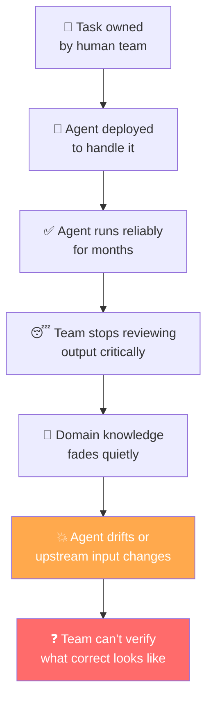

Eight months in, we had an agent handling data normalization. Twenty-three vendor export formats, all mapped to a single internal schema. It ran clean every night — no errors, no alerts, no drama.

Then a vendor quietly updated their export format. One new column header in a field we'd always treated as optional. The agent didn't crash. It just silently dropped every record that included the new field.

Eleven days passed before we noticed. Not because we lacked monitoring. We had dashboards. We had alerts. But every engineer who checked the output saw numbers that seemed about right, and moved on. Nobody remembered what "right" actually looked like anymore. The agent had been handling that task so reliably, for so long, that the team stopped holding the mental model of what correct output was supposed to be.

That's the part nobody plans for. Agents don't just automate tasks. Over time, they quietly replace the knowledge your team had about those tasks.

## The Knowledge Transfer Nobody Plans For

When you deploy an agent, you're focused on whether it can do the job. Does it produce accurate output? Does it handle edge cases? Does it run without supervision?

Those are the right questions. But there's one most teams skip entirely: after six months of the agent running fine, will anyone on your team still know what to do when it stops?

Skills degrade when they're not exercised. The engineer who built your normalization logic knows it cold right now. In a year of the agent handling everything, that familiarity fades. And any engineer who joins after the agent was deployed learns the output format — not the underlying logic that makes the output correct.

You end up with a team that can describe what the agent produces, but not evaluate whether what it produced is right.

## What This Looks Like in Practice

Three patterns, all real:

**Code review agents.** A team deploys an agent to flag issues before human review. Junior engineers start waiting to see what the agent surfaces before reading the code themselves. The agent is good — but it misses a class of architecture issues that aren't in its training context. Nobody catches this for months, because nobody is reading code deeply anymore. They're reading the agent's summary.

**Report generation.** An agent assembles weekly business reports from raw metrics. The engineering team slowly forgets that there are two competing definitions of "sessions" in their analytics setup — the agent uses one, not the other. A product manager asks a question the agent can't answer. Nobody in the room can explain what the numbers mean.

**Data validation.** Same story as the normalization example above. The agent runs clean, so nobody reviews the output sample. When something changes upstream, there's no tripwire — just a quiet data gap that surfaces 10 days later when a downstream report looks wrong.

This isn't a freak failure mode. It's a predictable sequence. The agent runs well, so attention shifts elsewhere. Domain familiarity fades. When the agent eventually drifts or hits something new, the team lacks the reference point to catch it.

## What to Do About It

Three habits that actually help:

**Keep one person who can do the task without the agent.** Not full time. But someone on your team should run the manual version occasionally — not as a test of the agent, but to keep domain knowledge alive. When the agent drifts, you need someone who recognizes what wrong looks like before the downstream effects pile up.

**Document what correct output looks like before you hand off the task.** Most teams skip this because the agent is already working. But "the agent runs clean" and "this output is correct" are different claims. Write down the definition of correct output, the expected ranges, the known edge cases. That document becomes your audit spec six months later when something feels off and you need a baseline.

**Rotate manual review even for your most reliable agents.** Not every run — once a month is enough. Have a human evaluate a sample of outputs the way they would have on day one. The goal isn't to catch agent failures your [agent monitoring](/features/agent-monitoring) already handles. The goal is to keep the team sharp enough to recognize the failures monitoring misses.

You can track which agents are running and how often in [AgentCenter's agent dashboard](/features/agent-dashboard). Coverage tells you what ran. Only domain knowledge tells you if it ran right.

## Who This Matters Most For

Engineering leads who deployed agents six or more months ago — especially agents handling data pipelines, content classification, or anything where correctness is evaluated by a human with context rather than a rule-based check.

If the agent on your team is older than the newest engineer's familiarity with the underlying task, the knowledge gap is probably already there. The agent didn't cause it. But it's hiding it.

## The Honest Caveat

Some tasks are fine to hand off fully. Formatting, simple classification, low-stakes generation — the cost of a missed failure is low and the definition of correct is easy to verify externally.

But the more judgment a task requires, the more important it is that someone on your team still holds that judgment. Agents are good at running tasks. They're not good at flagging when something changed upstream in a way they weren't designed to catch, or signaling when their output is subtly wrong rather than obviously broken.

The tools that track error rates and throughput won't catch knowledge atrophy. That's a team discipline problem, not a tooling problem. The monitoring shows you what the agent did. Someone on your team still has to know what it was supposed to do.

---

*The dashboard won't fix a broken agent. But it will tell you which one is broken at 3am. [Try AgentCenter free](/pricing).*
