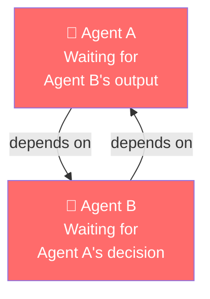
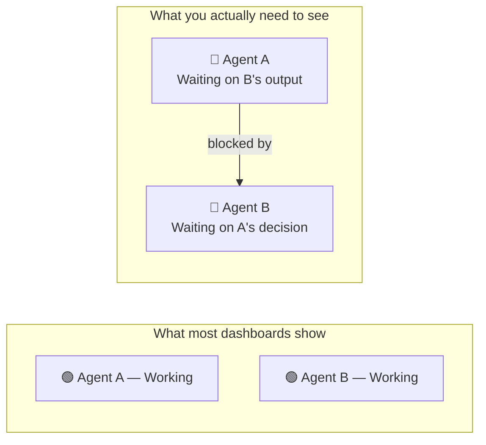

## The queue that kept growing

We had 9 agents running a content research pipeline. The queue showed 47 tasks pending. We'd been watching it for 40 minutes and the number hadn't moved.

No errors. No timeouts. No alerts. Every agent showed status: "working."

Agent 3 was generating context for Agent 7's writing task. Agent 7 was waiting to see Agent 3's framing before it could define what to actually research. Neither agent was failing. Both were just waiting on each other.

That's a deadlock. And unless you're watching the right signals, it looks exactly like normal work in progress.

## What agent deadlock actually looks like

In distributed systems, deadlock has a name, detection algorithms, and prevention patterns. In agent pipelines, most teams don't know to look for it until 45 minutes have passed and someone asks why nothing is finishing.

The classic form: Agent A is waiting for data from Agent B. Agent B is waiting for a decision from Agent A. Both are active in the sense that they haven't crashed or timed out. Neither is making progress.

The less obvious form: Agent A submits its output. Agent B consumes it but writes back a clarification request. Agent A is now paused waiting for that clarification — but nobody is watching Agent A for inbound messages. It's just sitting there.

There's also the resource version: two agents both need write access to the same shared context store. Your system has no locking or queue for that store. Both agents block each other at the I/O layer. Nothing in your logs says why they stopped.

The blocked state doesn't just slow things down. It holds up every downstream task that depends on either agent finishing.

## Why it doesn't look like a failure

This is the part that catches teams off guard: nothing breaks.

No error rate spike. No timeout alert. No memory leak. Every individual agent health check passes. Token consumption might actually drop, because a waiting agent isn't generating tokens. Your cost dashboard looks fine.

If you're monitoring at the infrastructure level — CPU, memory, queue depth in isolation — you will not see this coming.

What you'd need to catch it is: task wait time per agent, dependency graph state, and an alert that fires when an agent has been in a waiting state for longer than a threshold you've set. Most teams don't have any of that on day one.

The pattern shows up clearly in retrospect. You look at the timeline, see both agents enter a waiting state at roughly the same time, and trace the dependency chain backwards. That reconstruction takes time you didn't have.

## How to catch it before the queue fills up

Three things have to be true to detect agent deadlocks before they become incidents.

**Task wait time needs to be a first-class metric.** Not just "is the agent running" but "how long has this specific task been in a waiting state." Five minutes is fine for a complex research task. Forty minutes is not, and that distinction should trigger an alert.

**Dependency relationships need to be visible.** If you can't look at a dashboard and see that Agent A's task is blocked on Agent B's output, you're triaging by reading logs and reconstructing the chain manually. That takes ten minutes you don't want to spend at 2am.

**Status has to distinguish between working and waiting.** "Working" covers too much ground. An agent that's actively generating tokens is different from an agent that's waiting for an upstream deliverable. Treating both as the same state is how you miss the deadlock for 40 minutes.

[AgentCenter's agent monitoring](/features/agent-monitoring) shows real-time agent status with blocked states surfaced at the task level. When an agent is waiting on another agent's output, you can see that dependency in the task view without log archaeology. That's the specific thing that changed our detection time from 40 minutes to under 5.

The left side is what you get from most infrastructure monitoring. The right side is what a proper agent status layer shows you.

## What to do about it before it happens

Agent deadlocks are a design problem as much as a runtime problem. A few patterns that prevent them:

**Break circular dependencies before deployment.** If Agent A's output shapes what Agent B should research, and Agent B's research shapes what Agent A outputs — that's a circular design. One of those dependencies needs to be cut or made sequential. This is easier to see on paper than in a running system.

**Use timeouts on every waiting state.** Every agent waiting on an upstream dependency should have a maximum wait time. When it expires, the task fails explicitly rather than hanging indefinitely. An explicit failure is faster to handle than an ambiguous wait that you don't notice for 40 minutes.

**Make handoff contracts specific.** Agent B shouldn't be waiting for "something from Agent A." It should be waiting for a defined output field in a defined format. If that field isn't present after a reasonable interval, that's a signal — not silent waiting.

None of these require a specific tool. They require treating agent coordination as a design problem you solve before deployment, not a runtime condition you react to.

## Who this hits hardest

Teams running multi-step pipelines where agents hand off to each other. Research-to-writing flows, data-gathering-to-analysis chains, code-review-then-fix loops. Any workflow where one agent's output becomes another agent's input is a candidate for this failure mode.

It's especially common in teams that started with 2-3 agents and never revisited their dependency model as they scaled. Coordination patterns that work at 3 agents start hiding problems at 8.

If you've never mapped your agent dependencies as a directed graph, that's the place to start. You might find a cycle you didn't know was there.

## The honest caveat

Visibility into which agent is waiting on which doesn't prevent deadlocks. You can see the full dependency chain in AgentCenter's [multi-agent workflow view](/features/multi-agent-workflows) and still ship agents that block each other.

The detection layer helps you find it faster. The design work — breaking cycles, adding timeouts, writing explicit contracts — still has to happen before deployment. No dashboard replaces that.

But catching a deadlock in 4 minutes instead of 44 is a real difference when your production queue is sitting at 47 tasks and growing.

---

*The dashboard won't fix a broken agent. But it will tell you which one is broken at 3am. [Try AgentCenter free](/pricing).*
