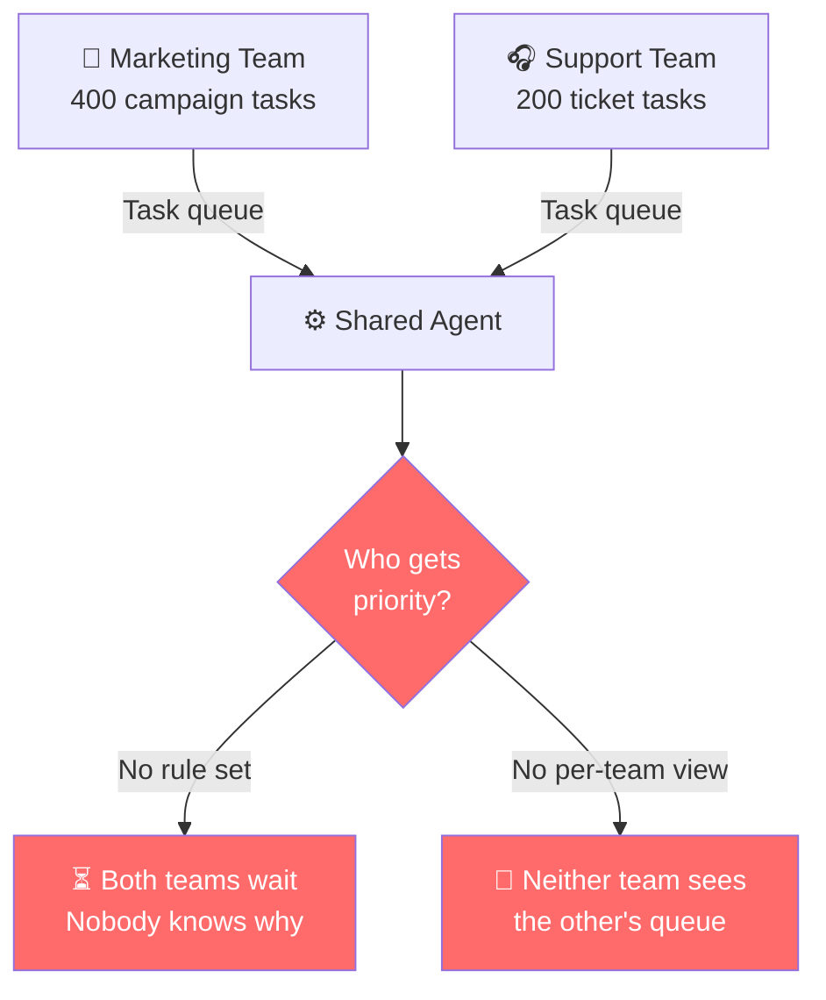

The marketing team's campaign analysis agent and the customer support team's ticket classification agent were the same agent. Not by design. The data engineering team had built it for marketing nine months earlier, support asked if they could use it, someone said yes, and nobody wrote anything down.

For most of those nine months, it worked fine.

Then, on a Tuesday in October, marketing queued 400 campaign analysis tasks for end-of-quarter reporting. Support was clearing a backlog from a product outage the night before. Both teams hit the shared agent simultaneously. Tasks that normally processed in under 15 minutes started taking 45. Support's ticket queue backed up. Marketing's report was going to miss its deadline.

Neither team had visibility into the other's task queue. Neither knew what was causing the slowdown. Both messaged the data engineering team assuming something was broken.

Nothing was broken. The agent was just overwhelmed.

## Why Shared Agents Create Shared Blind Spots

When one team owns an agent, the failure mode is simple: you built it, you monitor it, you get paged when it fails. Shared agents are more complicated — and not in obvious ways.

The problems don't come from the agent itself. They come from the gaps between teams. The things nobody agreed on when the second team started using it.

Here is what actually breaks when two teams share an agent without a coordination layer.

## Priority Conflicts Nobody Planned For

When both teams have urgent work, what runs first? Most agents process tasks in the order they arrive. The team that queued five minutes earlier gets priority, regardless of business importance.

Marketing running end-of-quarter reporting and support handling an outage spike are both urgent. First-in, first-out doesn't know that. It just runs in order.

Without explicit priority rules set before a conflict happens, you're deciding under pressure. That's when teams start working around each other. Marketing starts duplicating the agent on their own infrastructure. Support starts doing ticket work manually. Both teams quietly stop trusting the shared agent because it's become unpredictable.

## Quality Expectations That Silently Diverge

Marketing wanted detailed, structured output: segment breakdowns, attribution notes, numbered lists. Support wanted fast, short summaries: two sentences per ticket, action verbs up front.

The same prompt can't serve both well. So whoever can change the prompt will. And when they do, the other team's output quality quietly degrades. Nobody files a bug because nothing is broken. The agent still runs and produces output. It just gets slightly worse for one team while improving for the other. This goes unnoticed for weeks.

Then one team starts complaining the agent "isn't as good as it used to be." The other team has no idea what changed.

## The Ownership Vacuum

When one team builds an agent, ownership is clear. When a second team starts using it without a formal handoff, ownership becomes murky.

The team that built it no longer feels fully responsible — other people are using it now, so surely someone else is watching it. The teams using it assume the team that built it is still monitoring. Nobody is monitoring.

When something breaks, the actual sequence goes like this: team A notices bad output, messages team B asking if they changed anything, team B says no and messages the original builders, the builders check logs and discover the agent has been misbehaving for six days. Six days of bad output that nobody caught because everyone assumed someone else was watching.

## Debugging Disagreements

When a shared agent starts producing bad output, there is an extra step in the debugging process: figuring out whose tasks triggered the regression.

Without task-level visibility per team, you're comparing outputs across time and guessing. Team A thinks team B changed the prompt. Team B thinks team A's task volume is overloading the context window. Both might be right. Neither can prove it without logs that show which team's tasks changed behavior and when.

Separate task queues with per-team filtering — like the project-level view in AgentCenter's [task orchestration](/features/task-orchestration) — collapses this from a three-day investigation into a ten-minute comparison.

## Scaling Surprises

One team decides to run their workload at 5x normal volume for a one-time batch job and doesn't mention it. Token costs spike. Rate limits kick in. The other team's tasks queue for hours or fail silently.

No malice. Just no coordination.

This is fixable with per-team cost budgets and task rate limits — not per agent, but per team using the agent. Set a ceiling on what any one team can consume before triggering a review. Shared [agent monitoring](/features/agent-monitoring) with team-level cost attribution makes this tractable without building a spreadsheet from scratch.

## Three Habits That Prevent Most of This

**Name an owner, not just a team.** "Marketing owns this agent" is not specific enough when something breaks at 3am. One named person gets paged when the agent degrades. That person reviews the task logs weekly. Everyone knows who to contact.

**Keep execution shared but visibility separate.** Each team should see their own task queue, their own output history, and their own error rate without seeing the other team's work. This is what makes shared agents operationally viable rather than just logistically convenient.

**Set per-team rate limits and cost caps before you need them.** When onboarding a second team to use an existing agent, spend 20 minutes agreeing on limits: how many tasks per hour, what the monthly token budget is per team, and what happens when someone hits the cap. Agree on this when everyone is calm, not when the agent is falling over.

These are not complicated rules. They just need to exist before someone needs them on a Tuesday afternoon.

## Who Runs Into This

Platform teams and ML engineers are most likely to build something that other teams start adopting without a formal process. If you built an agent and six months later two other teams are using it without a handoff or documented ownership, this is already your situation.

The signal is two Slack threads opening at the same time after a failure — both asking "is the agent down?" but neither aware of the other.

## Honest Take

Sharing agents isn't inherently bad. Teams share databases, internal APIs, and shared services all the time. Sharing agents reduces duplication and lets teams benefit from each other's prompt work. The problem isn't sharing. It's sharing without a coordination layer: no named owner, no per-team visibility, no priority rules, no rate limits.

Add those before the second team starts using the agent, and it works well. Skip them and the first time two teams need the same agent on the same afternoon, you'll be rebuilding governance under pressure while output sits in a queue nobody is watching.

---

*The dashboard won't fix a broken agent. But it will tell you which one is broken at 3am. [Try AgentCenter free](/pricing).*
