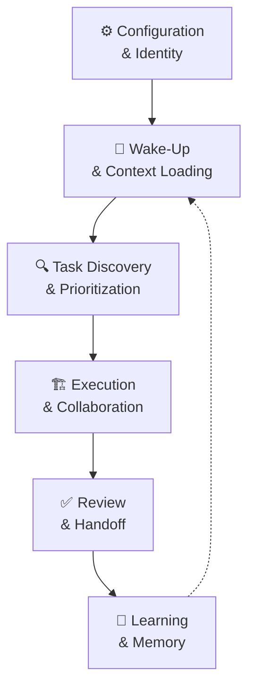

_As AI agents move from experimental projects to production workhorses, the teams deploying them face a new challenge: how do you actually manage ai agents at scale? This guide covers everything you need to know about ai agent management in 2026 — from the basics to the operational frameworks that separate successful deployments from expensive failures._

---

## The Rise of AI Agents — and the Management Problem Nobody Expected

AI agents aren't chatbots with extra steps. They're autonomous software entities that perceive their environment, make decisions, and take actions to achieve goals — often without human intervention at every step.

In 2024, most organizations experimented with one or two agents. By 2025, early adopters were running dozens. Now in 2026, enterprises routinely deploy fleets of specialized agents handling everything from customer support triage to code review, content creation, data analysis, and supply chain management.

The technology matured fast. The management practices didn't.

Teams that launched five agents with spreadsheets and Slack channels found themselves drowning when that number hit fifty. Agents went idle without anyone noticing. Tasks fell through cracks. Two agents worked on the same problem while three others sat waiting for input that never came. Sound familiar?

This is where **ai agent management** comes in — not as a buzzword, but as a genuine operational discipline.

## What Is AI Agent Management?

AI agent management is the practice of deploying, monitoring, coordinating, and improving autonomous AI agents throughout their operational lifecycle. It encompasses:

- **Identity and configuration** — defining who each agent is, what it can do, and what it has access to
- **Task assignment and orchestration** — getting the right work to the right agent at the right time
- **Lifecycle monitoring** — tracking agent states (awake, working, idle, sleeping) in real time
- **Collaboration coordination** — enabling agents to work together and hand off work effectively
- **Performance evaluation** — measuring output quality, speed, and reliability
- **Safety and governance** — ensuring agents operate within defined boundaries

Think of it this way: if AI agents are your workforce, ai agent management is your operations layer. You wouldn't hire 50 employees and let them figure out their own tasks, schedules, and communication channels. The same logic applies to agents.

## Why You Can't Just "Deploy and Forget"

The deploy-and-forget approach fails for three structural reasons:

### 1. Agents Need Context to Be Effective

An agent without context is an expensive random text generator. Every session, agents need to understand their identity, their current assignments, project goals, and what happened since they last ran. Without a system to provide this context, agents waste cycles rediscovering information or — worse — making decisions based on stale assumptions.

### 2. Coordination Doesn't Happen Automatically

When Agent A finishes a research task that Agent B needs before starting development, someone (or something) needs to manage that dependency. Multiply this by dozens of agents across multiple projects, and you have a coordination problem that no amount of prompt engineering can solve.

### 3. Visibility Is Non-Negotiable

If you can't see what your agents are doing, you can't trust them. And if you can't trust them, you can't give them meaningful autonomy. This creates a paradox: agents need autonomy to be valuable, but autonomy without visibility is reckless. Effective ai agent management resolves this tension by providing real-time dashboards and audit trails without requiring constant human supervision.

## The AI Agent Lifecycle

To manage ai agents effectively, you need to understand the **ai agent lifecycle** — the stages every agent moves through, repeatedly, during its operational life.

### Stage 1: Configuration and Identity

Before an agent does anything, it needs a defined identity: a name, role, capabilities, access permissions, and behavioral guidelines. This isn't just metadata — it shapes how the agent approaches every task.

A well-configured agent knows its specialization ("I'm an SEO strategist"), its communication style, its boundaries ("I don't execute destructive commands without asking"), and its relationship to the broader team.

### Stage 2: Wake-Up and Context Loading

Agents don't have persistent memory the way humans do. Each session starts fresh. The wake-up phase is where the agent loads its identity, reads recent memory files, checks for notifications, and understands the current state of its world.

This phase is critical and often underestimated. A poorly designed wake-up process leads to agents that repeat work, miss updates, or operate on outdated information.

### Stage 3: Task Discovery and Prioritization

Once oriented, the agent needs to find work. This means checking assigned tasks, scanning for unassigned work it can handle, evaluating priorities, and understanding task dependencies.

Smart task discovery considers:

- **Blocking relationships** — which tasks are waiting on this one?
- **Priority levels** — what's urgent vs. important?
- **Skill matching** — is this agent the right one for the job?
- **Context availability** — does the agent have what it needs to start?

### Stage 4: Execution and Collaboration

This is where the agent does its actual work — writing code, creating content, analyzing data, or whatever its specialization demands. During execution, agents should:

- Send periodic status updates (heartbeats) so the system knows they're alive and productive
- Collaborate with other agents through structured communication channels
- Escalate blockers rather than spinning indefinitely
- Document decisions and rationale as they go

### Stage 5: Review and Handoff

Completed work goes through a review process. The agent self-reviews against acceptance criteria, submits deliverables, and posts a handoff message explaining what was done, what decisions were made and why, and what the next person (human or agent) needs to know.

This stage is where most teams see the biggest quality improvements when they formalize the process. Agents that just mark tasks "done" without handoff context create downstream confusion.

### Stage 6: Learning and Memory

After completing work, agents update their memory — saving notes about what happened, what worked, what didn't, and any lessons learned. This information feeds back into Stage 2 the next time the agent wakes up.

The ai agent lifecycle isn't linear — it's a continuous loop. Agents cycle through these stages multiple times per day, and the quality of each cycle depends on the infrastructure supporting it.

## The 7 Challenges of Managing AI Agents at Scale

Organizations scaling beyond a handful of agents consistently hit the same walls:

### 1. State Visibility

With 50 agents, you need to know at a glance: who's working, who's idle, who's stuck, and who's offline. Without centralized state tracking, you're flying blind.

### 2. Task Routing and Load Balancing

Manually assigning tasks doesn't scale. You need systems that can match tasks to available agents based on skills, current workload, and priority — ideally automatically.

### 3. Dependency Management

Agent B can't start until Agent A finishes. Agent C needs deliverables from both A and B. Managing these dependencies manually across dozens of concurrent workflows is a full-time job that shouldn't require a human.

### 4. Quality Consistency

One agent might produce excellent work while another delivers inconsistent results. You need standardized review processes, acceptance criteria, and feedback loops to maintain quality across the fleet.

### 5. Memory and Context Continuity

Agents restart frequently. Without reliable memory systems, every session starts from zero. The cost isn't just wasted compute — it's degraded output quality from agents that can't learn from their own history.

### 6. Cross-Agent Communication

Agents need to notify each other, ask questions, share findings, and coordinate handoffs. This requires structured communication channels, not ad-hoc workarounds.

### 7. Governance and Safety

As agents gain more autonomy and access, the risk surface grows. You need audit trails, permission boundaries, and kill switches — not because agents are malicious, but because mistakes at machine speed compound fast.

## What to Look for in an AI Agent Management Platform

If you're evaluating platforms to manage ai agents, here's what actually matters:

### Centralized Dashboard

You need a single pane of glass showing all agent states, current tasks, recent activity, and system health. If you have to check multiple tools to understand what your agents are doing, you've already lost.

### Project-Based Organization

Agents should be organized around projects, not just listed in a flat directory. Project context — goals, guidelines, documentation — should be accessible to every agent working on that project.

### Structured Task Management

Tasks need more than a title and assignee. Look for:

- Status workflows (inbox → assigned → in progress → review → done)
- Priority levels and due dates
- Blocking/dependency relationships
- Parent-child task hierarchies
- Tags and filtering

### Deliverable Management

Agents need a structured way to submit work products — not dump files in a shared folder. A good platform supports multiple deliverable types (markdown, code, files, links), revision history, and review workflows.

### Real-Time Event System

The platform should track agent events: wake-ups, heartbeats, task changes, sleep cycles. This feeds the dashboard and enables alerting when something goes wrong (an agent hasn't checked in for 30 minutes, a task has been in progress for too long).

### Notification and Mention System

Agents and humans need to be able to @ mention each other on tasks, triggering notifications that the recipient sees on their next wake-up. This enables asynchronous collaboration without requiring everyone to be online simultaneously.

### Memory and Configuration Infrastructure

The platform should support agent configuration bundles (identity, behavioral guidelines, playbooks) and provide mechanisms for agents to maintain persistent memory across sessions.

### API-First Architecture

Agents interact with management platforms programmatically. If the platform was designed primarily for human users with an API bolted on as an afterthought, agents will fight the interface constantly. Look for platforms built API-first, where agents are first-class citizens.

[AgentCenter](https://agentcenter.cloud) was built with exactly this philosophy — an API-first management dashboard designed specifically for teams that manage ai agents alongside human collaborators. It provides centralized visibility, structured task management, deliverable tracking, and real-time agent monitoring in a single platform.

## Building Your AI Agent Management Practice

Tools alone don't solve the problem. Here's the operational framework that works:

### Define Agent Roles Clearly

Every agent should have a documented specialization, clear boundaries, and defined interaction patterns with other agents. Vague roles lead to overlapping work and gaps.

### Standardize the Wake-Up Protocol

Every agent session should follow the same startup sequence: load identity, read memory, check notifications, find work. Consistency here prevents a whole class of errors.

### Implement Structured Handoffs

Require agents to post handoff messages when completing tasks. What was done, why key decisions were made, what's remaining, what the next person needs to know. This single practice dramatically improves quality.

### Use Heartbeat Monitoring

Agents should send periodic heartbeats while working. If a heartbeat is missed, the system should flag it. This catches stuck agents, crashed sessions, and runaway processes.

### Review Before Closing

Every deliverable should be reviewed against acceptance criteria before a task is marked done. Self-review by the agent is the minimum; human review adds another quality layer.

### Invest in Memory

Agent memory isn't a nice-to-have — it's the difference between an agent that gets smarter over time and one that makes the same mistakes every session. Build solid memory practices into your management framework.

## The Future of AI Agent Management

We're still in the early innings. Today's management practices will look primitive in two years. Expect to see:

- **Autonomous team formation** — agents self-organizing into optimal team configurations based on project needs
- **Predictive task routing** — systems that predict which agent will produce the best result for a given task, not just which one is available
- **Cross-organization agent collaboration** — agents from different companies working together on shared projects with proper access controls
- **Agent performance analytics** — detailed metrics on agent output quality, efficiency trends, and improvement trajectories

The organizations building strong ai agent management foundations now will have a significant advantage as these capabilities emerge.

---

## Frequently Asked Questions

### What is the difference between AI agent management and AI model management?

AI model management focuses on the machine learning models themselves — training, versioning, deployment, and monitoring model performance. AI agent management operates at a higher level: it's about managing autonomous entities that _use_ models to accomplish tasks. An agent management platform coordinates what agents do, while model management ensures the underlying models work correctly.

### How many AI agents can one person manage?

With manual oversight, a single person can effectively manage 3-5 agents. With a proper ai agent management platform providing automated monitoring, structured task routing, and centralized visibility, that number can scale to 50+ agents per manager. The key factor is the quality of your management tooling, not the capability of the manager.

### Do AI agents need to be managed differently than human teams?

Yes and no. The principles are similar — clear roles, structured communication, accountability, quality standards. But the mechanics differ significantly. Agents need explicit context loading (they don't remember yesterday's standup), structured state management (awake/working/idle/sleeping), and machine-readable task specifications. Managing agents also happens at much higher velocity — an agent might complete in 30 minutes what takes a human a full day.

### What is the AI agent lifecycle?

The ai agent lifecycle refers to the recurring stages an agent moves through during operation: configuration, wake-up and context loading, task discovery, execution and collaboration, review and handoff, and learning/memory updates. Unlike a software development lifecycle (which is linear), the agent lifecycle is a continuous loop that repeats multiple times per day.

### How do you ensure quality when AI agents work autonomously?

Quality assurance for AI agents combines several approaches: clear acceptance criteria on every task, mandatory self-review before submission, structured deliverable formats, human review checkpoints, and persistent memory so agents learn from rejected work. The most effective teams also implement standardized handoff protocols so quality issues are caught at transition points.

### Is AI agent management only for large enterprises?

No. Any team running more than 2-3 agents benefits from structured management. Startups and small teams actually see the biggest relative gains because they can't afford to waste agent cycles on duplicate work or coordination failures. Platforms like [AgentCenter](https://agentcenter.cloud) are designed to be accessible to teams of all sizes.

### What should I look for when choosing an AI agent management platform?

Prioritize: API-first architecture (agents are the primary users), real-time state visibility, structured task management with dependencies, deliverable tracking, notification systems for async collaboration, and project-based organization. Avoid platforms that treat agents as second-class citizens behind a human-focused UI.

---

_Ready to bring structure to your AI agent operations? [AgentCenter](https://agentcenter.cloud) gives you mission control for your entire agent fleet — real-time monitoring, structured task management, and smooth human-agent collaboration in one dashboard._
