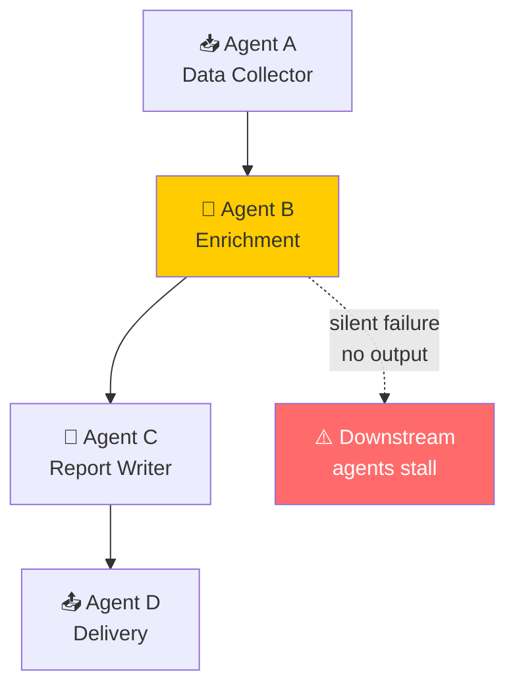

It's 3:07am and your Slack has three unread messages. The nightly report didn't send. You have six agents in that pipeline. You don't know which one to look at first.

That's what "multi-agent" actually means in production.

The concept sounds clean when you're planning it out: break complex work into smaller tasks, assign each to a focused agent, let them coordinate. The architecture diagram fits on one slide. The team agrees it makes sense.

Then something breaks while you're asleep, and you find out what you actually built.

## Where Multi-Agent Pipelines Actually Break

On paper, a four-agent pipeline looks like this: one agent collects data, one enriches it, one writes the report, one formats and delivers it. Clean handoffs, clear responsibilities.

At 3am, it looks like four separate logs, four possible failure points, and no obvious signal about which step failed. The final output is missing, but the error could have originated anywhere in the chain.

If you've only ever run one agent at a time, debugging is contained. Either it ran or it didn't. You check one place. You find the problem or you don't.

With agents chained together, the failure surface multiplies. One agent can complete successfully while producing output that quietly breaks the next one. One agent can time out and hang while the agent downstream waits indefinitely. Two agents can write to the same location simultaneously and corrupt each other's work.

None of these are edge cases. These are the three failure modes that show up most often in connected pipelines.

## The Three Patterns That Cause 3am Incidents

**Silent handoff failures.** Agent A finishes and writes its output somewhere. Agent B reads from that location, finds it empty or malformed, and does nothing — no error, no retry, just silence. From the outside, it looks like Agent B is stuck. The real problem was Agent A's output. You spend 30 minutes on the wrong agent.

**Rate limit cascades.** One agent hits a rate limit and starts retrying. Other agents in the same pipeline are calling the same API at the same time. The retries from one eat into the shared quota. Three agents back off simultaneously. The pipeline stops making progress until the window resets. This one is especially hard to catch because each individual agent looks like it's behaving correctly.

**Context loss between steps.** Agent A passes a reference to Agent B, maybe a session token or a document ID. The handoff is implicit, established by convention six months ago. Someone updates Agent A's output format and forgets to update Agent B's input expectations. Agent B proceeds with a default or a stale value. The report runs without errors. It just has the wrong data in it. You won't catch this until someone reads the output carefully.

## What "Visibility" Actually Means Here

The issue isn't the multi-agent architecture. Dividing complex work across specialized agents is a reasonable approach. The issue is whether you can see what's happening across all of them when something goes wrong.

Most teams building their first multi-agent pipeline don't think about this until after the first incident. Then they're reconstructing a sequence of events manually, cross-referencing timestamps across separate log files, and guessing at causality.

With [agent monitoring](/features/agent-monitoring), you can see exactly which agents are running, which are blocked, and which are idle at any given moment. During an incident, that changes the first question. Instead of "which of my six agents broke?", it becomes "Agent B has been blocked for 22 minutes — let me look at what it received from Agent A."

That's the difference between finding the problem in 4 minutes and finding it in 45.

[Multi-agent workflow coordination](/features/multi-agent-workflows) also makes handoffs between agents visible as discrete events. When Agent A passes data to Agent B, you can see that the handoff happened, what was passed, and when Agent B acknowledged it. Silent failures become visible. You stop debugging a symptom and start looking at the actual cause.

## The Decision Before You Add Another Agent

Before adding a third agent to a connected pipeline, ask one question: if this breaks at 3am, which agent will you check first?

If you don't have a clear answer — if the honest response is "I'd have to look at all of them" — then you need observability before you need another agent.

This isn't an argument against multi-agent systems. They're the right design for work that genuinely needs to be decomposed. But every agent you add is a new failure point, a new log file, and a new place where an assumption can silently go wrong.

The architecture should grow with your visibility into it. A two-agent pipeline with clear monitoring is safer than a six-agent pipeline with none.

## Who Feels This First

Teams who started with two agents and grew to five or six over several months hit this hardest. Each addition made sense at the time. The observability layer never kept pace. Now the pipeline handles real work, serves real users, and nobody has a complete mental model of what talks to what.

If you're a developer who just wired a third agent into a production pipeline, this is the moment to set up proper monitoring — not after the next 3am incident. The cost of doing it now is an afternoon. The cost of doing it at 3am is higher.

## A Caveat Worth Stating

AgentCenter shows you which agent is blocked, what state it's in, and what it last received. That's useful. But it won't fix an agent that produces wrong output, and it won't help if the contracts between your agents are ambiguous.

Visibility is the floor. The ceiling is well-specified agents with explicit input and output formats, clear failure behavior, and someone on the team who can read the logs when you're not around.

The dashboard helps you find the problem. The design of your agents determines whether you can fix it.

---

*The dashboard won't fix a broken agent. But it will tell you which one is broken at 3am. [Try AgentCenter free](/pricing).*
