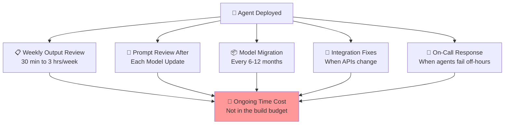

You launch your first production agent. It runs. The demo is great. The stakeholders are happy.

Six weeks later you're spending four hours a week on it and you have no idea where the time is going.

This is the pattern. The build gets all the planning. The ongoing operation gets none.

## What the Build Budget Covers

Most teams budget two things: development time and LLM API costs. Sometimes they add infrastructure. It's a reasonable starting point.

What it misses is everything that happens after the first week.

The hours don't disappear. They just don't have a line item. Someone is spending them — usually the person who built the agent, out of a sense of responsibility and mild guilt — and nobody is tracking it.

## The Real Cost Categories

### Prompt Review

Model providers update their models. Sometimes the update is minor. Sometimes it changes how your prompt is interpreted — what counts as "complete," what format gets returned, how edge cases get handled.

Suddenly your agent is producing outputs that are technically correct but practically wrong. You didn't change anything. The model did. But you own the outputs.

Someone needs to review prompt behavior after every model update. This isn't a one-time task. It's a recurring one, every few weeks for most teams.

### Output Review Overhead

Most agents produce outputs that a human needs to approve or validate. Even agents marketed as autonomous usually have checkpoints where a person decides what happens next.

The review time per output varies. But multiply it by how many tasks your agent runs per week and you'll find real numbers. In most teams, this runs between 30 minutes and 3 hours per week per agent. Unbudgeted.

This overhead also doesn't go down much as you get more familiar with the agent. You still have to read what it produced.

### Model Version Management

LLM providers deprecate models. When they do, you have a window — 90 days or six months, depending on the provider — to migrate.

That migration requires testing your prompts against the new model, updating your configuration, validating that outputs haven't changed in ways that matter, and coordinating the switch with whoever depends on the agent's work.

None of this is especially hard. But it happens on someone else's schedule, and it always seems to land during a busy week.

### On-Call Burden

Agents fail at inconvenient times. When they fail, someone needs to respond.

Most teams don't formally set up on-call for their agents. They informally expect the person who built the agent to handle issues when they come up. This works until that person takes vacation, changes roles, or burns out from being the de-facto owner of something they no longer have bandwidth for.

[Setting up an on-call rotation](https://agentcenter.cloud/features/agent-monitoring) for agents is solvable. Budgeting for the time it consumes is less common.

### Integration Point Maintenance

Your agent probably calls external services. APIs change. Rate limits get revised. Authentication tokens expire. Endpoints get deprecated.

Each of these events requires someone to notice the problem, diagnose it, fix it, and test the fix. This isn't agent work — it's plumbing work. But it still costs time, and it still happens to the person responsible for the agent.

## What This Looks Like in Practice

A team running three agents for eight months had budgeted carefully for the build: six weeks of engineering time, roughly $400 per month in API costs. Reasonable planning.

What they hadn't budgeted: two model migrations, a full prompt review after one update changed output format, and roughly two hours of weekly review spread across the three agents. By month six, the operational burden was equivalent to about a third of a full-time engineering week.

They didn't regret running the agents. The return was there. But the unplanned time caused real friction with the rest of the team who couldn't understand why "the agents are done" kept requiring engineering attention.

## The Habit That Actually Helps

Before you put an agent in production, write down the answers to four questions:

1. Who reviews outputs and how often?
2. Who responds when it fails at 2am?
3. Who owns the model migration when it's needed?
4. What's the prompt review cadence?

These aren't complex questions. They're questions nobody asks in advance.

[AgentCenter's monitoring and task features](https://agentcenter.cloud/features) help you answer the first two — you can assign reviewers, set notification rules, and track who's handling what. The last two still need a team decision. But at least you're making that decision before the first incident, not during it.

## Who This Matters For

This matters most for teams deploying their first or second production agent. You're past the prototype phase. You know the technology works. The risk now isn't technical — it's organizational. The time will get spent. The question is whether you planned for it or whether it's quietly eating into time that was supposed to go somewhere else.

It also matters for technical leads signing off on agent deployments. If someone hands you a proposal with only build costs, ask for the operational cost estimate. It doesn't have to be precise. It has to be there.

## The Honest Caveat

This isn't an argument against running agents. A well-run production agent delivers real value. But "well-run" means accounting for the full cost, not just the initial build.

The teams that get frustrated with agents aren't usually the ones where the technology failed. They're the ones where the agents quietly consumed time nobody had budgeted for, until someone with authority started asking uncomfortable questions about whether it was worth continuing.

Plan for the ongoing work before you launch. The alternative is explaining it after the fact.

---

*The dashboard won't fix a broken agent. But it will tell you which one is broken at 3am. [Try AgentCenter free](/pricing).*
