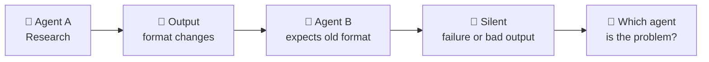

We had 9 agents running in production last October. I could tell you how many. I could not tell you what any of them were doing at any given moment, whether the outputs were any good, or which one was quietly burning $40/day on a broken retry loop.

That's the gap nobody mentions when they write tutorials about building AI agents.

## The Prototype Lie

Prototypes work beautifully. You write a prompt, test it a few times, get impressive results. You think: this scales. It doesn't — at least not the way you imagine.

In production, everything runs without you watching. The agent that worked perfectly in testing starts hitting edge cases you didn't design for. It retries. It loops. It produces outputs that are technically valid but contextually wrong. And it does all of this silently, at whatever cadence you scheduled it.

The shift from prototype to production isn't a deployment step. It's an epistemological shift. You go from "I know what this agent is doing" to "I have no idea what this agent is doing."

## What Actually Breaks

**Cost unpredictability.** Token usage is not linear with task volume. One agent processing a 50,000-word document costs 40x more than one processing a 200-word brief. If your workload distribution changes — and it will — your costs change in ways your estimates didn't account for. We had one agent rack up $200 in a weekend because someone submitted a batch of unusually long documents.

**Prompt drift.** The prompt that worked great in February produces different results in May. Not because you changed it, but because the model changed. Model providers update frequently. You're not always notified. You find out when a downstream metric changes.

**Coordination gaps.** Multi-agent pipelines fail at the handoff points. Agent A produces output. Agent B expects it in a specific format. Something changes in A's output schema. B starts failing silently, or worse, producing wrong outputs based on malformed input. Without visibility into the handoff, you're debugging both agents simultaneously without knowing which one is the source.

**Human dependency hidden inside automation.** Some tasks genuinely need human judgment at specific decision points. When you bake an agent into an automated pipeline, those decision points get skipped. The agent makes a guess. Sometimes the guess is fine. Sometimes it's not. You find out from the end result, not the process.

## What Helps

Visibility into agent state is not a nice-to-have. It's the difference between managing your agents and hoping they're fine. The [agent monitoring features](/features/agent-monitoring) in AgentCenter show you real-time status, task history, and deliverable quality in one place. Not perfect, but dramatically better than piecing together logs.

A deliberate review gate on deliverables catches the quality problems before they hit downstream systems. This is the step most teams skip because it feels slow. It's actually the fastest way to catch drift.

Cost tracking at the task level — not just aggregate spend — shows you which agents are expensive and why. The expensive one is usually not the one you expected.

## What the Reader Should Take Away

Run your agents like a system you don't control. Because you don't. You set them up, you monitor them, and you review what they produce. But between those moments, they're making decisions without you.

Build in observation before you need it. Set up status monitoring, review gates, and cost tracking in the first week of production — not after the first incident.

The agents aren't unreliable. They're just doing exactly what they were built to do, in conditions that are slightly different from when you built them.

## Who This Matters Most For

This matters most for small teams running 3-10 agents without dedicated ML ops support. You're the engineer who built the agent and the person who has to keep it running. You don't have a monitoring team or an on-call rotation. You need the feedback loop to be short.

If something is wrong, you want to know in minutes, not days.

## The Honest Caveat

A dashboard doesn't fix a broken agent. Good tooling tells you something is wrong faster; it doesn't tell you how to fix it. That still requires understanding the agent, the task, and the model behavior. The visibility is just the starting point.

_The dashboard won't fix a broken agent. But it will tell you which one is broken at 3am. [Try AgentCenter free](/pricing)._
