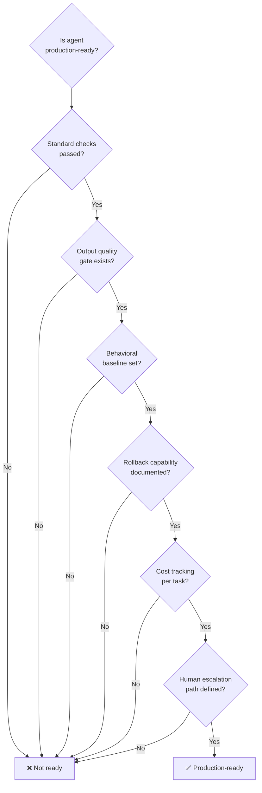

"Production-ready" is one of those phrases that sounds clear but means different things to different people. For a web service, it usually means: the API is stable, there's logging, there's error handling, and it's been tested. Ship it.

For AI agents, that checklist is necessary but not sufficient. An agent can pass all those criteria and still fail in ways that are unique to non-deterministic systems.

Here's what production-ready actually means for AI agents.

## The Standard Checklist (Still Necessary)

These are the minimum requirements — the same things you'd require from any service:

- The agent runs reliably and doesn't crash on expected inputs
- Errors are caught and logged, not swallowed silently
- There's a restart mechanism if the agent process dies
- Sensitive data (API keys, user data) is handled correctly
- The deployment is repeatable and documented

If your agent doesn't meet these criteria, it's not production-ready by any definition. These are the floor.

## The Agent-Specific Checklist (What Most Teams Miss)

Beyond the standard checklist, production-ready for agents requires:

### 1. Output Quality Gate

There's a mechanism to catch bad outputs before they propagate. This could be automated (schema validation, quality scoring) or human (review gate). The specific mechanism matters less than whether one exists.

A production-ready agent doesn't just produce output. It produces output that has been checked.

### 2. Behavioral Baseline

You know what normal looks like. Average task duration. Average cost. Typical output quality score. Expected throughput.

Without a baseline, you can't detect drift. And drift is how most agent failures actually manifest — gradual, below the threshold of obvious, until something downstream breaks.

### 3. Rollback Capability

You can restore the previous working state in under 30 minutes. This means: the previous prompt is accessible, the previous model version is pinned and documented, and someone knows the exact steps to revert.

If your rollback plan is "figure it out during the incident," you're not production-ready.

### 4. Cost Visibility

You know what each task costs and you're alerted if it exceeds a threshold. Not aggregate monthly spend — per-task cost. An agent that's suddenly costing 4x the baseline is either hitting a retry loop or processing unusually large inputs. You want to know in minutes, not at the end of the month.

### 5. Human Escalation Path

When the agent produces something it shouldn't — a sensitive output, an edge case it can't handle, a task that requires judgment beyond its design — there's a clear path to human intervention. The agent knows how to say "I need help" and the human gets notified.

## The Test

Here's a quick test you can run on any agent you're considering deploying:

1. Can you answer "what does this agent cost per task?" If not, it's not production-ready.
2. Can you answer "what was this agent's output quality 2 weeks ago, compared to today?" If not, it's not production-ready.
3. Can you describe the exact steps to roll back this agent to its previous version, right now? If not, it's not production-ready.
4. Is there a human review step or automated quality check before the output is used? If not, it's not production-ready.

These aren't hard requirements to meet. They take 2-4 hours to set up for an agent that already runs correctly. But they separate "this runs" from "this is production-ready."

## What the Reader Should Take Away

Production-ready is a system property, not just an agent property. The agent does work. The surrounding system monitors it, reviews its outputs, tracks its costs, and enables recovery when something goes wrong.

Deploying an agent without that surrounding system means you're hoping it works. Production-ready means you'll know when it doesn't.

## Who This Matters Most For

Small teams and solo engineers who are both building agents and operating them. If you're the person who built it and the person who gets paged at 2am when it breaks, you have the strongest incentive to build the surrounding system before you need it.

## Honest Caveat

Truly production-ready is a moving target. As your agent handles more edge cases, as your team's standards rise, as the downstream stakes increase, what counts as production-ready grows. Treat it as a continuous improvement process, not a one-time gate.

_The dashboard won't fix a broken agent. But it will tell you which one is broken at 3am. [Try AgentCenter free](/pricing)._
